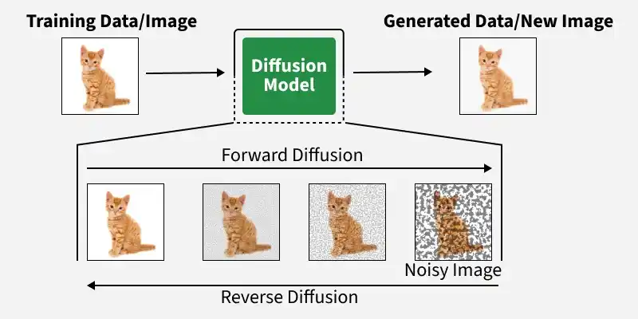
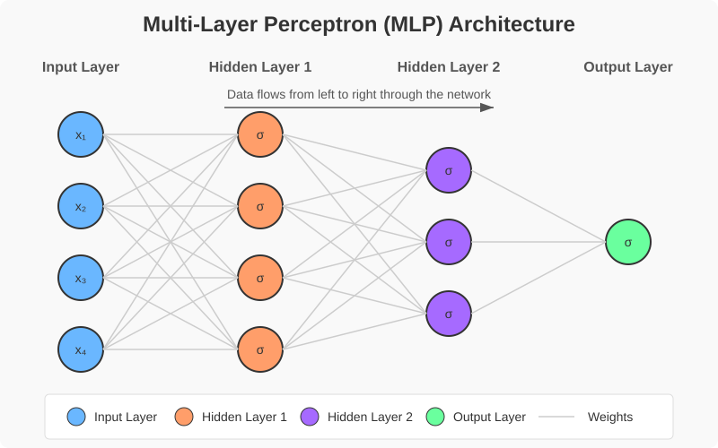

# BAB I
# PENDAHULUAN

## 1.1 Latar Belakang

Hipotermia merupakan kondisi darurat ketika suhu inti tubuh turun secara abnormal akibat kehilangan panas yang melebihi kemampuan tubuh untuk memproduksinya. Pada aktivitas pendakian, risiko hipotermia meningkat ketika pendaki terpapar suhu rendah, angin kencang, hujan, pakaian basah, serta kelelahan fisik dalam durasi yang panjang [1], [2]. Menurut Aminullah et al. [2], data BASARNAS periode 2015–2018 menunjukkan bahwa hipotermia merupakan penyebab kecelakaan pendakian yang paling dominan dengan persentase 47%. Sumber yang sama melaporkan tiga pendaki meninggal akibat hipotermia di Gunung Tampomas pada 2018. Studi eksperimental menunjukkan bahwa mempertahankan pakaian basah setelah paparan dingin dapat memperlambat pemulihan suhu kulit dibandingkan dengan mengganti pakaian basah [58]. Fakta tersebut menegaskan pentingnya ketersediaan informasi kondisi cuaca yang cepat dan akurat agar pendaki dapat mengambil tindakan pencegahan sebelum paparan risiko berkembang menjadi kondisi medis yang mengancam jiwa.

Untuk meminimalkan risiko kecelakaan tersebut, diperlukan informasi prakiraan cuaca jangka pendek (nowcasting) yang mampu memberikan deteksi dini sebelum kondisi berbahaya terjadi. Dalam konteks mitigasi keselamatan pendakian, informasi cuaca per jam lebih relevan untuk mendukung keputusan jangka pendek dibandingkan prakiraan harian karena kondisi atmosfer di pegunungan dapat berubah secara dinamis dalam hitungan jam. Informasi mengenai prakiraan probabilistik curah hujan—yaitu peluang atau sebaran kemungkinan curah hujan dalam rentang waktu tertentu—menjadi parameter penting untuk memahami tingkat ketidakpastian cuaca di lapangan. Berbeda dengan prakiraan deterministik yang hanya memberikan nilai tunggal, prakiraan probabilistik menyajikan distribusi kemungkinan kejadian cuaca beserta tingkat keyakinannya. Hal ini memungkinkan pendaki memperoleh gambaran risiko yang lebih realistis, seperti kemungkinan terjadinya hujan lebat mendadak atau peningkatan kecepatan angin yang ekstrem.

Nowcasting cuaca pada rentang waktu sangat pendek (0–6 jam) berperan penting dalam sistem peringatan dini untuk aktivitas luar ruang [3], [4]. Pemanfaatan data radar, model prediksi numerik, dan kecerdasan buatan memungkinkan informasi cuaca diperbarui secara berkala dan cepat guna mendukung keputusan taktis di lapangan [4], [5]. Penerapan metode deep learning dalam nowcasting juga telah terbukti mampu menghasilkan prakiraan curah hujan dan angin dengan resolusi spasial dan temporal yang tinggi [6], [7], [8]. Kendati demikian, efektivitas model ini sangat bergantung pada karakteristik wilayah pengamatan, sehingga evaluasi metodologis yang mendalam pada area dengan kondisi geografis ekstrem sangat diperlukan sebelum model diterapkan secara praktis.

Kawasan Gunung Gede–Pangrango merupakan salah satu destinasi wisata alam dan pendakian dengan intensitas kunjungan yang sangat tinggi, sehingga memiliki risiko keselamatan yang perlu diperhatikan. Berdasarkan kajian daya dukung lingkungan di kawasan Curug Cibeureum [9], curah hujan merupakan salah satu faktor yang perlu dipertimbangkan dalam pengelolaan kawasan wisata. Temuan tersebut menunjukkan bahwa kondisi cuaca dapat berkaitan dengan kapasitas dan keselamatan pengunjung. Oleh karena itu, ketersediaan informasi cuaca per jam di kawasan ini dapat menjadi bahan pertimbangan bagi pihak pengelola dan pendaki dalam menilai kondisi aktivitas di lapangan.

Dinamika hujan di wilayah pegunungan seperti Gunung Gede–Pangrango sangat kompleks karena dipengaruhi oleh interaksi antara topografi, perbedaan elevasi, kelembapan udara, dan arah angin. Mekanisme pengangkatan orografis (*orographic lifting*) memicu kondensasi uap air dan pembentukan awan konvektif secara cepat di lereng atas, sementara siklus harian pemanasan daratan turut menentukan waktu puncak terjadinya hujan [11], [12], [13]. Dinamika lokal ini menciptakan variabilitas spasial yang ekstrem, di mana perbedaan curah hujan yang signifikan dapat terjadi dalam jarak horizontal yang sangat pendek [14], [15]. Ketergantungan spasial dan temporal yang erat antar-elevasi ini membuat prakiraan cuaca per jam di wilayah pegunungan menjadi sangat menantang dan tidak dapat didekati dengan asumsi stasioner.

Model prakiraan cuaca deterministik konvensional dapat mengalami keterbatasan dalam merepresentasikan kejadian ekstrem di pegunungan karena prediksinya cenderung mendekati nilai rata-rata (*smoothing effect*) [16], [17]. Model deterministik merupakan pendekatan prediksi yang menghasilkan satu nilai untuk setiap waktu dan lokasi, tanpa menyertakan rentang ketidakpastian atau peluang kejadian lainnya. Sebaliknya, pendekatan probabilistik menghasilkan beberapa kemungkinan prediksi beserta peluang atau tingkat ketidakpastiannya, sehingga dapat menggambarkan berbagai kondisi cuaca yang mungkin terjadi. Hambatan utama dalam pemodelan cuaca ini berkaitan dengan kemungkinan karakteristik data hujan yang *zero-inflated* dan *heavy-tailed*. Karakteristik *zero-inflated* berarti sebagian besar rekaman data menunjukkan nilai nol (tidak ada hujan), sedangkan karakteristik *heavy-tailed* berarti sebagian kecil kejadian hujan memiliki intensitas yang sangat ekstrem. Karakteristik tersebut perlu dikonfirmasi melalui analisis statistik pada data penelitian. Model regresi deterministik yang dioptimalkan dengan fungsi loss rata-rata akan cenderung memprediksi hujan ringan saat terjadi hujan lebat, dan sebaliknya, memprediksi ada hujan ringan saat kondisi sebenarnya kering. Akibatnya, representasi kejadian ekstrem yang sangat penting untuk mitigasi keselamatan menjadi terabaikan [16], [17].

Untuk mengatasi keterbatasan tersebut, sejumlah penelitian mengembangkan pendekatan **probabilistik generatif**, termasuk *Retrieval-Augmented Diffusion Model*, serta **pemodelan spasio-temporal** melalui *Spatio-Temporal Graph Neural Network*. Namun, pada penelitian yang ditinjau, kedua pendekatan tersebut masih banyak diterapkan secara terpisah. Beberapa penelitian hanya berfokus pada model generatif untuk ketidakpastian tanpa mempertimbangkan informasi topografi [6], [7], sedangkan sebagian lainnya menggunakan pemodelan spasio-temporal untuk representasi spasial namun menghasilkan keluaran deterministik tunggal [10], [18], [20], [21]. Berdasarkan penelitian yang ditinjau, masih diperlukan kajian yang mengintegrasikan model generatif probabilistik dengan representasi spasial graf untuk menangani karakteristik data hujan pegunungan yang zero-inflated dan heavy-tailed.

Penelitian ini merespons kebutuhan tersebut dengan mengembangkan **Retrieval-Augmented Diffusion Model dengan Spatio-Temporal Graph Neural Network**. Dalam model ini, **Retrieval-Augmented Diffusion Model** bertindak sebagai model generatif utama yang memodelkan distribusi probabilistik cuaca melalui proses *diffusion*, sehingga mampu menghasilkan beberapa kemungkinan skenario cuaca. Sementara itu, **Spatio-Temporal Graph Neural Network** digunakan sebagai komponen pengondisi (*conditioning*) yang memodelkan lima titik lokasi pengamatan sebagai graf untuk menangkap ketergantungan spasial dan evolusi temporal kondisi cuaca di wilayah pegunungan. Kombinasi kedua metode ini dirancang untuk menghasilkan ensemble prakiraan probabilistik yang realistis dan sensitif terhadap nilai ekstrem.

Fokus penelitian ini dibatasi pada evaluasi metodologis model dalam memprediksi curah hujan, kecepatan angin, dan kelembapan relatif satu jam ke depan di kawasan Gunung Gede–Pangrango dengan menggunakan data ERA5. Dataset ERA5 merupakan data reanalisis global dari *European Centre for Medium-Range Weather Forecasts* (ECMWF) yang menggabungkan hasil model numerik atmosfer dengan berbagai pengamatan melalui proses asimilasi data. Data ini disajikan pada grid dengan resolusi horizontal sekitar 25 kilometer. Oleh karena itu, nilai ERA5 merupakan estimasi kondisi atmosfer pada grid tersebut dan tidak secara langsung merepresentasikan kondisi cuaca mikro pada titik ketinggian tertentu di puncak gunung [57]. Dalam penelitian ini, ERA5 digunakan untuk menguji kinerja metodologis model pada skala grid yang tersedia, bukan untuk mengklaim representasi kondisi mikrocuaca secara presisi. Atas dasar tersebut, penelitian ini berorientasi pada mitigasi risiko dengan menganalisis hasil prediksi serta kemampuan model dalam mendeteksi kejadian cuaca ekstrem [23]. Selain itu, hasil prediksi dari model ini dirancang untuk diintegrasikan ke dalam visualisasi berbasis web.

## 1.2 Rumusan Masalah

Berdasarkan latar belakang yang telah diuraikan, penelitian ini merumuskan permasalahan sebagai berikut:

1. Bagaimana kinerja Retrieval-Augmented Diffusion Model dengan Spatio-Temporal Graph Neural Network dalam memprediksi curah hujan, kecepatan angin, dan kelembapan relatif pada skala waktu per jam di wilayah pegunungan Gunung Gede–Pangrango menggunakan data ERA5?
2. Bagaimana kinerja Retrieval-Augmented Diffusion Model dengan Spatio-Temporal Graph Neural Network dibandingkan dengan model deterministik dalam memprediksi kondisi cuaca dan kejadian ekstrem?
3. Seberapa baik Retrieval-Augmented Diffusion Model dengan Spatio-Temporal Graph Neural Network dalam memprediksi kejadian cuaca ekstrem, khususnya hujan dengan intensitas tinggi?
4. Bagaimana hasil prediksi Retrieval-Augmented Diffusion Model dengan Spatio-Temporal Graph Neural Network dapat ditampilkan melalui visualisasi berbasis web untuk menyajikan informasi cuaca pendukung bagi aktivitas pendakian?

## 1.3 Tujuan Penelitian

Tujuan umum penelitian ini adalah mengevaluasi Retrieval-Augmented Diffusion Model dengan Spatio-Temporal Graph Neural Network untuk nowcasting kondisi cuaca satu jam ke depan di wilayah pegunungan Gunung Gede–Pangrango menggunakan data ERA5.

Tujuan khusus penelitian ini adalah:

1. Mengevaluasi kinerja Retrieval-Augmented Diffusion Model dengan Spatio-Temporal Graph Neural Network dalam memprediksi curah hujan, kecepatan angin, dan kelembapan relatif pada skala waktu per jam di wilayah pegunungan Gunung Gede–Pangrango menggunakan data ERA5.
2. Membandingkan kinerja Retrieval-Augmented Diffusion Model dengan Spatio-Temporal Graph Neural Network dan model deterministik dalam memprediksi kondisi cuaca dan kejadian ekstrem.
3. Mengevaluasi kemampuan Retrieval-Augmented Diffusion Model dengan Spatio-Temporal Graph Neural Network dalam memprediksi kejadian cuaca ekstrem, khususnya hujan dengan intensitas tinggi.
4. Mengembangkan visualisasi berbasis web untuk menampilkan hasil prediksi Retrieval-Augmented Diffusion Model dengan Spatio-Temporal Graph Neural Network sebagai informasi pendukung pengambilan keputusan dalam aktivitas pendakian.

## 1.4 Manfaat Penelitian

Penelitian ini diharapkan dapat memberikan kontribusi dalam pengembangan metode *nowcasting* cuaca serta penerapannya dalam mendukung mitigasi risiko aktivitas pendakian di wilayah pegunungan. Manfaat yang diharapkan dari penelitian ini adalah sebagai berikut:

1. Memberikan kontribusi dalam pengembangan dan evaluasi model *nowcasting* probabilistik berbasis *Retrieval-Augmented Diffusion Model* dan *Spatio-Temporal Graph Neural Network* untuk memodelkan dinamika curah hujan, kecepatan angin, dan kelembapan relatif pada skala waktu per jam di wilayah pegunungan.
2. Memberikan pemahaman ilmiah mengenai efektivitas penggabungan pencarian kondisi cuaca historis yang serupa pada *Retrieval-Augmented Diffusion Model* dan representasi graf spasio-temporal pada *Spatio-Temporal Graph Neural Network* dalam menangkap ketidakpastian serta hubungan spasial-temporal cuaca.
3. Menyajikan analisis empiris mengenai kemampuan model *Retrieval-Augmented Diffusion Model dengan Spatio-Temporal Graph Neural Network* dalam merepresentasikan ketidakpastian curah hujan yang sering kali bernilai nol (*zero-inflated*) dan memiliki nilai ekstrem (*heavy-tailed*), termasuk kepekaan prediksi terhadap kejadian hujan pada berbagai ambang intensitas.
4. Menyajikan analisis terkait perbandingan antara akurasi prediksi rata-rata dan kemampuan model *Retrieval-Augmented Diffusion Model dengan Spatio-Temporal Graph Neural Network* dalam mendeteksi kejadian ekstrem sebagai dasar dalam pengambilan keputusan berbasis risiko pada aktivitas pendakian di wilayah pegunungan.
5. Menghasilkan prediksi probabilistik dari model *Retrieval-Augmented Diffusion Model dengan Spatio-Temporal Graph Neural Network* yang dapat digunakan sebagai dasar pengembangan sistem visualisasi berbasis web untuk penyampaian informasi cuaca jangka pendek.

## 1.5 Batasan Masalah

Untuk menjaga fokus penelitian dan memastikan ketercapaian tujuan dalam ruang lingkup skripsi, penelitian ini dibatasi oleh beberapa ketentuan sebagai berikut:

1. Penelitian difokuskan pada kawasan Gunung Gede–Pangrango yang direpresentasikan oleh lima titik lokasi.
2. Penelitian menggunakan data *reanalysis* ERA5 melalui *Open-Meteo API* dengan menggunakan data masukan (*input*) enam jam terakhir untuk memprediksi kondisi cuaca satu jam ke depan.
3. Target prediksi dibatasi pada curah hujan, kecepatan angin, dan kelembapan relatif.
4. Penelitian mengevaluasi model *nowcasting* probabilistik berbasis *Retrieval-Augmented Diffusion Model* yang terintegrasi dengan representasi graf dari *Spatio-Temporal Graph Neural Network*.
5. Hasil prediksi tidak merepresentasikan kondisi cuaca mikro secara presisi karena menggunakan data berbasis grid dari *reanalysis* ERA5.
6. Penelitian difokuskan pada pengembangan dan evaluasi metodologi *nowcasting* probabilistik, bukan pada implementasi sistem operasional secara langsung.

---

# BAB II — TINJAUAN PUSTAKA

## 2.1 Penelitian Terdahulu

Penelitian-penelitian yang telah dilakukan dan relevan dengan penelitian ini mencakup model generatif probabilistik, model graf spasio-temporal, mekanisme retrieval pada diffusion model, model recurrent berbasis attention, serta pendekatan ensemble untuk prakiraan cuaca. Sepuluh penelitian berikut digunakan sebagai landasan perbandingan konseptual. Tiga penelitian yang paling dekat dengan fokus penelitian dirangkum dalam Tabel 2.1, sedangkan penelitian yang diusulkan ditampilkan sebagai baris pembanding keempat. Penelitian yang diusulkan tidak dihitung sebagai penelitian terdahulu.

1. Penelitian “Precipitation Nowcasting with Generative Diffusion Models”

oleh Asperti et al. (2024) [25] Penelitian ini mengembangkan Generative Ensemble Diffusion (GED) berbasis DDIM dan denoiser U-Net untuk menghasilkan 15 sampel prediksi hujan berbasis ERA5. Ensemble dibentuk melalui proses sampling berulang dan dapat diproses menggunakan rata-rata atau post-processing U-Net. Penelitian tersebut relevan karena menunjukkan bahwa diffusion ensemble dapat merepresentasikan beberapa kemungkinan evolusi hujan. Perbedaannya terletak pada penggunaan grid Eropa, bukan lima node ERA5 dengan target `MAIN` di Gunung Gede–Pangrango.

2. Penelitian   “Spatio-temporal      graph    neural    networks     to   improve

precipitation forecasts from numerical models” oleh Yousaf et al. (2025) [26] Penelitian ini mengembangkan WRF-GNN untuk memperbaiki keluaran prakiraan WRF menggunakan informasi 22 rain gauge di Calabria, Italia. Relevansinya terletak pada penggunaan representasi graf untuk memodelkan ketergantungan spasio-temporal. Namun, penelitian ini memakai keluaran WRF, observasi rain gauge, resolusi 2 km, dan horizon satu hari sehingga tidak merupakan reproduksi model pada penelitian ini.

3. Penelitian “Retrieval-Augmented Diffusion Models for Time Series

Forecasting” oleh Liu et al. (2024) [27] Penelitian ini mengusulkan Retrieval-Augmented Time series Diffusion (RATD), yang mengambil urutan historis serupa melalui embedding retrieval dan memasukkannya ke proses denoising melalui Reference-Modulated Attention. Relevansinya adalah prinsip integrasi retrieval dan diffusion pada data deret waktu. RATD tidak menggunakan lima node, ERA5, target `MAIN`, atau Spatio-Temporal Graph Neural Network, sehingga hasilnya tidak dapat dianggap sebagai bukti performa pada hujan lokal.

4. Penelitian “Skilful precipitation nowcasting using deep generative models

of radar” oleh Ravuri et al. (2021) [6] Penelitian ini mengembangkan DGMR berbasis conditional GAN untuk menghasilkan prakiraan hujan probabilistik dari empat frame radar dan memprediksi hingga 90 menit. Model menggunakan spatial discriminator, temporal discriminator, dan regularisasi grid-cell. Penelitian ini relevan sebagai rujukan model generatif probabilistik untuk nowcasting, tetapi data radar dan resolusi spasialnya berbeda dari data ERA5 titik-lokasi pada penelitian ini.

5. Penelitian “Skilful nowcasting of extreme precipitation with NowcastNet”

oleh Zhang et al. (2023) [7] NowcastNet menggabungkan evolution network berbasis adveksi dan persamaan kontinuitas dengan stochastic generative network untuk mempertahankan struktur hujan ekstrem. Penelitian ini relevan karena memadukan kendala evolusi dan pembangkitan stokastik. Ketergantungannya pada data radar resolusi tinggi dan evaluasi hingga tiga jam membatasi penerapan langsung pada lima node ERA5.

6. Penelitian “Exploring Geometric Deep Learning for Precipitation

Nowcasting” oleh Zhao et al. (2023) [28] Penelitian ini memandang grid radar sebagai graf dan menggunakan temporal Graph Convolutional Network untuk memodelkan hubungan antarlokasi. Relevansinya adalah dasar konseptual adaptasi representasi graf pada data hujan. Perbedaan unit node, sumber data radar, dan horizon prediksi menyebabkan hasilnya tidak dapat dipindahkan langsung ke penelitian ini.

7. Penelitian   “RSDF-AM-LSTM:          Regional    Scale    Division    Rainfall

Forecasting Using Attention and LSTM” oleh Li et al. (2022) [29] Penelitian ini menggabungkan beberapa LSTM paralel dengan mekanisme attention untuk menangkap dependensi temporal-spasial pada ribuan stasiun meteorologi. Relevansinya terletak pada pemanfaatan attention dan LSTM untuk data multi-lokasi. Baseline Multi-node LSTM + Attention pada penelitian ini hanya merupakan adaptasi gagasan tersebut ke lima node ERA5 dan target `MAIN`, bukan reproduksi penuh RSDF-AM-LSTM.

8. Penelitian “A Hybrid Approach to Physical and Deep Learning Models for

Radar-Based Precipitation Nowcasting” oleh Kim et al. (2025) [20] Penelitian ini memadukan PySTEPS, RainNet, dan LightGBM untuk menggabungkan keunggulan model adveksi dan deep learning. Relevansinya terletak pada strategi penggabungan beberapa sumber representasi untuk meningkatkan prediksi. Pipeline radar dan model fisik pada penelitian tersebut tidak direproduksi karena penelitian ini menggunakan ERA5 pada lima node.

9. Penelitian “FuXi-ENS: A machine learning model for efficient and accurate

ensemble weather prediction” oleh Zhong et al. (2025) [17] FuXi-ENS menggunakan variational autoencoder dan loss CRPS untuk menghasilkan prakiraan ensemble global dengan perturbasi yang bergantung pada kondisi atmosfer. Relevansinya adalah representasi ketidakpastian dan evaluasi probabilistik. Perbedaan resolusi, wilayah, interval enam jam, dan horizon hingga 15 hari membatasi perbandingan langsung dengan nowcasting satu jam pada penelitian ini.

10. Penelitian “Beyond the horizon: A comprehensive analysis of artificial

intelligence-based weather forecasting models” oleh Haji-Aghajany et al. (2025) [30] Penelitian ini merupakan tinjauan komprehensif terhadap model prakiraan cuaca berbasis AI, termasuk isu ketidakpastian, generalisasi, interpretabilitas, dan kendala fisik. Relevansinya adalah pemetaan konseptual posisi diffusion model, retrieval, graf, dan attention dalam perkembangan prakiraan cuaca berbasis AI. Artikel tinjauan ini bukan baseline dan tidak menyediakan eksperimen langsung pada lima node ERA5 atau Gunung Gede–Pangrango. Kesepuluh penelitian tersebut menunjukkan perkembangan pada diffusion ensemble, graf spasio-temporal, retrieval-augmented forecasting, attention-LSTM, dan ensemble weather prediction. Berdasarkan penelitian yang ditinjau dalam naskah ini, belum ditemukan penelitian yang menguji integrasi Retrieval-Augmented Diffusion Model dan Spatio-Temporal Graph Neural Network secara simultan pada lima node ERA5 dengan target `MAIN` dan horizon satu jam di kawasan Gunung Gede–Pangrango. Kebaruan penelitian ini dibatasi pada kombinasi metode, konfigurasi spasial, sumber data, horizon, dan wilayah studi; penelitian ini tidak mengklaim sebagai penelitian pertama di dunia. **Tabel 2.1 Penelitian Terdahulu**

| No. | Judul dan Peneliti | Metode | Temuan Utama | Kedudukan terhadap Penelitian Ini |
|---:|---|---|---|---|
| 1 | Precipitation Nowcasting with Generative Diffusion Models — Asperti et al. (2024) [25] | Generative Ensemble Diffusion berbasis DDIM dan U-Net | Ensemble diffusion menghasilkan beberapa kemungkinan prediksi presipitasi berbasis ERA5. | Rujukan utama diffusion ensemble; berbeda pada grid, wilayah, dan konfigurasi spasial. |
| 2 | Spatio-temporal graph neural networks to improve precipitation forecasts from numerical models — Yousaf et al. (2025) [26] | WRF-GNN dengan keluaran WRF dan rain gauge | Graf spasio-temporal digunakan untuk memperbaiki prakiraan presipitasi numerik. | Rujukan utama representasi graf; penelitian ini tidak menggunakan WRF atau 22 rain gauge. |
| 3 | Retrieval-Augmented Diffusion Models for Time Series Forecasting — Liu et al. (2024) [27] | RATD dengan embedding retrieval dan Reference-Modulated Attention | Retrieval historis membantu diffusion model pada forecasting deret waktu. | Rujukan integrasi retrieval-diffusion; bukan penelitian cuaca lokal dan tidak memakai Spatio-Temporal Graph Neural Network. |
| 4 | Penelitian yang diusulkan | Retrieval-Augmented Diffusion Model dengan Spatio-Temporal Graph Neural Network; ERA5/Open-Meteo; lima node; target MAIN | Hasil penelitian belum tersedia. | Model utama penelitian ini. |

## 2.2 Landasan Teori

Landasan teori dalam penelitian ini disusun untuk memberikan dasar ilmiah bagi pengembangan model *nowcasting* probabilistik kondisi cuaca menggunakan *Retrieval-Augmented Diffusion Model* dengan *Spatio-Temporal Graph Neural Network*. Bab ini membahas konsep-konsep utama yang menjadi dasar penelitian, mulai dari prinsip *nowcasting* pada skala waktu per jam, dinamika hujan orografis di pegunungan tropis, hingga cara kerja *Retrieval-Augmented Diffusion Model* dalam menghasilkan beberapa kemungkinan prediksi cuaca. Selanjutnya, dibahas pula pencarian kondisi cuaca historis yang serupa serta penggunaan representasi graf spasio-temporal melalui lima node, yaitu `MAIN`, `UP`, `DOWN`, `LEFT`, dan `RIGHT`. Representasi tersebut digunakan untuk menangkap hubungan kondisi cuaca antar lokasi dan perubahan kondisi atmosfer dari waktu ke waktu, dengan node `MAIN` sebagai titik target prediksi. Pembahasan kemudian dilanjutkan dengan risiko hipotermia pada aktivitas pendakian di Gunung Gede–Pangrango serta relevansinya terhadap penyampaian informasi cuaca jangka pendek. Dengan landasan teori tersebut, penelitian ini mengevaluasi kemampuan model dalam menghasilkan prediksi cuaca yang mempertimbangkan kemungkinan ketidakpastian, hubungan antar lokasi, dan perubahan kondisi dari waktu ke waktu di wilayah pegunungan tropis.

### 2.2.1 Konsep Nowcasting dan Skala Waktu Prediksi Atmosfer

*Nowcasting* merupakan prakiraan cuaca jangka sangat pendek yang menggunakan kondisi atmosfer terkini untuk memprediksi perubahan cuaca hingga sekitar enam jam ke depan [6]. Berbeda dengan prakiraan cuaca harian atau mingguan, *nowcasting* berfokus pada perubahan cuaca lokal yang berlangsung cepat. Dalam penelitian ini, *nowcasting* digunakan untuk memprediksi kondisi cuaca satu jam ke depan pada satu titik pengamatan utama yang disebut node `MAIN` di kawasan Gunung Gede–Pangrango.

Target prediksi meliputi curah hujan, kecepatan angin, dan kelembapan relatif. Ketiga variabel tersebut digunakan untuk menggambarkan kondisi cuaca yang dapat memengaruhi paparan pendaki. Tabel 2.2 membandingkan *nowcasting* dengan prakiraan cuaca pada rentang waktu yang lebih panjang. Contoh keluaran pada tabel menggunakan curah hujan karena hujan merupakan salah satu fenomena cuaca yang dapat berubah dengan cepat. Keluaran model penelitian ini tetap mencakup tiga target, yaitu curah hujan, kecepatan angin, dan kelembapan relatif.

Konsep *nowcasting* ini menjadi dasar untuk membahas dinamika cuaca per jam, fitur temporal, keterbatasan pendekatan deterministik, dan pendekatan probabilistik pada subbab berikutnya.
**Tabel 2.2 Perbandingan Skala Prakiraan Atmosfer [7] [16]**

| Skala Prakiraan | Horizon | Karakteristik Utama | Contoh Keluaran |
|---|---|---|---|
| Nowcasting | 0–6 jam | Bergantung kuat pada kondisi awal dan observasi terkini; menargetkan fenomena lokal yang berubah cepat. | Prediksi curah hujan satu jam ke depan. |
| Short-range forecasting | 6–72 jam | Memadukan observasi dan prediksi numerik untuk evolusi cuaca jangka pendek. | Prakiraan hujan harian dan peringatan cuaca. |
| Medium-range forecasting | Lebih dari 72 jam hingga sekitar 15 hari | Menekankan dinamika atmosfer skala besar dan prediksi ensemble. | Prakiraan probabilistik regional atau global. |

#### 2.2.1.1 Definisi dan Ruang Lingkup Nowcasting

Dalam meteorologi operasional, *nowcasting* merupakan prakiraan cuaca jangka sangat pendek yang memberikan informasi mengenai kondisi saat ini hingga sekitar enam jam ke depan. Prakiraan ini berfokus pada kondisi lokal yang dapat berubah dengan cepat dan memanfaatkan informasi pengamatan terkini [6].

Dalam penelitian ini, *nowcasting* dibatasi pada prediksi kondisi cuaca satu jam ke depan berdasarkan data enam jam sebelumnya. Data tersebut digunakan untuk mengenali perubahan kondisi atmosfer terbaru sebelum model menghasilkan prediksi pada satu titik pengamatan utama, yaitu node `MAIN` [7]. Target prediksi meliputi curah hujan, kecepatan angin, dan kelembapan relatif.

*Nowcasting* berbeda dari prakiraan cuaca jangka pendek yang umumnya mencakup rentang waktu enam hingga 72 jam. Prakiraan jangka pendek dapat menggunakan model numerik dan informasi atmosfer berskala lebih luas, sedangkan *nowcasting* lebih menekankan kondisi terkini dan perubahan cuaca lokal. Oleh karena itu, pendekatan *nowcasting* sesuai digunakan untuk memantau perubahan cuaca per jam di kawasan pegunungan yang memiliki kondisi atmosfer dinamis [6], [7].

Pemahaman mengenai ruang lingkup *nowcasting* menjadi dasar untuk membahas karakteristik perubahan cuaca per jam di wilayah pegunungan pada subbab berikutnya.

#### 2.2.1.2 Karakteristik Dinamika pada Skala Waktu Per Jam di Wilayah Pegunungan

Rentang prediksi 0–6 jam pada *nowcasting* berkaitan erat dengan perubahan cuaca lokal dan pembentukan awan atau hujan yang dapat berlangsung cepat [7]. Dalam meteorologi, fenomena tersebut umumnya dibahas pada skala menengah (*mesoscale*) dan skala pembentukan awan atau hujan akibat naiknya udara lembap. Pada skala ini, proses awal pembentukan awan dan hujan di wilayah pegunungan, yang dalam meteorologi disebut **inisiasi pembentukan awan dan hujan (*convective initiation*)**, sangat dipengaruhi oleh naiknya udara lembap serta perubahan kecil pada kelembapan, suhu, dan kecepatan angin lokal [13].

Di wilayah pegunungan tropis seperti Gunung Gede–Pangrango, dinamika tersebut menjadi lebih kompleks karena dipengaruhi oleh pengangkatan udara akibat topografi (*orographic lifting*), siklus harian pembentukan awan, dan interaksi angin dengan lereng. Faktor-faktor tersebut menyebabkan kondisi cuaca berbeda antarlokasi dan berubah dari waktu ke waktu [11], [14].

Awan dan hujan yang terbentuk melalui proses tersebut dapat muncul dan berubah dalam waktu yang relatif singkat [11], [20]. Oleh karena itu, prediksi cuaca satu jam ke depan perlu mempertimbangkan kemungkinan terbentuknya awan baru, pergerakan hujan, serta perubahan intensitas curah hujan [4], [20].

Perubahan kecil pada kondisi awal atmosfer, seperti kelembapan, suhu, dan kecepatan angin, dapat menghasilkan perubahan cuaca yang berbeda dalam waktu singkat. Akibatnya, kesalahan prakiraan dapat membesar seiring bertambahnya waktu prediksi (*rapid error growth*) [32]. Di kawasan Gunung Gede–Pangrango, perbedaan elevasi yang cukup besar dapat menyebabkan kondisi meteorologis yang berbeda dalam jarak horizontal yang relatif pendek [11], [14]. Kondisi ini membuat prediksi per jam penting untuk menggambarkan perubahan curah hujan, kecepatan angin, dan kelembapan relatif di sepanjang wilayah pendakian. Oleh karena itu, model *nowcasting* perlu mempertimbangkan perubahan kondisi cuaca yang berlangsung cepat, baik menurut waktu maupun lokasi [1].

#### 2.2.1.3 Keterkaitan Waktu dalam Prediksi Curah Hujan

Curah hujan dapat berubah dalam waktu yang relatif singkat [11], [20]. Kondisi tersebut menunjukkan bahwa keadaan hujan pada waktu sebelumnya dapat memberikan informasi mengenai kemungkinan kondisi hujan pada waktu berikutnya [4], [20].

Dalam penelitian ini, keterkaitan waktu tersebut direpresentasikan melalui fitur curah hujan satu jam sebelumnya atau *lag-1*. Fitur ini digunakan sebagai salah satu fitur masukan pada setiap waktu pengamatan dan dirumuskan sebagai berikut:

$$
\operatorname{PrecipitationLag1}_t = \operatorname{Precipitation}_{t-1} \tag{2.1}
$$

dengan:

- `PrecipitationLag1_t` = nilai curah hujan satu jam sebelum waktu prediksi `t`;

- `Precipitation_{t-1}` = nilai curah hujan pada waktu `t-1`.

Formula 2.1 hanya menunjukkan penggunaan curah hujan satu jam sebelumnya sebagai salah satu fitur temporal. Sementara itu, jendela pengamatan enam jam mencakup rangkaian kondisi cuaca dari waktu `t-6` hingga `t-1` untuk memprediksi curah hujan, kecepatan angin, dan kelembapan relatif pada waktu `t`. Jendela tersebut diproses sebagai rangkaian snapshot graf, sedangkan perubahan kondisi antarwaktu dipelajari melalui mekanisme *temporal attention* pada *Spatio-Temporal Graph Neural Network*. Mekanisme tersebut dibahas lebih lanjut pada Subbab 2.2.6. (noted [pertanyaan ke dosen nantinya])

#### 2.2.1.4 Transformasi dan Standardisasi Data Curah Hujan

Data curah hujan memiliki karakteristik *zero-inflated*, yaitu sebagian besar nilainya berada pada angka nol karena tidak terjadi hujan, serta *heavy-tailed*, yaitu sebagian kecil datanya memiliki nilai curah hujan yang sangat tinggi. Karakteristik tersebut menyebabkan rentang nilai curah hujan menjadi tidak seimbang, sehingga perlu dilakukan transformasi agar pola data lebih mudah dipelajari oleh model. Oleh karena itu, digunakan transformasi logaritmik `log1p`, yaitu transformasi yang tetap dapat diterapkan pada nilai nol:

$$  
y' = \log(1+y) \tag{2.2}
$$

dengan:

- `y` = nilai curah hujan asli;

- `y'` = nilai curah hujan setelah transformasi.

Setelah transformasi, data diseragamkan menggunakan standardisasi Z-score agar variabel dengan rentang nilai berbeda dapat diproses pada skala yang sebanding:

$$
z = \frac{y' - \mu}{\sigma + \varepsilon} \tag{2.3}
$$

dengan:

- `z` = nilai setelah standardisasi;

- `y'` = nilai curah hujan setelah transformasi;

- `μ` = rata-rata data pelatihan;

- `σ` = simpangan baku data pelatihan;

- `ε` = konstanta kecil untuk mencegah pembagian dengan nol.

Rata-rata dan simpangan baku dihitung hanya berdasarkan data pelatihan untuk mencegah informasi dari data validasi dan data pengujian masuk ke dalam proses pembelajaran model. Data yang telah ditransformasi dan distandardisasi kemudian digunakan sebagai bagian dari masukan model.

### 2.2.2 Dinamika Hujan Orografis di Pegunungan Tropis

Hujan orografis merupakan hujan yang terbentuk ketika udara lembap bergerak menuju pegunungan dan terdorong naik oleh permukaan lereng. Udara yang naik mengalami penurunan suhu sehingga uap air mengembun dan membentuk awan serta hujan [11], [35]. Di wilayah tropis, proses ini dipengaruhi oleh kelembapan udara yang tinggi dan kondisi atmosfer yang tidak stabil. Akibatnya, curah hujan dapat berbeda antara satu lokasi dan lokasi lainnya dalam jarak yang relatif dekat [11], [14], [35].

Di kawasan Gunung Gede–Pangrango, perbedaan elevasi, bentuk lereng, dan arah angin menyebabkan kondisi cuaca berubah menurut lokasi. Lereng yang berhadapan dengan arah datangnya angin (*windward slope*) cenderung menerima lebih banyak udara lembap, sedangkan lereng yang terlindung dari arah angin (*leeward slope*) dapat mengalami kondisi yang lebih kering atau bayangan hujan (*rain shadow*) [11], [36]. Selain itu, pemanasan permukaan pada siang hari dan perubahan angin dapat memengaruhi waktu serta intensitas terjadinya hujan [37].

Dinamika tersebut menyebabkan hujan di wilayah pegunungan dapat berubah dalam waktu singkat dan memiliki perbedaan intensitas yang besar. Karakteristik ini membuat prediksi cuaca per jam menjadi penting, terutama untuk memprediksi curah hujan, kecepatan angin, dan kelembapan relatif. Oleh karena itu, pemodelan cuaca di wilayah Gunung Gede–Pangrango perlu mempertimbangkan perubahan kondisi atmosfer menurut lokasi dan waktu. Penjelasan mengenai mekanisme pembentukan hujan serta variasi hujan menurut lokasi dan waktu dibahas pada subbab berikutnya.

#### 2.2.2.1 Mekanisme Orographic Lifting dan Convective Initiation

Mekanisme utama hujan orografis terjadi ketika udara lembap terdorong naik oleh permukaan lereng pegunungan. Ketika udara tersebut naik, suhunya menurun sehingga uap air dapat mengembun dan membentuk awan [36]. Di wilayah tropis, proses awal pembentukan awan dan hujan ini disebut inisiasi konveksi (*convective initiation*). Proses tersebut dipengaruhi oleh kelembapan udara, suhu, kestabilan atmosfer, serta kecepatan dan arah angin [11].

Angin yang bergerak melintasi lereng (*cross-slope wind*) dapat memperkuat pengangkatan udara dan membawa uap air menuju lereng pegunungan. Namun, pengaruh angin terhadap pembentukan hujan tidak berdiri sendiri karena juga bergantung pada topografi, kelembapan, orientasi lereng, dan kondisi atmosfer [36]. Dengan demikian, peningkatan kecepatan angin dapat meningkatkan potensi pembentukan hujan pada kondisi tertentu, tetapi besarnya pengaruh tersebut dapat berbeda menurut wilayah dan keadaan atmosfer.

Hubungan konseptual antara intensitas hujan orografis dan faktor atmosfer serta topografi dapat dinyatakan sebagai berikut:

$$
P_{\mathrm{orografis}} = f(U_{\mathrm{cross}}, q, H, S, C) \tag{2.4}
$$

dengan:

- `P_orografis` = intensitas hujan orografis;

- `U_cross` = komponen kecepatan angin yang bergerak melintasi lereng;

- `q` = kelembapan udara;

- `H` = karakteristik elevasi atau topografi;

- `S` = orientasi dan kemiringan lereng;

- `C` = kondisi atmosfer yang mendukung pembentukan awan dan hujan.

Rumus tersebut merupakan representasi konseptual mengenai faktor-faktor yang berkaitan dengan pembentukan hujan orografis. Rumus ini bukan persamaan empiris untuk menghitung curah hujan di Gunung Gede–Pangrango dan tidak digunakan secara langsung dalam proses prediksi model. Hubungan antara angin, kelembapan, topografi, dan pembentukan hujan menjadi dasar teoritis untuk mempertimbangkan informasi dari beberapa titik pengamatan dalam penelitian ini [11], [12], [36].

Di kawasan Gunung Gede–Pangrango, interaksi antara faktor mekanis, seperti pengangkatan udara oleh lereng, dan faktor termal, seperti pemanasan permukaan, dapat menyebabkan hujan terbentuk secara tidak merata. Kondisi tersebut mendukung penggunaan representasi spasio-temporal untuk mempelajari hubungan kondisi cuaca antartitik pengamatan. Pembahasan mengenai variasi hujan menurut lokasi dan waktu dilanjutkan pada Subbab 2.2.2.2.

#### 2.2.2.2 Variabilitas Spasial dan Temporal Hujan Orografis

Hujan orografis di wilayah pegunungan memiliki variasi spasial karena dipengaruhi oleh elevasi, bentuk dan orientasi lereng, arah angin, serta kelembapan udara [14], [35]. Hubungan antara curah hujan dan elevasi tidak selalu seragam karena bergantung pada kondisi atmosfer dan karakteristik topografi setempat [11], [36]. Oleh karena itu, perbedaan curah hujan antarlokasi di kawasan Gunung Gede–Pangrango perlu dianalisis berdasarkan data penelitian dan tidak diasumsikan mengikuti satu pola tertentu.

Perbedaan kondisi cuaca juga dapat terjadi antara sisi lereng yang berhadapan dengan arah datangnya angin dan sisi lereng yang terlindung. Lereng yang berhadapan dengan angin dapat menerima lebih banyak udara lembap, sedangkan sisi yang terlindung dapat mengalami kondisi yang berbeda. Perbedaan tersebut berpotensi menghasilkan curah hujan, kecepatan angin, dan kelembapan relatif yang tidak sama pada setiap titik pengamatan [11], [36].

Dari sisi waktu atau secara temporal, curah hujan dapat menunjukkan pola harian. Namun, waktu puncaknya dapat berbeda menurut lokasi, musim, arah angin, dan kondisi atmosfer [37]. Pada kondisi tertentu, pengaruh topografi dan angin dapat mengubah pola harian sehingga waktu terjadinya hujan menjadi lebih sulit diprediksi [36]. Perubahan tersebut menjadi alasan pentingnya penggunaan data beberapa jam sebelumnya untuk memprediksi kondisi cuaca satu jam ke depan.

Selain berbeda menurut waktu dan lokasi, intensitas hujan juga tidak tersebar secara merata. Sebagian besar rekaman dapat menunjukkan curah hujan rendah atau tidak terjadi hujan, sedangkan sebagian kecil kejadian dapat memiliki intensitas yang sangat tinggi. Karakteristik ini disebut distribusi berekor berat (*heavy-tailed*), yaitu kondisi ketika terdapat sebagian kecil nilai ekstrem yang jauh lebih besar daripada nilai umumnya [6], [7]. Pada kondisi tertentu, hujan lebat dapat bertahan lebih lama di sekitar lereng apabila pergerakan sistem hujan terhambat oleh topografi atau terjadi pengangkatan udara secara berulang [34], [35]. Namun, pola tersebut bergantung pada kondisi atmosfer dan perlu dibuktikan melalui data penelitian.

Perbedaan curah hujan antarlokasi dan antarwaktu tersebut menjadi dasar penggunaan representasi spasio-temporal dalam penelitian ini. Informasi dari beberapa titik pengamatan digunakan untuk menggambarkan hubungan kondisi cuaca di sekitar titik utama. Dalam model yang dikembangkan, hubungan tersebut dipelajari menggunakan Spatio-Temporal Graph Neural Network, sedangkan pendekatan diffusion digunakan untuk menghasilkan beberapa kemungkinan prediksi. Detail mengenai peran kedua pendekatan tersebut dijelaskan pada subbab berikutnya.

#### 2.2.2.3 Relevansi dengan Nowcasting Probabilistik dan Mitigasi Risiko

Variasi hujan orografis yang kompleks dan cepat berubah menjadi tantangan bagi model deterministik dalam memprediksi kejadian ekstrem di wilayah pegunungan tropis [7], [32]. Model regresi deterministik cenderung menghasilkan prediksi yang mendekati nilai rata-rata. Akibatnya, model dapat memprediksi hujan berintensitas tinggi lebih rendah daripada kondisi sebenarnya karena mengalami efek perataan (*smoothing*). Pendekatan probabilistik digunakan untuk menghasilkan beberapa kemungkinan kondisi cuaca sehingga ketidakpastian prediksi dapat direpresentasikan [25].

Hal tersebut penting dalam nowcasting di Gunung Gede–Pangrango karena hujan orografis dapat mempercepat kehilangan panas tubuh pendaki. Variasi kondisi cuaca yang tinggi antarlokasi dan antarketinggian dapat direpresentasikan menggunakan graf untuk menangkap ketergantungan antar-*node* [7].

Spatio-Temporal Graph Neural Network digunakan untuk mempelajari hubungan kondisi cuaca antarlokasi melalui mekanisme *message passing*. Mekanisme ini menggabungkan informasi dari node yang saling terhubung. Dalam penelitian ini, informasi kondisi cuaca dari beberapa titik dapat digunakan secara bersama untuk membantu merepresentasikan kondisi di sekitar titik prediksi utama, termasuk perubahan yang berkaitan dengan kejadian hujan ekstrem [6], [7].

Informasi dari Spatio-Temporal Graph Neural Network kemudian digunakan sebagai informasi tambahan dalam Retrieval-Augmented Diffusion Model. Retrieval-Augmented Diffusion Model menghasilkan prediksi probabilistik berupa beberapa kemungkinan kondisi cuaca. Dengan demikian, integrasi kedua pendekatan tersebut menjadi landasan bagi pengembangan prediksi cuaca satu jam ke depan yang dapat mendukung mitigasi risiko hipotermia pendaki di kawasan Gunung Gede–Pangrango [1], [36].

### 2.2.3 Risiko Hipotermia pada Pendakian

Risiko hipotermia merupakan salah satu ancaman keselamatan dalam aktivitas pendakian, termasuk di kawasan pegunungan tropis seperti Gunung Gede–Pangrango [1]. Hipotermia terjadi ketika suhu inti tubuh turun di bawah 35°C karena kehilangan panas tubuh lebih besar daripada panas yang dihasilkan [1].

Di lingkungan pegunungan tropis, paparan hujan dapat membasahi pakaian dan kulit pendaki. Kondisi tersebut mengurangi kemampuan pakaian dalam mempertahankan panas tubuh. Angin juga dapat mempercepat kehilangan panas dari permukaan tubuh, sedangkan kelembapan relatif yang tinggi dapat mempertahankan kondisi basah pada pakaian dan lingkungan [1]. Oleh karena itu, risiko hipotermia tidak hanya berkaitan dengan suhu udara, tetapi juga dengan kombinasi curah hujan, kecepatan angin, kelembapan relatif, dan durasi paparan.

Kelelahan akibat aktivitas pendakian yang berlangsung lama juga dapat meningkatkan kerentanan pendaki terhadap hipotermia. Dalam kondisi lelah, kemampuan tubuh untuk menghasilkan dan mempertahankan panas dapat menurun. Gejala awal seperti menggigil, kelelahan, dan menurunnya koordinasi tubuh juga dapat dianggap sebagai kelelahan biasa sehingga berpotensi terlambat dikenali [1].

Ketiga variabel tersebut, yaitu curah hujan, kecepatan angin, dan kelembapan relatif, merupakan kondisi cuaca yang relevan untuk diprediksi dalam penelitian ini. Hubungan antara prediksi cuaca dan mitigasi risiko dibahas lebih lanjut pada Subbab 2.2.3.3.

#### 2.2.3.1 Mekanisme Hipotermia di Lingkungan Pegunungan Tropis

Hipotermia terjadi ketika tubuh kehilangan panas lebih cepat daripada kemampuan tubuh untuk menghasilkan panas. Di lingkungan pegunungan tropis, kondisi tersebut dapat dipicu oleh hujan, pakaian basah, angin, dan durasi paparan yang panjang, meskipun suhu udara tidak serendah wilayah pegunungan bersalju [1].

Kehilangan panas tubuh dapat terjadi melalui beberapa mekanisme. **Konduksi** merupakan perpindahan panas melalui kontak langsung antara tubuh dan permukaan yang lebih dingin, termasuk pakaian atau kulit yang basah. **Konveksi** merupakan kehilangan panas akibat pergerakan udara di sekitar tubuh dan dapat meningkat ketika pendaki terpapar angin. Sementara itu, **evaporasi** merupakan kehilangan panas ketika air menguap dari permukaan kulit atau pakaian yang basah [1].

Hujan dan pakaian basah dapat memperbesar kehilangan panas melalui konduksi dan evaporasi. Pakaian yang basah juga memiliki kemampuan perlindungan yang lebih rendah dibandingkan pakaian dalam kondisi kering. Selain itu, angin dapat mempercepat perpindahan udara di sekitar tubuh sehingga kehilangan panas melalui konveksi menjadi lebih besar [1].

Di kawasan Gunung Gede–Pangrango, perubahan kondisi cuaca dapat terjadi antarlokasi dan dalam waktu yang relatif singkat karena pengaruh topografi, elevasi, arah angin, dan pembentukan hujan orografis [11], [35]. Perubahan tersebut dapat menyebabkan pendaki mengalami paparan hujan, angin, dan kelembapan yang berbeda sepanjang jalur pendakian, mulai dari elevasi rendah hingga elevasi yang lebih tinggi.

Dengan demikian, prediksi curah hujan, kecepatan angin, dan kelembapan relatif dapat memberikan informasi mengenai kondisi meteorologis yang berpotensi meningkatkan paparan dingin. Prediksi tersebut bukan diagnosis hipotermia, tetapi dapat menjadi informasi pendukung dalam pemantauan kondisi cuaca selama aktivitas pendakian.

#### 2.2.3.2 Faktor Meteorologis yang Berkaitan dengan Risiko Hipotermia

Faktor meteorologis yang berkaitan dengan paparan dingin di wilayah pegunungan tropis meliputi curah hujan, kecepatan angin, dan kelembapan relatif [1]. Curah hujan yang tinggi dapat membasahi pakaian pendaki dan memperbesar kehilangan panas. Kecepatan angin dapat mempercepat perpindahan udara di sekitar tubuh. Kelembapan relatif digunakan sebagai informasi tambahan untuk menilai kondisi lingkungan yang berkaitan dengan kebasahan pakaian dan paparan dingin.

**Tabel 2.3 Faktor Meteorologis terkait Paparan Dingin Pendaki [1], [58]**

| Faktor | Dampak Potensial | Variabel Model | Peran Informasi Nowcasting |
|---|---|---|---|
| Curah hujan | Membasahi pakaian dan meningkatkan kehilangan panas melalui konduksi serta evaporasi. | Curah hujan. | Memberi peringatan peluang hujan pada satu jam berikutnya. |
| Kecepatan angin | Meningkatkan kehilangan panas melalui konveksi dan pergerakan udara di sekitar tubuh. | Kecepatan angin. | Mengidentifikasi kondisi angin yang berpotensi memperburuk paparan. |
| Kelembapan relatif | Memengaruhi kondisi basah pada pakaian dan lingkungan. | Kelembapan relatif. | Melengkapi interpretasi kondisi basah dan kenyamanan termal. |

Ketiga variabel tersebut merupakan indikator kondisi meteorologis yang dapat meningkatkan paparan pendaki terhadap dingin. Pada node utama (`MAIN`) sebagai titik prediksi, informasi dari node `UP`, `DOWN`, `LEFT`, dan `RIGHT` digunakan untuk menggambarkan kondisi cuaca di sekitar lokasi tersebut [7], [16]. Perbedaan kondisi antarlokasi dapat membantu model mempelajari variasi cuaca di sekitar `MAIN`, termasuk perubahan curah hujan dan angin yang berpotensi meningkatkan paparan dingin [1].

Pendekatan probabilistik digunakan untuk merepresentasikan beberapa kemungkinan kondisi cuaca, terutama karena intensitas hujan dapat berubah dan memiliki kejadian ekstrem yang jarang [6], [25]. Informasi tersebut tidak digunakan untuk menghitung risiko hipotermia secara langsung, tetapi dapat menjadi dasar untuk memahami kondisi meteorologis yang berkaitan dengan paparan dingin pendaki.

#### 2.2.3.3 Relevansi Nowcasting Probabilistik sebagai Mitigasi Risiko

Nowcasting probabilistik dengan horizon satu jam ke depan dapat menyediakan informasi mengenai kemungkinan perubahan curah hujan, kecepatan angin, dan kelembapan relatif. Informasi tersebut dapat menjadi bahan pertimbangan dalam menilai kondisi cuaca selama aktivitas pendakian [1], [46].

Hasil keluaran model berupa distribusi probabilitas pada node `MAIN` dapat menjadi masukan bagi pengembangan indeks risiko hipotermia multi-faktor pada penelitian lanjutan. Indeks tersebut tidak menjadi keluaran langsung dalam penelitian ini. Penelitian ini berfokus pada prediksi kondisi meteorologis yang berpotensi meningkatkan paparan dingin pendaki.

Integrasi Retrieval-Augmented Diffusion Model dengan Spatio-Temporal Graph Neural Network digunakan untuk menghasilkan prediksi probabilistik dengan memanfaatkan informasi historis dan hubungan kondisi cuaca antarlokasi [7], [25]. Pendekatan tersebut diharapkan dapat membantu model merepresentasikan ketidakpastian dan perubahan cuaca, termasuk kemungkinan terjadinya hujan berintensitas tinggi. Kemampuan model dalam mendeteksi kejadian ekstrem dan menghasilkan prediksi yang bermanfaat perlu dievaluasi berdasarkan hasil eksperimen.

Dalam penerapannya, hasil nowcasting dapat menjadi dasar pengembangan sistem pendukung keputusan bagi pengelola kawasan dan pendaki. Namun, penelitian ini tidak mengukur penurunan kejadian hipotermia, perubahan perilaku pendaki, atau efektivitas sistem peringatan dini secara operasional. Oleh karena itu, kontribusi model terhadap mitigasi risiko dipahami sebagai penyediaan informasi cuaca pendukung bagi keselamatan aktivitas pendakian [1], [22], [46].

### 2.2.4 Model Generatif Probabilistik dengan Diffusion Model

*Diffusion model* banyak digunakan dalam pembangkitan data, termasuk citra. Namun, prinsip *diffusion model* tidak terbatas pada data citra. Model ini juga dapat diterapkan pada data noncitra, seperti data tabel dan deret waktu, dengan menambahkan serta mengurangi *noise* pada bentuk data yang sesuai [39], [48]. Dalam penelitian ini, data yang diproses berupa vektor tiga variabel cuaca pada node `MAIN`, bukan citra radar.

Model generatif probabilistik, seperti *diffusion model*, digunakan untuk menghasilkan beberapa kemungkinan kondisi cuaca masa depan, bukan hanya satu nilai prediksi. Pendekatan ini relevan dalam *nowcasting* karena kondisi atmosfer dapat berubah dan tidak selalu dapat diprakirakan secara pasti. Dengan menghasilkan beberapa kemungkinan prediksi, model dapat memberikan informasi mengenai ketidakpastian kondisi cuaca yang diprakirakan [6], [25].

Salah satu pendekatan generatif probabilistik yang digunakan dalam penelitian ini adalah *diffusion model*. Model ini bekerja melalui dua tahap utama. Pada tahap pertama, *noise* ditambahkan secara bertahap ke data asli. Pada tahap kedua, model mempelajari cara mengurangi *noise* tersebut secara bertahap untuk menghasilkan sampel prediksi. Proses pertama disebut *forward diffusion*, sedangkan proses kedua disebut *reverse denoising* [16], [25].

Dalam penelitian ini, *diffusion model* digunakan untuk menghasilkan prediksi probabilistik tiga variabel cuaca pada node `MAIN`, yaitu curah hujan, kecepatan angin, dan kelembapan relatif. Target prediksi berbentuk vektor, sedangkan informasi dari kondisi cuaca sebelumnya, representasi spasio-temporal, dan analog historis digunakan sebagai informasi tambahan selama proses pembentukan prediksi. Proses penambahan noise secara bertahap pada data dapat dinyatakan sebagai berikut [25], [39]:

$$
q(x_t \mid x_{t-1}) = \mathcal{N}\left(x_t;\sqrt{1-\beta_t}\,x_{t-1},\beta_t I\right) \tag{2.5}
$$

Selanjutnya, fungsi loss untuk meminimalkan perbedaan antara noise aktual dan noise prediksi dapat dinyatakan sebagai berikut [25], [39]:

$$
L_{diff} = \mathbb{E}_{x_0,\epsilon,t}\left[\left\|\epsilon-\epsilon_\theta(x_t,t,c)\right\|_2^2\right] \tag{2.6}
$$

dengan:

- `x_0` = target asli;

- `x_t` = target bernoise pada timestep diffusion `t`;

- `β_t` = varians noise pada timestep `t`;

- `I` = matriks identitas;

- `ε` = noise Gaussian yang ditambahkan;

- `ε_θ` = noise yang diprediksi model; dan

- `c` = kondisi tambahan, berupa representasi historis, spasial, dan retrieval.

Pada tahap pelatihan, hasil jaringan `ε_θ` bukanlah hasil prediksi cuaca akhir, melainkan perkiraan noise yang terdapat pada target bernoise `x_t`. Perkiraan noise tersebut dibandingkan dengan noise aktual `ε` melalui fungsi loss pada Formula 2.6. Pada tahap pembentukan prediksi, model memulai proses *reverse diffusion* dari noise acak, kemudian menggunakan perkiraan noise secara berulang untuk mengurangi noise sedikit demi sedikit. Setelah proses tersebut selesai, hasilnya dikembalikan ke ruang data cuaca dan menjadi sampel prediksi berupa curah hujan, kecepatan angin, dan kelembapan relatif pada node `MAIN`. Beberapa sampel yang dihasilkan membentuk prediksi ensemble. Dengan demikian, hasil akhir diffusion model bukan nilai `ε_θ`, melainkan kondisi cuaca yang diperoleh setelah seluruh proses denoising selesai [25], [39].

Sejumlah penelitian melaporkan bahwa diffusion models memiliki kualitas sampel dan stabilitas pelatihan yang kompetitif dibandingkan sebagian pendekatan generatif sebelumnya, seperti Generative Adversarial Networks (GAN), pada konfigurasi eksperimen tertentu [25], [30]. Dalam penelitian ini, kualitas sampel, sensitivitas terhadap kejadian ekstrem, dan relevansinya terhadap prediksi cuaca di kawasan dengan dinamika orografis menjadi bagian dari evaluasi model [7], [31].

#### 2.2.4.1 Prinsip Kerja Diffusion Model untuk Nowcasting

Diffusion models terdiri dari dua proses utama, yaitu *forward diffusion process* dan *reverse denoising process*. *Forward diffusion process* adalah proses penambahan noise secara bertahap pada data. *Reverse denoising process* adalah proses pengurangan noise secara bertahap untuk membentuk kembali sampel prediksi berdasarkan informasi kondisi [6], [16], [25]. Pada penelitian ini, data yang diberi noise berbentuk vektor target cuaca ternormalisasi pada node `MAIN`, bukan citra radar.

**Gambar 2.X Ilustrasi *Forward Diffusion* dan *Reverse Diffusion* pada Data Citra**

Gambar 2.X menggunakan citra kucing sebagai ilustrasi agar tahapan penambahan dan pengurangan *noise* mudah dipahami. Pada *forward diffusion*, citra awal secara bertahap diberi *noise* hingga menjadi citra yang hampir acak. Pada *reverse diffusion*, model memprediksi *noise* dan menguranginya secara bertahap untuk menghasilkan data baru. Gambar ini hanya menjelaskan prinsip umum diffusion model; bentuk data pada penelitian ini bukan citra, melainkan vektor tiga variabel cuaca pada node `MAIN`. Sumber: GeeksforGeeks, “What are Diffusion Models?”, diperbarui 14 April 2026, https://www.geeksforgeeks.org/artificial-intelligence/what-are-diffusion-models/.

Proses *forward diffusion* pada data cuaca dapat dituliskan sebagai berikut:

$$
x_t = \sqrt{\bar{\alpha}_t}\,x_0 + \sqrt{1-\bar{\alpha}_t}\,\varepsilon \tag{2.7}
$$

Estimasi noise dikondisikan pada target bernoise, timestep, representasi graf, dan retrieval:

$$
\hat{\varepsilon}=f_\theta(x_t,t,h_t^G,R_t) \tag{2.8}
$$

Embedding timestep dapat menggunakan fungsi GELU [38]:

$$
\operatorname{GELU}(x)=x\Phi(x) \tag{2.9}
$$

Denoising network mempelajari pemetaan dari target bernoise dan kondisi menuju estimasi noise. Setelah proses reverse diffusion selesai, satu kali proses sampling menghasilkan satu sampel prediksi pada ruang target. Jika proses sampling diulang dengan noise awal yang berbeda, kumpulan sampel tersebut membentuk ensemble dan digunakan untuk mendekati distribusi prediktif bersyarat:

$$
p\left(y_{t+1}^{\mathrm{MAIN}} \mid X_{\leq t},h_t^G,R_t\right) \tag{2.10}
$$

dengan `y_{t+1}^{MAIN}` sebagai vektor target cuaca satu jam ke depan, `X_{\leq t}` sebagai informasi historis hingga waktu pengamatan `t`, `h_t^G` sebagai representasi graf, dan `R_t` sebagai representasi analog historis.

Proses sampling bertahap memungkinkan *diffusion model* menghasilkan beberapa sampel dengan variasi yang berbeda. Dalam *nowcasting* hujan, *multiple plausible realizations* berarti beberapa sampel prediksi yang mungkin untuk merepresentasikan ketidakpastian kondisi cuaca. Keragaman sampel dan kualitas representasi ketidakpastian tersebut perlu dinilai melalui evaluasi probabilistik dan evaluasi berbasis kejadian [7], [25], [31].

Diffusion models dapat dikondisikan terhadap variabel tambahan melalui informasi yang dimasukkan ke dalam denoising network. Dalam penelitian ini, kondisi cuaca sebelumnya, angin, kelembapan, informasi spasial elevasi, dan hasil retrieval digunakan sebagai informasi tambahan [6], [25]. Informasi spasio-temporal dari beberapa node diringkas melalui Spatio-Temporal Graph Neural Network untuk membantu proses pembentukan prediksi pada node `MAIN` [7], [16].

#### 2.2.4.2 MLP sebagai Denoiser pada Diffusion Model

Denoiser penelitian ini menggunakan multilayer perceptron (MLP) pada diffusion model. MLP merupakan jaringan yang tersusun atas beberapa lapisan terhubung penuh dan digunakan untuk mempelajari hubungan nonlinier antara target bernoise dan informasi pengondisi. Target yang diberi noise, informasi cuaca, retrieval, representasi graf, dan timestep diproses sebagai representasi vektor. Penggunaan MLP sebagai denoiser pada data berbentuk tabel juga diterapkan dalam diffusion model untuk data noncitra [39], [48]. Pada proses ini, MLP memperkirakan noise dari target bernoise dan kondisi tambahan, bukan langsung menghasilkan nilai cuaca akhir. Dalam penelitian ini, hubungan antarnode telah diringkas lebih dahulu oleh Spatio-Temporal Graph Neural Network sehingga denoiser MLP memproses representasi vektor tersebut.

**Gambar 2.X Arsitektur Dasar Multilayer Perceptron**

Gambar 2.X menunjukkan MLP yang terdiri atas lapisan masukan, beberapa lapisan tersembunyi, dan lapisan keluaran. Setiap neuron pada satu lapisan terhubung dengan neuron pada lapisan berikutnya melalui bobot yang dipelajari selama pelatihan. Pada penelitian ini, MLP digunakan untuk memproses vektor target bernoise bersama informasi pengondisi dan menghasilkan estimasi noise. Gambar ini merupakan ilustrasi struktur umum MLP, bukan konfigurasi jumlah neuron pada model penelitian. Sumber: K3 AI, “MLP Diagram,” https://k3-production-bucket.s3.us-east-1.amazonaws.com/uploads/htWd3Jv7ccGxgcFQS_mlp_diagram.svg.

Lebar lapisan MLP dapat diperbesar atau diperkecil sesuai kebutuhan representasi. Pelebaran lapisan, misalnya dari 64 menjadi 128 unit, menyediakan ruang representasi yang lebih besar untuk mempelajari hubungan nonlinier yang lebih beragam. Penyempitan lapisan, misalnya dari 128 menjadi 64 unit, meringkas informasi ke representasi yang lebih ringkas sebelum diteruskan ke lapisan berikutnya atau ke lapisan hasil akhir. Pemilihan jumlah lapisan dan unit tersembunyi merupakan bagian dari desain arsitektur MLP dan dapat memengaruhi kinerja model serta risiko *overfitting* [52]. DiffImpute menunjukkan bahwa diffusion model untuk data tabular dapat menggunakan beberapa pilihan arsitektur denoiser, termasuk MLP, sehingga bentuk dan kapasitas denoiser merupakan bagian dari rancangan model [48].

Aktivasi SiLU digunakan sebagai fungsi nonlinier pada lapisan MLP. SiLU didefinisikan sebagai:

$$
\operatorname{SiLU}(x)=x\sigma(x) \tag{2.11}
$$

Penggunaan SiLU merupakan pilihan arsitektur pada jaringan generatif [40]. Pengaruhnya terhadap optimisasi dan performa bergantung pada data, konfigurasi, dan hasil eksperimen.

*Skip connection* adalah jalur yang menghubungkan representasi dari lapisan sebelumnya dengan lapisan berikutnya sehingga informasi dari tahap awal tetap dapat digunakan pada tahap pemrosesan selanjutnya. *Residual connection* merupakan salah satu bentuk *skip connection* yang menggabungkan representasi melalui penjumlahan. DenseNet merupakan contoh arsitektur yang menggabungkan fitur melalui konkatenasi [50], [51]. Pada penelitian ini, *skip connection* menggunakan konkatenasi. Jika `h_mid` dan `h_2` merupakan representasi dari dua lapisan, keduanya digabungkan pada dimensi fitur:

$$
h_{skip}=h_{mid}\,\|\,h_2 \tag{2.12}
$$

Hasil konkatenasi tersebut diteruskan ke lapisan berikutnya untuk menghasilkan estimasi noise. Dengan demikian, skip connection membantu mempertahankan informasi dari representasi sebelumnya selama proses pemetaan noise, sedangkan hasil prediksi cuaca diperoleh setelah proses reverse diffusion selesai.

#### 2.2.4.3 Peran Diffusion Model pada Arsitektur Penelitian

Pendekatan deterministik berbasis regresi atau Numerical Weather Prediction (NWP) dapat memiliki keterbatasan pada *lead time* pendek, yaitu rentang waktu antara saat prakiraan dibuat dan waktu prediksi berlaku, terutama ketika prediksi terlalu dekat dengan nilai rata-rata dan kurang merepresentasikan kejadian ekstrem [32], [34]. Model prakiraan berbasis machine learning juga menghadapi tantangan dalam merepresentasikan ketidakpastian dan *rapid error growth*, yaitu pertumbuhan kesalahan prakiraan dalam waktu singkat, pada skala per jam [16], [32].

Diffusion model dipilih karena termasuk pendekatan probabilistik generatif yang dapat memodelkan beberapa kemungkinan kondisi cuaca, bukan hanya satu nilai prediksi [6], [25]. Dalam penelitian ini, diffusion model digunakan untuk mempelajari pola cuaca yang berubah menurut lokasi dan waktu serta menghasilkan ensemble prediksi. Retrieval-Augmented Diffusion Model memanfaatkan analog historis sebagai informasi pengondisi tambahan selama proses denoising. Retrieval membantu model menggunakan informasi dari kejadian historis yang serupa, sedangkan pengaruhnya terhadap akurasi, kalibrasi, deteksi kejadian ekstrem, dan kualitas ensemble dinilai melalui metrik evaluasi [1], [7], [16], [25], [31]. Kalibrasi adalah kesesuaian antara probabilitas yang diperkirakan model dan frekuensi kejadian aktual.

Pemilihan diffusion model dalam penelitian ini berkaitan dengan kebutuhan nowcasting cuaca pegunungan yang memiliki perubahan kondisi menurut lokasi dan waktu serta ketidakpastian prediksi. Kesesuaian pendekatan tersebut terhadap data penelitian, kualitas prediksi, dan kemampuan merepresentasikan kejadian ekstrem menjadi bagian dari evaluasi model [7], [11].

### 2.2.5 Retrieval-Based Historical Analogs

*Retrieval-Based Historical Analogs* merupakan mekanisme untuk mencari kondisi historis yang memiliki kemiripan dengan kondisi cuaca saat ini. Kondisi historis tersebut digunakan sebagai informasi tambahan bagi model, bukan sebagai pengganti proses *reverse diffusion*. Dalam penelitian ini, kondisi cuaca pada periode pengamatan digunakan sebagai *query*, yaitu masukan pencarian, untuk menemukan analog historis yang serupa pada basis data pelatihan [27].

Kondisi historis yang serupa dapat memberikan gambaran mengenai pola perubahan cuaca yang pernah terjadi. Hasil retrieval kemudian digunakan sebagai informasi pengondisi tambahan selama proses *denoising* pada *Retrieval-Augmented Diffusion Model*. Pengaruh informasi analog historis terhadap akurasi, kalibrasi, deteksi kejadian ekstrem, dan kualitas ensemble dinilai melalui metrik evaluasi [16], [27], [31].

Secara konseptual, penggunaan informasi retrieval tidak mengubah proses *diffusion*. Analog historis dimasukkan ke dalam kondisi tambahan `c` bersama informasi historis dan spasial. Dengan demikian, *diffusion model* tetap melakukan penambahan *noise*, estimasi *noise*, dan proses *denoising* seperti dirumuskan pada Formula 2.5–2.6. Retrieval berperan menyediakan informasi dari analog historis, bukan menggantikan proses *diffusion* [25], [27].

### 2.2.6 Spatio-Temporal Graph Neural Network untuk Pemodelan Cuaca

Kondisi cuaca memiliki hubungan spasial karena dapat berbeda antarlokasi dan memiliki hubungan temporal karena berubah dari waktu ke waktu [11], [14]. Spatio-Temporal Graph Neural Network digunakan untuk mempelajari kedua jenis hubungan tersebut secara bersamaan. Spatio-Temporal Graph Neural Network tersusun atas tiga gagasan yang saling berhubungan: Graph Neural Network (GNN) untuk memproses hubungan antar-node, Graph Attention Network (GAT) sebagai lapisan spasial untuk mempelajari kontribusi relatif informasi dari node tetangga, dan pemodelan temporal untuk mempelajari perubahan representasi dari waktu ke waktu.

Pada GAT, *attention mechanism* adalah mekanisme yang memberikan bobot berbeda pada informasi dari setiap node tetangga. Bobot tersebut menunjukkan seberapa besar kontribusi informasi suatu node dalam membentuk representasi node lain yang terhubung. GNN membentuk representasi awal data cuaca, GAT menggabungkan informasi antarnode berdasarkan bobot tersebut, dan pemodelan temporal mengolah hasilnya dari waktu ke waktu. Representasi akhir *Spatio-Temporal Graph Neural Network* digunakan sebagai informasi pengondisi tambahan bagi *diffusion model* [7], [16].

#### 2.2.6.1 Graph Neural Network untuk Representasi Data Cuaca

Graph Neural Network (GNN) merepresentasikan data multi-lokasi sebagai graf yang terdiri atas node, edge, dan fitur node. Node merepresentasikan lokasi pengamatan, edge merepresentasikan hubungan yang digunakan untuk pertukaran informasi, sedangkan fitur node berisi variabel cuaca pada waktu tertentu. Satu graf pada satu waktu disebut *graph snapshot* (snapshot graf). GNN mengolah fitur node dengan menggabungkan informasi dari node yang terhubung melalui *message passing* (pertukaran informasi antarnode) [7], [16].

Hasil pemrosesan tersebut merupakan representasi spasial pada satu waktu. Beberapa snapshot graf kemudian disusun menjadi urutan untuk mempelajari perubahan kondisi cuaca dari waktu ke waktu. Dengan `t` sebagai waktu target, urutan snapshot historis ditulis sebagai:

$$
X_t=\left(x_{t-6},x_{t-5},\ldots,x_{t-1}\right) \tag{2.13}
$$

Dengan:

- `X_t` = urutan enam matriks fitur node sebelum waktu target `t`;

- `x_τ` = matriks fitur node pada satu waktu `τ`;

Urutan graf spasio-temporal dinyatakan sebagai:

$$
\mathcal{G}=\left(G_{t-6},G_{t-5},\ldots,G_{t-1}\right) \tag{2.14}
$$

dengan:

- `G_τ` = graf pada waktu `τ`;

- `\mathcal{G}` = urutan graf yang menjadi input model;

Secara umum, node merepresentasikan lokasi pengamatan, sedangkan edge menyatakan hubungan yang digunakan untuk pertukaran informasi. Pada implementasi, pemrosesan graf dilakukan pada setiap snapshot secara berurutan. Setelah representasi setiap node dibentuk melalui pengodean spasial, representasi tersebut dapat diringkas dengan *global mean pooling*, yaitu perataan representasi seluruh node:

$$
g_\tau=\frac{1}{|V|}\sum_{i\in V}H_{\tau,i} \tag{2.15}
$$

Dengan `g_τ` sebagai representasi graf pada waktu `τ`, `V` sebagai himpunan node, dan `H_{τ,i}` sebagai representasi node ke-`i` setelah pengodean spasial. *Global mean pooling* mengubah representasi seluruh node menjadi satu *graph-level embedding* (representasi tingkat graf). Pada implementasi, pengodean spasial dilakukan oleh GAT pada setiap *graph snapshot*, kemudian hasilnya diringkas melalui *global mean pooling*. Operasi *global mean pooling* pada representasi graf multi-lokasi sejalan dengan alur pemrosesan *Spatio-Temporal Graph Neural Network* pada penelitian terdahulu [43]. Enam representasi graf kemudian disusun sebagai urutan waktu untuk diproses oleh *temporal attention* (mekanisme pemberian bobot pada waktu pengamatan).

#### 2.2.6.2 Graph Attention Network untuk Hubungan Antar-Node

Graph Attention Network (GAT) merupakan pengembangan GNN yang menggunakan *attention mechanism*. Dalam GAT, *attention mechanism* memberikan bobot berbeda pada informasi dari node tetangga untuk menentukan kontribusi relatifnya dalam membentuk representasi node. Mekanisme ini menghasilkan bobot berdasarkan pola statistik pada data dan tidak dimaknai sebagai bukti hubungan sebab-akibat antarnode [44]. Pada setiap pasangan node yang saling terhubung, GAT menghitung skor attention berdasarkan fitur kedua node. Skor tersebut dihitung menggunakan transformasi linear dan fungsi aktivasi *LeakyReLU* [44]:

$$
e_{ij}=\operatorname{LeakyReLU}\left(\mathbf{a}^{\mathsf{T}}[W\mathbf{h}_i\mathbin{\|}W\mathbf{h}_j]\right)
$$

dengan `e_{ij}` sebagai skor attention dari node `j` terhadap node `i`, `W` sebagai matriks transformasi fitur, `h_i` dan `h_j` sebagai fitur node `i` dan `j`, `a` sebagai vektor parameter attention, dan `\|` sebagai operator konkatenasi. *LeakyReLU* mempertahankan sebagian kecil nilai negatif sehingga skor attention tetap dapat diproses ketika hasil transformasi bernilai negatif. Secara matematis, fungsi tersebut dapat ditulis sebagai [44]:

$$
\operatorname{LeakyReLU}(x)=\begin{cases}x, & x\geq 0,\\\lambda x, & x<0,\end{cases}
$$

dengan `x` sebagai nilai masukan dan `λ` sebagai kemiringan pada bagian negatif. Fungsi ini digunakan dalam perhitungan skor attention pada `GATConv` yang digunakan oleh model [44].

Skor attention kemudian dinormalisasi terhadap seluruh node tetangga agar menjadi bobot yang dapat dibandingkan:

$$
\alpha_{ij}=\frac{\exp(e_{ij})}{\sum_{k\in\mathcal{N}_i}\exp(e_{ik})}
$$

dengan `α_{ij}` sebagai bobot attention dari node `j` terhadap node `i` dan `\mathcal{N}_i` sebagai himpunan node tetangga dari node `i`. Pengodean spasial oleh GAT dirumuskan secara umum sebagai:

$$
H_\tau=GAT(G_\tau,X_\tau) \tag{2.16}
$$

dengan `G_τ` sebagai graf pada waktu `τ`, `X_τ` sebagai fitur node pada waktu tersebut, dan `H_τ` sebagai kumpulan representasi seluruh node setelah pengodean spasial. Representasi tingkat graf pada Formula 2.15 diperoleh dengan merata-ratakan representasi node `H_τ`. Pada mekanisme *multi-head attention*, beberapa hasil attention dapat digabungkan melalui konkatenasi [44].

#### 2.2.6.3 Pemodelan Temporal dalam Spatio-Temporal Graph Neural Network

*Spatio-Temporal Graph Neural Network* menyusun representasi spasial dari beberapa *graph snapshot* untuk mempelajari perubahan kondisi cuaca dari waktu ke waktu. Pada penelitian ini, enam representasi graf historis diringkas menggunakan *temporal attention* (mekanisme pemberian bobot pada beberapa waktu pengamatan) [7], [16]:

$$
h_{t-1}^G=\mathrm{TemporalAttention}\left(g_{t-L},\ldots,g_{t-1}\right),\quad L=6 \tag{2.17}
$$

dengan `h_{t-1}^G` sebagai representasi spasio-temporal akhir dari jendela historis, `g_τ` sebagai representasi graf pada waktu `τ`, dan `L` sebagai panjang jendela historis. *Temporal attention* menggunakan *scaled dot-product attention* (perhitungan bobot perhatian berdasarkan kesamaan representasi) dengan *causal mask*:

$$
\mathrm{Attention}(Q,K,V)=\mathrm{softmax}\left(\frac{QK^T}{\sqrt{d_K}}+M\right)V \tag{2.18}
$$

Pada Formula 2.18, `Q` (*query*) digunakan untuk mencari informasi yang relevan, `K` (*key*) digunakan sebagai pembanding, dan `V` (*value*) berisi informasi yang diringkas. Simbol `d_K` menyatakan dimensi *key*, sedangkan `M` merupakan *causal mask*. Dalam implementasi, `M` membatasi setiap langkah waktu agar hanya menggunakan representasi pada waktu yang sama atau lebih awal dalam urutan historis. Karena seluruh masukan berasal dari waktu `t-6` hingga `t-1`, pembatasan ini menjaga urutan temporal tetap kausal dan tidak menggunakan informasi dari waktu yang lebih baru dalam jendela tersebut. Representasi pada waktu terakhir digunakan sebagai ringkasan urutan graf historis. Secara keseluruhan, GNN membentuk representasi spasial, GAT mengatur penggabungan informasi antarnode, dan *temporal attention* mengolah perubahan representasi tersebut dari waktu ke waktu. Dengan demikian, *Spatio-Temporal Graph Neural Network* menggabungkan informasi antarlokasi dan antarwaktu menjadi representasi spasio-temporal `h_{t-1}^G`, kemudian menggunakannya sebagai informasi pengondisi bagi *diffusion model* untuk menghasilkan prediksi cuaca pada waktu target [43], [44].

Pada mekanisme GAT, penggabungan informasi dari beberapa *attention head* dapat dituliskan sebagai:

$$
h_i'=\mathbin{\|}_{k=1}^{4}\sum_{j\in\mathcal{N}_i}\alpha_{ij}^{k}W^{k}h_j \tag{2.19}
$$

dengan `\mathcal{N}_i` sebagai himpunan node tetangga dari node `i`, `\alpha_{ij}^{k}` sebagai bobot perhatian dari node `j` ke node `i` pada *attention head* ke-`k`, `W^k` sebagai matriks transformasi pada *attention head* ke-`k`, `h_j` sebagai representasi node `j`, dan `\|` sebagai operator konkatenasi. Batas `k=1` hingga `4` menunjukkan penggunaan empat *attention head*.

### 2.2.7 Metrik Evaluasi Prediksi Cuaca

Evaluasi prediksi perlu menilai lebih dari satu aspek. Prediksi titik dinilai berdasarkan kedekatannya dengan observasi, sedangkan prediksi probabilistik dinilai berdasarkan kualitas distribusi kemungkinan yang dihasilkan. Untuk kejadian hujan pada ambang tertentu, evaluasi juga perlu menilai kemampuan model dalam mendeteksi kejadian, menghindari alarm palsu, dan memberikan probabilitas yang sesuai dengan frekuensi kejadian aktual [53], [54].

#### 2.2.7.1 MAE, RMSE, dan Pearson Correlation

Mean Absolute Error (MAE), Root Mean Square Error (RMSE), dan Pearson Correlation Coefficient (`r`) merupakan metrik evaluasi *deterministic forecast* atau prediksi titik [53], [55]. Pada penelitian ini, prediksi titik diringkas menggunakan median ensemble. MAE mengukur rata-rata nilai absolut selisih antara prediksi dan observasi:

$$
\mathrm{MAE}=\frac{1}{N}\sum_{i=1}^{N}|\hat{y}_i-y_i| \tag{2.20}
$$

dengan `\hat{y}_i` sebagai prediksi, `y_i` sebagai observasi, dan `N` sebagai jumlah waktu evaluasi. Nilai MAE yang lebih kecil menunjukkan kesalahan absolut rata-rata yang lebih kecil.

Root Mean Square Error (RMSE) memberikan bobot lebih besar pada kesalahan yang besar:

$$
\mathrm{RMSE}=\sqrt{\frac{1}{N}\sum_{i=1}^{N}(\hat{y}_i-y_i)^2} \tag{2.21}
$$

Pearson Correlation Coefficient (`r`) mengukur keeratan hubungan linear antara prediksi dan observasi:

$$
r=\frac{\sum_{i=1}^{N}(\hat{y}_i-\bar{\hat{y}})(y_i-\bar{y})}{\sqrt{\sum_{i=1}^{N}(\hat{y}_i-\bar{\hat{y}})^2}\sqrt{\sum_{i=1}^{N}(y_i-\bar{y})^2}} \tag{2.22}
$$

dengan `\bar{\hat{y}}` dan `\bar{y}` sebagai rata-rata prediksi dan observasi. MAE menilai rata-rata besar kesalahan tanpa membedakan arahnya, sedangkan RMSE memberikan pengaruh lebih besar pada kesalahan yang besar. Pearson Correlation Coefficient (`r`) menilai kesesuaian pola perubahan prediksi terhadap observasi, bukan jarak absolut antara keduanya [53], [55].

#### 2.2.7.2 CRPS dan Brier Score

Continuous Ranked Probability Score (CRPS) dan Brier Score merupakan metrik evaluasi probabilistik. CRPS menilai kualitas distribusi prediksi kontinu, sedangkan Brier Score menilai ketepatan probabilitas untuk kejadian biner [53], [54]. Continuous Ranked Probability Score (CRPS) menilai jarak antara distribusi prediksi dan nilai observasi. Untuk sampel ensemble `x_1,\ldots,x_M`, bentuk estimator ensemble yang digunakan dalam implementasi adalah:

$$
\mathrm{CRPS}=\frac{1}{M}\sum_{m=1}^{M}|x_m-y|-\frac{1}{2M(M-1)}\sum_{m=1}^{M}\sum_{n=1,\,n\neq m}^{M}|x_m-x_n| \tag{2.23}
$$

dengan `M` sebagai jumlah anggota ensemble, `x_m` sebagai sampel prediksi, dan `y` sebagai observasi. CRPS mempertimbangkan kedekatan sampel terhadap observasi serta penyebaran antarsampel. Formula tersebut berlaku untuk `M>1`. Untuk ensemble satu anggota, CRPS dihitung sebagai `|x_1-y|`, sehingga sama dengan kesalahan absolut. CRPS yang lebih kecil menunjukkan distribusi prediksi yang lebih baik [54].

Brier Score digunakan untuk menilai probabilitas suatu kejadian biner, misalnya curah hujan yang melampaui ambang `u`. Nilai ini menghukum perbedaan kuadrat antara probabilitas yang diprediksi dan hasil kejadian aktual:

$$
\mathrm{BS}=\frac{1}{N}\sum_{i=1}^{N}(p_i-o_i)^2 \tag{2.24}
$$

dengan `p_i` sebagai probabilitas prediksi kejadian, yang dihitung dari proporsi anggota ensemble dengan nilai di atas `u`, dan `o_i` sebagai indikator observasi. Nilai `o_i` adalah `1` jika `y_i>u` dan `0` jika `y_i\leq u`. Nilai Brier Score yang lebih kecil menunjukkan probabilitas yang lebih dekat dengan kejadian aktual [53].

#### 2.2.7.3 POD, FAR, dan CSI

Probability of Detection (POD), False Alarm Ratio (FAR), dan Critical Success Index (CSI) merupakan metrik *event-based verification* atau evaluasi berbasis kejadian. Ketiganya digunakan untuk menilai deteksi hujan setelah kejadian ditentukan berdasarkan ambang curah hujan dan ambang probabilitas prediksi [55]. Untuk mengevaluasi deteksi kejadian, probabilitas ensemble dibandingkan dengan ambang probabilitas `p_0`. Hasilnya diringkas dalam empat jumlah: `H` (*hit*), `M` (*miss*), `F` (*false alarm*), dan `C` (*correct negative*). Metrik yang digunakan adalah:

$$
\mathrm{POD}=\frac{H}{H+M} \tag{2.25}
$$

$$
\mathrm{FAR}=\frac{F}{H+F} \tag{2.26}
$$

$$
\mathrm{CSI}=\frac{H}{H+M+F} \tag{2.27}
$$

POD menunjukkan proporsi kejadian aktual yang berhasil terdeteksi. FAR menunjukkan proporsi prediksi kejadian yang ternyata tidak terjadi. CSI menggabungkan hit, miss, dan false alarm untuk menilai keberhasilan deteksi secara keseluruhan. POD dan CSI yang lebih besar lebih baik, sedangkan FAR yang lebih kecil lebih baik. Jika penyebut suatu metrik bernilai nol, nilai metrik tidak didefinisikan dan dikeluarkan dari agregasi sesuai penanganan pada implementasi evaluasi [55].

#### 2.2.7.4 Reliability Diagram

Reliability Diagram merupakan alat evaluasi kalibrasi probabilitas. Diagram ini membandingkan probabilitas kejadian yang diprediksi dengan frekuensi kejadian aktual pada kelompok prediksi yang memiliki rentang probabilitas serupa. Prediksi dikatakan reliabel apabila probabilitas yang diperkirakan mendekati frekuensi kejadian aktual. Diagram ini digunakan untuk menilai kesesuaian probabilitas, bukan sebagai satu nilai kesalahan tunggal [53], [55].

### 2.2.8 Visualisasi Web Berbasis Vue.js dan FastAPI

Visualisasi berbasis web digunakan untuk menyajikan hasil prediksi cuaca kepada pengguna. Hasil yang ditampilkan dapat berupa prediksi titik, distribusi ensemble, probabilitas kejadian hujan, dan informasi pendukung risiko. Visualisasi ini tidak mengubah proses pelatihan maupun proses prediksi model [47]. FastAPI digunakan sebagai backend untuk menyediakan data hasil prediksi melalui endpoint API. Vue.js digunakan sebagai frontend untuk menampilkan data tersebut dalam bentuk kartu informasi, grafik deret waktu, grafik probabilitas, dan tabel ringkasan. Pemisahan backend dan frontend membantu menjaga fungsi model prediksi tetap terpisah dari tampilan web [47], [49].

Dalam rancangan penelitian ini, FastAPI menyalurkan hasil prediksi dari model, sedangkan Vue.js menyajikan hasil tersebut kepada pengguna. Visualisasi berbasis web berfungsi sebagai media penyampaian informasi, bukan sebagai bagian dari evaluasi kinerja model.

## 2.3 Analisis Celah Penelitian

Penelitian *nowcasting* hujan telah mengembangkan model generatif probabilistik, termasuk *diffusion models*, untuk menghasilkan beberapa kemungkinan prediksi dan merepresentasikan ketidakpastian prakiraan [6], [25], [56]. Hasil penelitian tersebut menunjukkan potensi pendekatan probabilistik, tetapi kualitas prediksi tetap dipengaruhi oleh karakteristik data, metode evaluasi, dan kemampuan model dalam merepresentasikan kejadian ekstrem [7], [16]. Dengan demikian, penggunaan model generatif saja belum menjelaskan bagaimana hubungan kondisi cuaca antarlokasi dan antarwaktu pada wilayah pegunungan direpresentasikan.

Celah penelitian berikutnya terletak pada integrasi informasi spasial, temporal, dan historis dalam *nowcasting* cuaca pegunungan. Representasi berbasis grid atau urutan data belum tentu menggambarkan hubungan antarlokasi secara eksplisit, terutama pada wilayah dengan perbedaan elevasi dan perubahan cuaca yang cepat [14], [32]. Selain itu, informasi kondisi historis yang serupa berpotensi membantu proses prediksi, tetapi integrasi *retrieval-based historical analogs* dengan proses *denoising* pada *diffusion model* untuk *nowcasting* satu jam berbasis data *reanalysis* masih terbatas dalam penelitian yang ditinjau [27], [30]. Berdasarkan tinjauan tersebut, belum ditemukan penelitian yang secara bersamaan mengintegrasikan model generatif probabilistik, pencarian analog historis, dan representasi graf spasio-temporal pada lima node ERA5 untuk prediksi cuaca di kawasan Gunung Gede–Pangrango.

Penelitian ini menempatkan *Retrieval-Augmented Diffusion Model* dengan *Spatio-Temporal Graph Neural Network* sebagai pendekatan untuk mengisi celah tersebut. Model menggabungkan analog historis dengan representasi hubungan cuaca antarlokasi dan antarwaktu, kemudian menghasilkan prediksi probabilistik pada node `MAIN` untuk curah hujan, kecepatan angin, dan kelembapan relatif. Posisi penelitian dinilai melalui akurasi prediksi titik, kualitas distribusi probabilistik, dan kemampuan mendeteksi kejadian hujan. Model tidak memprediksi indeks hipotermia; hasil prediksi hanya digunakan sebagai informasi pendukung keselamatan pendakian, sedangkan manfaatnya ditafsirkan berdasarkan hasil evaluasi [46].

---

# BAB III
# METODE PENELITIAN

## 3.1 Tahapan Penelitian

Tahapan penelitian disusun secara berurutan untuk mengembangkan dan mengevaluasi Retrieval-Augmented Diffusion Model dengan Spatio-Temporal Graph Neural Network dalam nowcasting probabilistik hujan satu jam ke depan. Tahapan tersebut mencakup studi literatur, pengambilan data, preprocessing, pembagian dataset temporal, pembentukan fitur dan representasi graf, perancangan arsitektur model, pelatihan, inferensi, evaluasi, serta skenario eksperimen. Alur keseluruhan tahapan penelitian ditunjukkan pada Gambar 3.1.

**Gambar 3.1 Alur Tahapan Penelitian**

Tahap awal penelitian adalah studi literatur untuk mengidentifikasi, menganalisis, dan mensintesis kajian terdahulu yang relevan dengan pengembangan model nowcasting probabilistik hujan berbasis deep learning. Fokus kajian mencakup: (1) teknik nowcasting hujan pada skala per jam, (2) penerapan model generatif probabilistik khususnya diffusion models, serta (3) pendekatan spatio-temporal graph dan retrieval-augmented mechanism dalam pemodelan cuaca.

Tahap selanjutnya adalah Pengambilan Data, yaitu pengumpulan data meteorologi per jam dari Open-Meteo Archive API berbasis ERA5 reanalysis pada lima titik observasi spasial (MAIN, UP, DOWN, LEFT, RIGHT). Tahap ini menjadi fondasi utama karena kualitas dan kelengkapan data sangat menentukan keberhasilan tahapan berikutnya.

Selanjutnya dilakukan Preprocessing Data yang meliputi validasi struktur, pembersihan, pembentukan fitur lag, transformasi logaritmik pada hujan, serta normalisasi data menggunakan Standard Scaling untuk memastikan data siap digunakan dalam pelatihan model.

Kemudian dilakukan Pembagian Dataset secara temporal (time-based split) untuk memisahkan data menjadi training, validation, dan testing set. Pembagian ini penting untuk menjaga aspek temporal order dan mencegah data leakage pada evaluasi model.

Tahap Pembentukan Fitur dan Graf melibatkan rekayasa fitur serta pembuatan struktur graph spatio-temporal dengan lima node di mana node MAIN menjadi target prediksi utama. Graf ini merepresentasikan ketergantungan spasial multidirectional antar node.

Selanjutnya adalah Perancangan Arsitektur Model yang mendefinisikan keseluruhan komponen Retrieval-Augmented Diffusion Model, termasuk mekanisme retrieval historical analogs dan Spatio-Temporal Graph Neural Network menggunakan Graph Attention Network (GAT).

Proses Proses Pelatihan Model dilakukan dengan menggunakan weighted denoising loss untuk meningkatkan sensitivitas model terhadap kejadian hujan ekstrem serta teknik conditional diffusion berdasarkan observasi historis dan struktur graph.

Tahap Evaluasi Model kemudian dilakukan menggunakan metrik deterministik (MAE, RMSE), metrik probabilistik (CRPS), serta metrik berbasis threshold (POD, FAR, CSI) untuk menilai performa model secara komprehensif.

Tahap terakhir, merancang web visualisasi hasil prediksi dirancang sebagai sarana penyampaian informasi nowcasting yang dapat mendukung interpretasi keluaran model oleh pengguna.

Dengan alur tahapan yang terstruktur seperti yang ditunjukkan pada Gambar 3.1, penelitian ini memastikan bahwa setiap komponen model dikembangkan secara bertahap dan dapat dievaluasi secara ilmiah.

## 3.2 Studi Literatur

Studi literatur merupakan tahap awal untuk membangun dasar metodologis penelitian dan menentukan komponen model yang sesuai dengan tujuan nowcasting probabilistik hujan. Kajian dilakukan secara terarah terhadap penelitian terdahulu, teori nowcasting, dinamika hujan orografis, model generatif berbasis diffusion, retrieval-based historical analogs, serta representasi graph spasio-temporal.

Proses studi literatur meliputi identifikasi sumber yang relevan, seleksi berdasarkan kesesuaian topik dan tahun publikasi, pembacaan metode serta hasil penelitian, kemudian sintesis kelebihan, keterbatasan, dan peluang pengembangan. Literatur tentang diffusion digunakan untuk merumuskan mekanisme pembangkitan ensemble dan denoising. Literatur tentang GNN, GAT, dan temporal attention digunakan untuk merancang representasi hubungan antar-node dan urutan snapshot historis. Literatur retrieval digunakan untuk merumuskan penggunaan analog historis sebagai kondisi tambahan pada diffusion model.

Hasil studi literatur digunakan untuk menetapkan: (1) penggunaan data ERA5 pada lima node spasial, (2) node MAIN sebagai target prediksi, (3) jendela historis enam snapshot, (4) integrasi STGNN, retrieval, dan conditional diffusion, serta (5) metrik evaluasi deterministik, probabilistik, dan berbasis kejadian. Selain itu, studi literatur digunakan untuk menentukan model pembanding yang diuji pada skenario eksperimen.

Studi literatur tidak digunakan untuk mengklaim bahwa model penelitian ini pasti lebih baik daripada penelitian terdahulu. Klaim kinerja ditentukan berdasarkan hasil eksperimen pada dataset dan protokol evaluasi penelitian ini. Dengan demikian, keluaran tahap studi literatur berupa kerangka teori, spesifikasi metodologis, daftar referensi, dan rumusan celah penelitian yang menjadi dasar tahap pengambilan data.

## 3.3 Pengambilan Data

Pengambilan data merupakan tahap awal yang sangat krusial dalam penelitian ini karena menjadi fondasi bagi seluruh proses pengembangan model. Penelitian ini menggunakan data sekunder berupa deret waktu multivariat dengan referensi spasial tetap yang diperoleh melalui layanan Open-Meteo Archive API berbasis reanalisis ERA5. Pemilihan ERA5 didasarkan pada konsistensi historis jangka panjang, kelengkapan variabel meteorologis, serta resolusi spasial dan temporal yang seragam. ERA5 adalah reanalysis historis, bukan sumber observasi real-time; karena itu penggunaannya dibatasi untuk pelatihan dan evaluasi metodologis, bukan operasi nowcasting langsung. Proses pengambilan data melalui Open-Meteo Archive API dapat dilihat pada Gambar 3.2 berikut.

**Gambar 3.2 Diagram Proses Pengambilan Data ERA5 melalui Open-Meteo API**

Gambar 3.2 mengilustrasikan alur pengambilan data yang dimulai dari penentuan Koordinat Node, permintaan data melalui Open-Meteo API, perolehan ERA5 Dataset, dilanjutkan dengan Validasi Data Grid, Penggabungan Data Semua Node, hingga menghasilkan Dataset Penelitian yang siap digunakan. Diagram ini menekankan mekanisme validasi grid center untuk mencegah duplikasi spasial serta konsistensi penggabungan data dari kelima node.

### 3.3.2 Koordinat Node

Koordinat node ditetapkan sebelum permintaan data dikirimkan ke Open-Meteo API. Lima node digunakan, yaitu MAIN sebagai node target serta UP, DOWN, LEFT, dan RIGHT sebagai node konteks. Koordinat setiap node dirangkum pada Tabel 3.1.

**Tabel 3.1 Koordinat Node**

| Node | Latitude | Longitude |
|---|---:|---:|
| MAIN | -6.75 | 107.00 |
| UP | -6.50 | 107.00 |
| DOWN | -7.00 | 107.00 |
| LEFT | -6.75 | 106.75 |
| RIGHT | -6.75 | 107.25 |

### 3.3.3 Open-Meteo API

Koordinat setiap node dikirimkan ke Open-Meteo Archive API menggunakan parameter waktu mulai dan waktu akhir, zona waktu UTC, serta daftar variabel meteorologis yang diperlukan. Respons API diterima dalam format data deret waktu. Proses ini diulang untuk setiap node menggunakan rentang waktu dan daftar variabel yang sama.

### 3.3.4 ERA5 Dataset

Data yang diterima melalui Open-Meteo API bersumber dari ERA5 reanalysis. Data dikumpulkan pada resolusi satu jam untuk periode 1 Januari 2005 hingga 31 Desember 2025. Variabel meteorologis dan elevasi disimpan bersama timestamp UTC dan ID node. ERA5 digunakan sebagai sumber data historis untuk pelatihan dan evaluasi metodologis, bukan sebagai sumber observasi real-time.

### 3.3.5 Validasi Data Grid

Setelah respons API diterima, koordinat grid aktual grid center diperiksa dan dibandingkan dengan koordinat node yang diminta. Pemeriksaan ini dilakukan untuk memastikan setiap node dipetakan pada grid yang sesuai dan mencegah grid collision, yaitu dua node berbeda memperoleh grid ERA5 yang sama. Apabila ditemukan ketidaksesuaian atau duplikasi grid, proses dihentikan dan koordinat node ditinjau sebelum pengambilan dilanjutkan.

### 3.3.6 Penggabungan Semua Node

Data dari kelima node digabungkan berdasarkan timestamp UTC ke dalam satu dataset terpadu. ID node dipertahankan sebagai penanda lokasi, dengan urutan konsisten [MAIN, UP, DOWN, LEFT, RIGHT]. Pemeriksaan kelengkapan dilakukan setelah penggabungan untuk memastikan setiap timestamp memiliki struktur node yang diperlukan. Tiga variabel target hanya ditetapkan pada node MAIN; node lainnya berfungsi sebagai penyedia fitur konteks spasial.

Posisi spasial kelima node hasil penetapan koordinat ditampilkan pada Gambar 3.3. Visualisasi ini digunakan untuk memeriksa susunan node yang dipertahankan ketika data digabungkan dan direpresentasikan sebagai graph sequence.

**Gambar 3.3 Posisi Lima Node Pengamatan pada Wilayah Studi Gunung Gede–Pangrango**

Gambar 3.3 memperlihatkan distribusi spasial kelima node di sekitar kawasan Gunung Gede–Pangrango. Node MAIN berfungsi sebagai titik target, sedangkan node UP, DOWN, LEFT, dan RIGHT menjadi konteks spasial pada dataset gabungan.

### 3.3.7 Dataset Penelitian

Dataset penelitian memiliki satu baris untuk setiap kombinasi timestamp dan node. Karakteristik keseluruhan dataset yang berhasil diperoleh ditunjukkan pada Tabel 3.2.

**Tabel 3.2 Karakteristik Dataset Penelitian**

| Karakteristik | Nilai |
|---|---|
| Sumber Data | Open-Meteo (ERA5) |
| Resolusi Temporal | 1 Jam |
| Periode Data | 2005–2025 |
| Jumlah Node | 5 |
| Jumlah Timestamp | 184.080 |
| Total Observasi | 920.400 |

Dengan prosedur pengambilan data yang terstruktur, tervalidasi, dan didukung visualisasi spasial, dataset yang dihasilkan memiliki integritas spasial dan temporal yang tinggi, sehingga siap digunakan pada tahapan preprocessing dan pemodelan selanjutnya.

Tabel 3.3 menampilkan beberapa baris contoh hasil penggabungan data dari lima node. Data disimpan sebagai deret waktu multivariat dengan satu baris untuk setiap kombinasi timestamp dan node. Kolom masukan memuat variabel meteorologis dan elevasi, sedangkan tiga kolom target digunakan khusus untuk node MAIN. Nilai target pada node konteks tidak digunakan dalam pembentukan target pelatihan dan ditandai sebagai diabaikan.

**Tabel 3.3 Contoh data yang diambil**

| Tanggal & Waktu (UTC) | Node | Suhu (°C) | Kelembapan (%) | Titik Embun (°C) | ... | Ketinggian (m) | [Target 1] Curah Hujan | [Target 2] Kecepatan Angin | [Target 3] Kelembapan |
|---|---|---:|---:|---:|---|---:|---|---|---|
| 2004-12-31 17:00:00 | MAIN | 15.20 | 95.59 | 14.49 | ... | 1529.0 | **0.00** | **5.59** | **95.59** |
| 2004-12-31 17:00:00 | UP | 23.69 | 94.71 | 22.79 | ... | 162.0 | *(diabaikan)* | *(diabaikan)* | *(diabaikan)* |
| 2004-12-31 17:00:00 | RIGHT | 23.57 | 96.15 | 22.92 | ... | 288.0 | *(diabaikan)* | *(diabaikan)* | *(diabaikan)* |
| ... | ... | ... | ... | ... | ... | ... | ... | ... | ... |

Pada Tabel 3.3, Baris MAIN memuat target yang digunakan untuk pelatihan dan evaluasi, sedangkan baris node konteks hanya menyediakan fitur masukan spasial. Tanda elipsis menunjukkan fitur meteorologis lain yang tidak ditampilkan dalam tabel ringkas.

## 3.4 Preprocessing Data

Tahap preprocessing data mengubah dataset hasil pengambilan menjadi data yang siap digunakan dalam pelatihan, validasi, pengujian, dan pembentukan graph sequence. Alur preprocessing dibagi menjadi tiga bagian, yaitu koleksi data, preprocessing dan validasi, serta normalisasi dan split.

**Gambar 3.4 Flowchart Preprocessing Data**

Gambar 3.4 menunjukan alur preprocessing data secara keseluruhan, mulai dari dataset mentah hingga dataset siap pemodelan. Diagram ini menunjukkan urutan tahapan yang saling terkait untuk memastikan integritas data sepanjang pipeline.

### 3.4.1 Koleksi Data

Koleksi data pada tahap preprocessing menggunakan dataset terpadu hasil penggabungan lima node pada subbab Pengambilan Data. Dataset dibaca dengan mempertahankan timestamp UTC, ID node, urutan node [MAIN, UP, DOWN, LEFT, RIGHT], variabel masukan, target node MAIN, dan fitur elevasi.

Pemeriksaan awal dilakukan untuk memastikan berkas tersedia, kolom wajib terbaca, serta jumlah baris dapat diproses sebelum validasi dan transformasi dilaksanakan.

Data kemudian disusun berdasarkan timestamp dan ID node. Penyusunan ini menjadi masukan bagi pemeriksaan kelengkapan node pada setiap timestamp. Target tidak dibentuk ulang untuk node konteks; node MAIN tetap menjadi satu-satunya node target, sedangkan empat node lainnya digunakan sebagai sumber konteks spasial.

### 3.4.2 Preprocessing dan Validasi

Tahap selanjutnya adalah validasi struktur data. Pemeriksaan dilakukan terhadap kelengkapan lima node pada setiap timestamp, urutan node yang harus konsisten ([MAIN, UP, DOWN, LEFT, RIGHT]), kesesuaian nama kolom, serta keberadaan nilai tidak valid. Validasi ini bersifat fail-fast, yaitu proses dihentikan apabila ditemukan ketidaksesuaian untuk mencegah propagasi kesalahan ke tahap berikutnya.

Selanjutnya dilakukan pembentukan fitur temporal. Untuk menangkap ketergantungan waktu pada horizon nowcasting satu jam, dibuat fitur lag curah hujan satu jam sebelumnya (`precipitation_lag1`). Fitur ini dihitung menggunakan persamaan berikut:

$$\mathrm{PrecipitationLag1}=\mathrm{Precipitation}$$

$t-1$ (DOCX: `PrecipitationLag1_t = Precipitation_{t-1}`)

Pada timestamp pertama setiap node, nilai lag diinisialisasi dengan nol. Penambahan fitur lag ini penting karena curah hujan memiliki autokorelasi temporal yang kuat pada skala per jam.

Tahap berikutnya adalah transformasi variabel curah hujan. Variabel ini memiliki distribusi yang sangat skewed dan didominasi oleh nilai nol dengan sedikit kejadian ekstrem. Untuk mengurangi skewness dan meningkatkan stabilitas pelatihan, dilakukan transformasi logaritmik menggunakan fungsi:

$$y'=\log(1+y)$$

Transformasi ini membantu model lebih baik dalam mempelajari pola hujan orografis yang bersifat heavy-tailed. Sebagai contoh untuk nilai curah hujan sebesar 2.40 mm maka $y=2.40\ \mathrm{mm}$, diperoleh nilai curah hujan setelah transformasi sebagai berikut $y'=\log(1+2.40)=1.2238$.

Setelah validasi, fitur lag dan transformasi logaritmik diterapkan pada kolom yang ditentukan. Tahap ini menghasilkan data yang konsisten secara struktur dan siap memasuki proses normalisasi. Nilai yang tidak memenuhi aturan validasi tidak diteruskan ke tahap berikutnya.

### 3.4.3 Normalisasi dan Split

Setelah transformasi, seluruh fitur dan variabel target dinormalisasi menggunakan parameter statistik yang dihitung dari data pelatihan. Statistik non-degenerate dihitung dari node MAIN pada data pelatihan dan digunakan pada validasi serta pengujian. Jika fitur tertentu memiliki statistik degenerate, fitur tersebut saja menggunakan fallback statistik seluruh node. Denominator tetap menggunakan epsilon $\varepsilon$ untuk mencegah pembagian dengan nol; DOCX mendefinisikan epsilon sebagai konstanta kecil, tetapi tidak memberikan nilai numerik.

Fitur dengan simpangan baku mendekati nol menggunakan fallback statistik seluruh node hanya untuk mengatasi kondisi degenerate. Fallback tersebut tidak berlaku otomatis untuk seluruh fitur. Seluruh fitur yang disalurkan ke DataLoader, termasuk fitur untuk GAT, telah berada pada skala Z-score. Proses normalisasi dilakukan dengan persamaan:

$$z=\frac{y'-\mu}{\sigma+\varepsilon}$$

Parameter $\mu$ dan $\sigma$ dihitung hanya dari data pelatihan untuk mencegah data leakage. Parameter yang sama kemudian diterapkan pada data validasi dan data uji. Dengan $y'=1.2238$, $\mu=0.60$, $\sigma=0.90$, $\epsilon=0.000001$, diperoleh nilai hasil normalisasi sebagai berikut $z=0.6931$.

Contoh perhitungan eksplisit tidak tersimpan sebagai struktur terpisah di DOCX; nilai hasil yang tercetak adalah $z=0.6931$.

Setelah normalisasi, dataset akan dibagi menjadi tiga himpunan secara kronologis. Detail rasio, rentang waktu, prosedur pencegahan data leakage, dan ilustrasi pembagian dijelaskan pada subbab selanjutnya.

## 3.5 Pembagian Dataset Temporal

Setelah melalui tahap preprocessing, dataset selanjutnya dibagi menjadi tiga himpunan yaitu data pelatihan (training set), data validasi (validation set), dan data pengujian (test set). Pembagian ini bertujuan untuk mendukung proses pelatihan model, pemilihan hyperparameter, serta evaluasi performa yang objektif dan tidak bias terhadap data yang belum pernah dilihat oleh model. Karena data meteorologis bersifat deret waktu dengan ketergantungan temporal yang kuat, penelitian ini menggunakan pembagian temporal (time-based split) daripada pembagian acak [6], [16].

Pendekatan temporal split dipilih untuk menjaga urutan kronologis data, sehingga model hanya mempelajari pola dari periode masa lalu dan dievaluasi pada periode masa depan. Skema pembagian dataset yang digunakan dalam penelitian ini ditunjukkan pada Gambar 3.5.

**Gambar 3.5 Ilustrasi Pembagian Dataset Temporal**

Gambar 3.5 menampilkan diagram garis waktu yang menggambarkan pembagian dataset secara kronologis menjadi tiga periode utama. Visualisasi ini memperjelas bahwa model dilatih hanya menggunakan data historis dan diuji pada data masa depan yang sepenuhnya tidak terlibat dalam proses pelatihan. Salah satu tujuan utama pembagian temporal adalah mencegah data leakage. Dalam penelitian ini, beberapa langkah pencegahan diterapkan, antara lain:

- Pembagian dilakukan secara kronologis tanpa pengacakan (shuffle).
- Statistik normalisasi dihitung hanya dari data pelatihan.
- Basis data retrieval hanya dibangun dari data pelatihan.
- Data validasi dan pengujian tidak digunakan dalam proses pelatihan maupun pemilihan hyperparameter.

Dengan skema pembagian temporal ini, model dilatih sesuai dengan kondisi operasional nowcasting yang sesungguhnya, di mana prediksi satu jam ke depan hanya dapat dibuat berdasarkan informasi observasi hingga waktu saat ini. Pendekatan ini meningkatkan reliabilitas evaluasi dan mendekatkan hasil penelitian dengan aplikasi nyata di lapangan untuk mitigasi risiko hipotermia pendaki di Gunung Gede–Pangrango.

## 3.6 Pembentukan Fitur dan Representasi Graf

Setelah dataset melalui tahap preprocessing dan pembagian temporal, langkah selanjutnya adalah membentuk representasi data yang sesuai dengan arsitektur model Retrieval-Augmented Diffusion dengan Spatio-Temporal Graph Neural Network. Pada tahap ini, data tidak lagi diperlakukan sebagai tabel konvensional, melainkan direpresentasikan sebagai urutan graf (graph sequence) yang mengintegrasikan informasi spasial dan temporal secara simultan. Proses ini mencakup pembentukan fitur input, pembuatan jendela waktu, serta konstruksi struktur graf yang merepresentasikan hubungan antar node observasi.

### 3.6.1 Pembentukan Fitur Input

Fitur input dipilih berdasarkan ketersediaan pada ERA5 dan relevansinya terhadap dinamika hujan orografis serta mitigasi risiko hipotermia. Fitur dibedakan menjadi dua kelompok: fitur dinamis (berubah terhadap waktu) dan fitur statis (nilai tetap). Elevasi berfungsi sebagai fitur statis yang memberikan informasi topografi pada setiap node. Fitur input ditunjukan pada Tabel 3.4.

**Tabel 3.4 Daftar Fitur Input Model**

| No | Variabel | Keterangan |
|---:|---|---|
| 1 | Temperature 2m | Suhu udara |
| 2 | Relative Humidity 2m | Kelembapan relatif |
| 3 | Dew Point 2m | Titik embun |
| 4 | Surface Pressure | Tekanan permukaan |
| 5 | Wind Speed 10m | Kecepatan angin |
| 6 | Wind Direction 10m | Arah angin |
| 7 | Cloud Cover | Tutupan awan |
| 8 | Precipitation Lag-1 | Curah hujan 1 jam sebelumnya |
| 9 | Elevation | Ketinggian node |

### 3.6.2 Pembentukan Jendela Waktu (Temporal Window)

Untuk menangkap ketergantungan temporal, data disusun menggunakan pendekatan sliding window. Setiap sampel input terdiri dari beberapa observasi historis sebagai konteks prediksi satu jam ke depan. Jendela observasi dapat dinyatakan sebagai:

$$X=\{x_{t-L+1},x_{t-L+2},\ldots,x_t\}$$

Formula pada DOCX tidak tersimpan sebagai OMML; bentuk di atas konsisten dengan keterangan DOCX bahwa jendela memuat enam snapshot historis.

Melalui pendekatan ini, model dapat mempelajari perubahan kondisi atmosfer yang terjadi dalam beberapa jam sebelumnya sebelum menghasilkan prediksi pada waktu berikutnya.

### 3.6.3 Representasi Graf Spasial

Hubungan spasial antar titik pengamatan direpresentasikan dalam bentuk graf. Penelitian ini menggunakan lima node dengan node MAIN sebagai target prediksi utama, sedangkan node UP, DOWN, LEFT, dan RIGHT berfungsi sebagai konteks spasial multidirectional. Struktur graf menggunakan topologi star dengan delapan edge terarah dan ditunjukkan pada Gambar 3.6.

**Gambar 3.6 Topologi Star Graph pada Representasi Spasial**

Pada Gamabr 3.6 menunjukan Node MAIN terhubung secara dua arah dengan node UP, DOWN, LEFT, dan RIGHT, sedangkan node tetangga tidak memiliki edge langsung satu sama lain.

Koefisien atensi pada topologi tersebut bersifat terarah dan asimetris. Pada node MAIN, normalisasi softmax mendistribusikan atensi pada lima hubungan, yaitu self-loop MAIN serta empat hubungan dengan node tetangga. Sebaliknya, pada setiap node tetangga, atensi hanya didistribusikan pada dua hubungan, yaitu self-loop node tersebut dan hubungan langsung menuju MAIN. Pembatasan ini memastikan informasi antartetangga tidak dipertukarkan secara langsung, melainkan digunakan untuk memperkaya representasi spasial lokal node target.

### 3.6.4 Representasi Spasio-Temporal

Setelah struktur graf terbentuk, informasi spasial dan temporal digabungkan menjadi rangkaian graf (graph sequence). Pada setiap langkah waktu digunakan struktur graf yang sama, sedangkan nilai fitur pada masing-masing node diperbarui sesuai kondisi meteorologis aktual. Secara konseptual, rangkaian graf dapat dituliskan sebagai:

$$g=\{G_{t-L+1},G_{t-L+2},\ldots,G_t\}$$

Formula pada DOCX tidak tersimpan sebagai OMML; bentuk di atas konsisten dengan keterangan DOCX tentang urutan enam snapshot graf historis.

Melalui tahap pembentukan fitur dan representasi graf ini, data berhasil diubah menjadi format yang sesuai dengan kebutuhan Graph Neural Network dan conditional diffusion model.

## 3.7 Perancangan Arsitektur Model

Arsitektur model yang dikembangkan dalam penelitian ini merupakan integrasi antara tiga komponen utama, yaitu Spatio-Temporal Graph Neural Network (STGNN), Retrieval-Augmented Mechanism, dan Conditional Diffusion Model. Desain ini dirancang khusus untuk menangani karakteristik hujan orografis di pegunungan tropis serta menghasilkan prediksi probabilistik satu jam ke depan yang akurat dan sensitif terhadap kejadian ekstrem.

### 3.7.1 Spatio-Temporal Graph Neural Network (STGNN)

Komponen pertama adalah Spatio-Temporal Graph Neural Network yang bertugas mengekstraksi fitur spasial dan temporal dari kelima node observasi. Alur pemrosesan STGNN, mulai dari masukan graph sequence, encoding spasial menggunakan Graph Attention Network (GAT), agregasi temporal, hingga pembentukan embedding spasio-temporal, ditunjukkan pada Gambar 3.7.

**Gambar 3.7 Arsitektur Spatio-Temporal Graph Neural Network**

Gambar 3.7 menunjukkan alur arsitektur STGNN yang menerima urutan graf sebagai masukan. Alur pemrosesan dibagi menjadi lima tahap, yaitu input graph sequence, encoding spasial dengan GAT, global mean pooling, temporal attention, dan pembentukan graph embedding. Embedding yang dihasilkan digunakan sebagai kondisi tambahan pada Conditional Diffusion Model.

#### a. Input Graph Sequence

Input STGNN berupa enam snapshot graf historis. Setiap snapshot memiliki lima node dengan sembilan fitur yang telah melalui preprocessing dan normalisasi. Struktur edge dipertahankan sama pada seluruh snapshot, sedangkan nilai fitur node berubah mengikuti timestamp. Dengan demikian, input STGNN memuat dimensi node, fitur, dan urutan waktu tanpa mengubah struktur spasial pada setiap langkah.

Secara operasional, urutan snapshot yang digunakan adalah $G_{t-6},G_{t-5},\ldots,G_{t-1}$. Node MAIN pada $t-1$ juga digunakan sebagai context tambahan, sedangkan target diffusion berada pada node MAIN waktu target dan tidak menjadi bagian dari graph sequence yang diberi noise.

#### b. Encoding Spasial dengan GAT 1

Pada setiap snapshot, GAT 1 menerima matriks fitur lima node dengan sembilan fitur per node. Lapisan ini mempelajari bobot hubungan antar-node secara adaptif menggunakan empat head atensi. Setiap head menghasilkan representasi berdimensi 64, kemudian seluruh keluaran head digabungkan melalui concatenation. Proses encoding GAT 1 dapat dinyatakan dengan:

$$H^{(1)}=\mathrm{GAT}_1(G)$$

DOCX hanya menyediakan keterangan operasional `GAT_1(G)` dan tidak menyimpan formula berindeks sebagai OMML; bentuk ringkas di atas dipertahankan sebagai representasi operator.

GAT 1 memproses seluruh lima node pada setiap snapshot. Hasil penggabungan empat head menghasilkan representasi node berdimensi 256, yaitu $4\times64$. Self-loop pada lapisan ini berasal dari perilaku default GATConv, bukan dari edge eksplisit topologi star.

#### c. Encoding Spasial dengan GAT 2

GAT 2 menerima keluaran GAT 1 berdimensi 256 pada setiap node. Lapisan ini menggunakan satu head atensi tanpa concatenation untuk memproyeksikan representasi setiap node menjadi 64 dimensi. Struktur edge dan self-loop yang digunakan tetap sama dengan GAT 1. Keluaran GAT 2 diteruskan ke tahap global mean pooling. Secara operasional, keluaran GAT 2 pada snapshot $\tau$ dapat ditulis sebagai:

DOCX tidak menyimpan formula keluaran GAT 2 sebagai OMML; hanya keterangan bahwa keluaran snapshot diteruskan ke global mean pooling.

#### d. Global Mean Pooling

Setelah dua lapisan GAT selesai, keluaran masih berupa representasi tingkat node. Global mean pooling digunakan untuk mengagregasi kelima node menjadi satu representasi tingkat graf berdimensi 64 pada setiap snapshot. Operasi ini mempertahankan informasi rata-rata seluruh node dan menghasilkan satu vektor graf untuk setiap waktu. Enam vektor hasil pooling kemudian disusun kembali sebagai urutan temporal.

#### e. Temporal Attention

Representasi dari seluruh snapshot historis kemudian diproses oleh temporal attention untuk menghasilkan representasi spasio-temporal akhir:

$$h=\mathrm{TemporalAttention}(h_{t-6},\ldots,h_{t-1})$$

Formula pada DOCX tidak tersimpan sebagai OMML; enam embedding snapshot historis dikonfirmasi oleh keterangan DOCX.

Temporal attention diimplementasikan menggunakan MultiheadAttention dengan empat head. Positional embedding trainable ditambahkan sebelum attention. Causal mask mencegah suatu timestep mengakses representasi timestep setelahnya. Residual connection, dropout, dan LayerNorm digunakan pada blok temporal.

#### f. Causal Slicing Last Timestep

Setelah temporal attention memproses enam embedding snapshot, hanya representasi pada timestep terakhir yang dipilih. Timestep tersebut mewakili snapshot paling baru dalam konteks historis, yaitu $t-1$, dan digunakan sebagai ringkasan seluruh urutan tanpa mengakses informasi pada waktu target $t$. Operasi pemilihan ini disebut causal slicing last timestep dan menjaga agar conditioning tidak menggunakan informasi masa depan.

Secara operasional, keluaran temporal attention berupa sequence embedding yang memuat representasi dari enam timestep historis. Model mengambil representasi pada timestep terakhir, yaitu timestep paling baru dalam jendela observasi, sebagai ringkasan konteks temporal. Pemilihan ini memastikan bahwa conditioning hanya menggunakan informasi hingga waktu observasi terakhir dan tidak mengakses informasi pada waktu target atau masa depan.

#### g. Output Projection

Representasi hasil causal slicing berdimensi 64 diproyeksikan menjadi 128 dimensi agar kompatibel dengan context MAIN, retrieval value, dan time embedding. Proyeksi ini merupakan transformasi linear yang menghasilkan graph conditioning embedding.

Lapisan output_projection menerima embedding timestep terakhir dan memetakannya dari dimensi representasi STGNN ke dimensi kondisi model. Hasil proyeksi tersebut menjadi graph embedding yang digunakan bersama context MAIN, retrieval value, dan time embedding pada tahap conditioning. Penyamaan dimensi memungkinkan seluruh representasi tersebut digabungkan secara elemen demi elemen sebelum diteruskan ke denoiser.

Dimensi 128 digunakan sebagai ruang bersama untuk operasi penjumlahan conditioning pada tahap berikutnya.

#### h. Graph Embedding dan Conditioning

Graph embedding hasil temporal attention diproyeksikan dari 64 menjadi 128 dimensi. Context MAIN pada $t-1$ dan retrieval value juga diproyeksikan ke 128 dimensi. Ketiga representasi tersebut dijumlahkan secara element-wise, kemudian time embedding dijumlahkan pada conditioning embedding. Conditioning embedding ini diteruskan ke denoiser bersama target MAIN yang telah diberi noise.

Formulasi multi-head attention pada lapisan GAT dituliskan sebagai berikut:

$$\mathbf{h}'_i=\mathbin{\|}_{k=1}^{K}\sigma\left(\sum_{j\in\mathcal{N}_i}\alpha_{ij}^{k}\mathbf{W}^{k}\mathbf{h}_j\right)$$

DOCX tidak menyimpan formula multi-head attention sebagai OMML; keterangan yang dapat diverifikasi: empat head, masing-masing berdimensi 64, digabungkan melalui concatenation menjadi 256 dimensi.

Operasi concatenation menghasilkan representasi 256 dimensi 64 × 4 sebelum diproyeksikan oleh lapisan GAT kedua menjadi 64 dimensi. Detail dimensi tersebut merupakan konfigurasi implementasi dan bukan klaim bahwa konfigurasi tersebut optimal tanpa pengujian pembanding.

### 3.7.2 Retrieval-Augmented Dan Conditional Diffusion Model

Untuk meningkatkan kemampuan model dalam menangani kejadian ekstrem, mekanisme retrieval historical analogs digunakan. Alur integrasi retrieval dengan representasi STGNN dan Conditional Diffusion Model ditunjukkan pada Gambar 3.8. Komponen ini mencari kondisi historis yang paling mirip dengan kondisi saat ini dari basis data pelatihan, kemudian menggunakan analog tersebut sebagai informasi pengondisian tambahan pada proses denoising.

**Gambar 3.8 Arsitektur Retrieval-Augmented Diffusion Model**

Gambar 3.8 menunjukkan alur Retrieval-Augmented Diffusion Model. Alur pembahasan mengikuti urutan pembentukan graph embedding, context embedding, retrieval embedding, condition embedding, time embedding, total embedding, dan denoising. Detail pembentukan graph embedding mengacu pada subbab 3.7.1 Spatio-Temporal Graph Neural Network (STGNN); bagian ini menjelaskan pemanfaatannya dalam arsitektur diffusion.

#### 3.7.2.2 Pembentukan Graph Embedding Menggunakan ST-GNN

Input ST-GNN berupa enam snapshot graf historis dengan lima node dan sembilan fitur per node. Proses pembentukan graph sequence, GAT 1, GAT 2, global mean pooling, temporal attention, causal slicing, dan output projection telah dijelaskan pada subbab 3.7.1 Spatio-Temporal Graph Neural Network (STGNN). Pada subbab ini, keluaran proses tersebut digunakan sebagai graph embedding berdimensi 128 melalui Graph MLP. Target node MAIN tidak digunakan sebagai masukan graph embedding.

Graph MLP memproses keluaran graph dari STGNN agar berada pada ruang embedding yang sama dengan context dan retrieval. Hasilnya merupakan representasi informasi spasio-temporal yang digunakan pada tahap integrasi condition embedding.

#### 3.7.2.3 Pembentukan Context Embedding

Tahap ini menjelaskan pembentukan representasi embedding dari fitur cuaca terkini pada node MAIN. Prosesnya meliputi penentuan masukan context, pemetaan melalui Context MLP, dan pembentukan embedding yang digunakan pada tahap integrasi kondisi.

##### a. Context Input (Main Features)

Context input berupa sembilan fitur node MAIN pada timestep observasi terakhir, yaitu $t-1$. Context ini tidak memuat target waktu $t$ dan digunakan sebagai representasi kondisi cuaca terkini serta query untuk retrieval.

##### b. Context MLP

Context input diproses menggunakan Context MLP yang memproyeksikan vektor sembilan dimensi ke ruang embedding berdimensi 128. Transformasi ini menyamakan dimensi context dengan graph embedding dan retrieval embedding sebelum ketiganya digabungkan.

##### c. Transformasi Fitur Menjadi Embedding

Context MLP menghasilkan context embedding yang memuat kondisi meteorologis node MAIN pada waktu observasi terakhir. Embedding tersebut diteruskan ke tahap integrasi condition embedding dan tidak digunakan untuk menggantikan graph embedding.

#### 3.7.2.4 Pembentukan Retrieval Embedding

Tahap ini menjelaskan perubahan hasil retrieval historis menjadi embedding yang dapat digabungkan dengan graph embedding dan context embedding. Pembahasan dimulai dari bentuk input retrieval, dilanjutkan dengan pemetaan melalui Retrieval MLP dan pembentukan representasi retrieval.

##### a. Retrieval Input (Top-3 × 3 Targets)

Context node MAIN digunakan untuk mencari analog historis pada basis data training. Setiap hasil retrieval menyimpan tiga value target, yaitu hujan, kecepatan angin, dan kelembapan relatif. Dengan tiga tetangga terdekat, retrieval input memiliki bentuk Top-3 × 3 target. Proses pengambilan tetangga terdekat diformulasikan sebagai:

$$R=\mathrm{kNN}(c,D,k)$$

Formula DOCX yang dapat diverifikasi adalah $R=\mathrm{kNN}(c,D,k)$; dimensi input/output dijelaskan terpisah sebagai query 9 fitur, $k=3$, dan tiga target per tetangga.

Mekanisme ini menyediakan informasi keluaran historis yang memiliki kemiripan dengan kondisi saat ini. Pengaruh retrieval terhadap performa model tetap ditentukan melalui skenario pengujian.

Pencarian analog historis diimplementasikan menggunakan indeks FAISS IndexFlatL2, yang menghitung jarak kuadrat Euclidean antara vektor kondisi saat ini $\mathbf{q}\in\mathbb{R}^{9}$ dan setiap kunci historis data pelatihan $\mathbf{k}_i\in\mathbb{R}^{9}$:

$$d(\mathbf{q},\mathbf{k}_i)=\lVert\mathbf{q}-\mathbf{k}_i\rVert_2^2$$

Formula DOCX yang dapat diverifikasi adalah $d(\mathbf{q},\mathbf{k}_i)=\lVert\mathbf{q}-\mathbf{k}_i\rVert_2^2$ (jarak kuadrat Euclidean).

Basis indeks dibangun hanya dari data pelatihan. Key berupa fitur ternormalisasi node MAIN berdimensi sembilan pada waktu $t$ sedangkan value berupa target ternormalisasi node MAIN pada waktu $t+1$ berdimensi tiga. Exact search menggunakan squared L2 dengan IndexFlatL2 dan mengambil $K=3$ kandidat. Filter training menggunakan strict-past dan `exclude_self`. Tidak digunakan PCA, reduksi ruang retrieval, learned retrieval encoder, atau metric learning.

##### b. Retrieval MLP

Tiga value retrieval diratakan menjadi vektor berdimensi sembilan dan diproses oleh Retrieval MLP. Retrieval MLP memproyeksikan vektor tersebut ke embedding berdimensi 128.

##### c. Representasi Informasi Retrieval

Retrieval embedding merepresentasikan tiga keluaran target dari analog historis terdekat. Representasi ini digunakan sebagai kondisi tambahan dan tidak menggantikan context input atau graph embedding.

### 3.7.2.5 Integrasi Condition Embedding

Setelah graph embedding, context embedding, dan retrieval embedding tersedia pada ruang dimensi yang sama, ketiganya diintegrasikan menjadi satu condition embedding. Tahap berikut menjelaskan kontribusi masing-masing embedding dan proses penggabungannya.

#### a. Penggabungan Graph Embedding

Graph embedding hasil ST-GNN dimasukkan ke ruang integrasi berdimensi 128 melalui Graph MLP.

#### b. Penggabungan Context Embedding

Context embedding dari fitur MAIN di jam ke $t-1$ dipertahankan pada ruang berdimensi 128 dan disiapkan untuk dijumlahkan dengan embedding lainnya.

#### c. Penggabungan Retrieval Embedding

Retrieval embedding dari Top-3 × 3 target dipetakan ke ruang berdimensi 128 melalui Retrieval MLP.

#### d. Pembentukan Condition Embedding

Ketiga embedding tersebut dijumlahkan secara elemen demi elemen. Hasil penjumlahan menjadi condition embedding yang memuat informasi graph, kondisi MAIN, dan analog historis. Dimensi target diffusion tetap tiga dan tidak berubah pada tahap ini.

### 3.7.2.6 Pembentukan Time Embedding

Selain kondisi cuaca, retrieval, dan graf, denoiser memerlukan informasi mengenai posisi proses diffusion. Section ini menjelaskan pembentukan representasi timestep melalui sinusoidal embedding dan Time MLP.

#### a. Diffusion Timestep $t$

Pada setiap langkah pelatihan, timestep diffusion dipilih untuk menentukan tingkat noise pada target. Timestep tersebut menjadi masukan terpisah dari condition embedding.

#### b. Time MLP

Timestep diubah menjadi sinusoidal embedding, kemudian diproses oleh Time MLP yang memetakan embedding berdimensi 128 ke 256 dimensi dan kembali ke 128 dimensi menggunakan aktivasi GELU.

#### c. Representasi Timestep

Keluaran Time MLP menjadi time embedding berdimensi 128. Embedding ini merepresentasikan posisi proses diffusion yang sedang diproses oleh denoiser. Aktivasi GELU pada Time MLP dirumuskan sebagai:

$$\mathrm{GELU}(x)=x\Phi(x)$$

Formula DOCX yang dapat diverifikasi adalah $\mathrm{GELU}(x)=x\Phi(x)$; $\Phi$ dipertahankan sebagai fungsi distribusi normal baku.

Karakteristik ini relevan karena timestep diffusion merepresentasikan tingkat noise Gaussian yang ditambahkan pada data.

### 3.7.2.7 Pembentukan Total Embedding

Condition embedding yang telah terbentuk kemudian digabungkan dengan time embedding. Hasil penggabungan ini menjadi representasi kondisi akhir yang digunakan dalam proses denoising.

#### a. Integrasi Time Embedding

Time embedding dijumlahkan dengan condition embedding setelah keduanya berada pada dimensi 128.

#### b. Integrasi Condition Embedding

Condition embedding yang memuat graph, context, dan retrieval dipertahankan sebagai dasar pengondisian diffusion.

#### c. Total Embedding sebagai Conditioning Akhir

Hasil penjumlahan time embedding dan condition embedding disebut total embedding. Total embedding menjadi conditioning akhir yang digunakan oleh denoiser MLP dan tidak diberi noise.

### 3.7.2.8 Proses Denoising Menggunakan Denoiser MLP

Setelah total embedding tersedia, proses berikutnya adalah pemetaan noisy target menjadi estimasi noise. Section ini menguraikan aliran data melalui setiap bagian Denoiser MLP, mulai dari input hingga predicted noise.

#### a. Denoiser Input (Noisy Target)

Target ternormalisasi node MAIN berdimensi tiga diberi noise Gaussian pada timestep yang dipilih. Hasilnya menjadi noisy target yang diterima denoiser. Graph sequence, context, dan retrieval tidak diberi noise. Forward diffusion dituliskan sebagai:

$$x_s=\sqrt{\bar{\alpha}_s}\,x_0+\sqrt{1-\bar{\alpha}_s}\,\epsilon$$

Formula DOCX yang dapat diverifikasi adalah $x_s=\sqrt{\bar{\alpha}_s}\,x_0+\sqrt{1-\bar{\alpha}_s}\,\epsilon$; notasi DDPM dipertahankan.

#### b. Down1

Noisy target berdimensi tiga diproyeksikan melalui `down1` menjadi representasi berdimensi 128.

#### c. Integrasi Total Embedding (+)

Total embedding berdimensi 128 dijumlahkan secara elemen demi elemen dengan keluaran down1. Operasi ini memasukkan seluruh kondisi model ke representasi noisy target.

#### d. Down2

Hasil integrasi diproses oleh down2 dan diperluas dari 128 menjadi 256 dimensi.

#### e. Mid Layer

Representasi berdimensi 256 diproses oleh mid layer dengan dimensi yang sama untuk mempelajari transformasi nonlinier lanjutan.

#### f. Skip Connection

Keluaran mid layer dipertahankan untuk digabungkan dengan keluaran down2. Koneksi ini menyediakan jalur informasi tambahan pada proses pemetaan kembali menuju dimensi keluaran.

#### g. Concatenate

Keluaran mid layer dan down2 digabungkan menggunakan concatenation, bukan penjumlahan. Dua representasi berdimensi 256 menghasilkan vektor berdimensi 512.

#### h. Up1

Vektor berdimensi 512 diproyeksikan melalui up1 menjadi 128 dimensi.

#### i. Predicted Noise

Lapisan keluaran memetakan representasi 128 dimensi menjadi prediksi noise berdimensi tiga. Prediksi tersebut digunakan scheduler untuk memperbarui noisy target pada setiap langkah reverse diffusion.

### 3.7.2.9 Reverse Diffusion dan Pembentukan Ensemble

Pada inferensi, proses reverse diffusion dimulai dari noise random berdimensi tiga. Total embedding yang sama digunakan pada setiap anggota ensemble, sedangkan noise awal diacak secara berbeda. Denoiser memperkirakan noise pada setiap langkah reverse diffusion, kemudian scheduler memperbarui target bernoise hingga menghasilkan satu sampel prediksi. Proses tersebut diulang untuk seluruh anggota ensemble. Dengan demikian, median, P10, P90, CRPS, dan peluang kejadian dihitung dari kumpulan sampel, bukan dari satu keluaran deterministik.

## 3.7.3 Integrasi Antar Komponen Model

Ketiga komponen bekerja secara terintegrasi. Representasi dari STGNN dan hasil retrieval menjadi conditioning input bagi diffusion model, sehingga prediksi yang dihasilkan tidak hanya probabilistik tetapi juga kontekstual terhadap dinamika spasial dan historis di kawasan Gunung Gede–Pangrango. Pendekatan ini memungkinkan model mempelajari distribusi kondisional berikut:

$$p(y_t\mid X_t)$$

Formula DOCX yang dapat diverifikasi adalah $p(y_t\mid X_t)$; subskrip target dan input dipertahankan.

Dengan arsitektur yang terintegrasi ini, model menghasilkan sampel prediksi probabilistik untuk dievaluasi dari sisi akurasi titik, kualitas distribusi, dan deteksi kejadian hujan.

## 3.8 Prosedur Pelatihan Model

Setelah arsitektur model dirancang, tahap pelatihan dilakukan untuk mengoptimalkan parameter model agar mampu mempelajari pola kompleks dari data spasio-temporal serta menghasilkan prediksi probabilistik yang akurat. Proses pelatihan menggunakan data pelatihan yang telah melalui preprocessing dan representasi graf, dengan tujuan utama meminimalkan kesalahan prediksi sekaligus meningkatkan sensitivitas terhadap kejadian ekstrem yang berpotensi memicu hipotermia pendaki.

Proses pelatihan diawali dengan pembentukan sampel berupa graph sequence dari enam snapshot historis $t-6$ hingga $t-1$. Setiap snapshot memuat lima node dengan sembilan fitur. Context tambahan diambil dari node MAIN pada waktu $t-1$, sedangkan target yang diprediksi adalah tiga variabel node MAIN pada waktu target $t$. Model kemudian melakukan forward pass yang meliputi ekstraksi representasi oleh STGNN, pencarian analog historis, dan prediksi noise pada Conditional Diffusion Model.

Pada setiap batch, target cuaca terstandardisasi node MAIN pada waktu target, $\mathbf{y}\in\mathbb{R}^{3}$, diubah secara dinamis menjadi noisy target. Noise hanya ditambahkan pada target tersebut, bukan pada graf atau seluruh fitur input. Pertama, noise $\epsilon\sim\mathcal{N}(0,\mathbf{I})$ diundi dengan dimensi identik dengan target. Kedua, timestep diffusion $s$ diundi secara seragam pada rentang 0 hingga 999. Ketiga, scheduler DDPM membentuk masukan denoiser melalui:

$$\mathbf{x}_s=\sqrt{\bar{\alpha}_s}\,\mathbf{y}+\sqrt{1-\bar{\alpha}_s}\,\boldsymbol{\epsilon}$$

Formula DOCX yang dapat diverifikasi adalah $\mathbf{x}_s=\sqrt{\bar{\alpha}_s}\,\mathbf{y}+\sqrt{1-\bar{\alpha}_s}\,\boldsymbol{\epsilon}$; garis atas dan indeks dipertahankan sesuai notasi DDPM.

Tensor $\mathbf{x}$ selanjutnya digunakan untuk melatih denoiser dalam menaksir noise $\epsilon$.

Konfigurasi pelatihan model ditetapkan sebagaimana ditunjukkan pada Tabel 3.4. Parameter tersebut digunakan secara konsisten pada seluruh skenario yang melibatkan pelatihan model agar perbandingan kinerja dapat dilakukan secara adil dan dapat direplikasi.

**Tabel 3.5 Konfigurasi Pelatihan Model**

| Parameter | Nilai | Keterangan |
|---|---|---|
| Optimizer | AdamW | Optimizer pembaruan parameter model |
| Weight decay |  | Regularisasi parameter optimizer |
| Learning rate | 0,001 | Laju pembelajaran awal |
| Batch size | 512 | Jumlah sampel per pembaruan parameter |
| Epoch | 20 | Jumlah maksimum putaran pelatihan |
| Early stopping patience | 12 | Batas epoch tanpa perbaikan validasi |
| Lookback window |  | Panjang konteks observasi historis |
| FAISS neighbors |  | Jumlah analog historis yang diambil |
| Diffusion train steps | 1000 | Jumlah langkah proses diffusion saat pelatihan |
| Diffusion inference steps | 20 | Jumlah langkah sampling saat inferensi |
| Ensemble size | 30 sampel | Jumlah sampel prediksi probabilistik |
| LR scheduler | ReduceLROnPlateau | Penyesuaian learning rate berdasarkan metrik validasi |
| Gradient clipping | 1,0 | Batas norma gradien untuk menjaga stabilitas pelatihan |
| Conditioning dropout | 0,15 | Peluang penghilangan kondisi saat pelatihan diffusion |
| Auxiliary wet/dry threshold | 0,1 mm/jam | Ambang klasifikasi kejadian hujan |
| Auxiliary wet/dry weight | 0,7 | Bobot loss auxiliary wet/dry |

Rujukan internal tidak konsisten: paragraf DOCX menyebut Tabel 3.4, sedangkan caption tabel DOCX menyebut Tabel 3.5; keduanya dipertahankan.

Parameter normalisasi dan basis retrieval hanya dihitung dari data pelatihan untuk mencegah data leakage. Pada akhir setiap epoch, model dievaluasi menggunakan data validasi. Mekanisme early stopping dan ReduceLROnPlateau menggunakan perkembangan metrik validasi untuk menghindari pelatihan berlebih dan menyesuaikan laju pembelajaran. Model dengan performa validasi terbaik disimpan untuk digunakan pada tahap inferensi.

Weighted denoising loss memberikan bobot 5 kali untuk target ternormalisasi dengan nilai absolut lebih dari 1,0 dan 10 kali untuk nilai absolut lebih dari 3,0. Pembobotan ini meningkatkan penekanan pada target besar, tetapi tidak mengatasi kelangkaan informasi kejadian ekstrem dalam data. Dengan auxiliary task wet/dry dan pemilihan model berdasarkan validasi, proses pelatihan ditujukan untuk meningkatkan sensitivitas terhadap kejadian berisiko tinggi.

## 3.9 Metode Evaluasi Model

Evaluasi model dilakukan untuk mengukur kemampuan sistem dalam memprediksi kondisi meteorologis pada node utama (MAIN) secara akurat dan andal. Mengingat model menghasilkan prediksi dalam bentuk distribusi probabilistik, evaluasi tidak hanya mencakup akurasi titik (point forecast), tetapi juga kualitas distribusi probabilitas dan kemampuan deteksi kejadian ekstrem. Seluruh evaluasi dilakukan secara eksklusif menggunakan data pengujian (test set) yang tidak pernah digunakan selama pelatihan maupun pemilihan model [6], [7], [25].

Evaluasi model dibagi menjadi tiga kelompok utama: evaluasi deterministik, evaluasi probabilistik, dan evaluasi berbasis kejadian. Selain itu, dilakukan pula analisis reliabilitas distribusi prediksi.

### a. Evaluasi Deterministik

Evaluasi deterministik mengukur kedekatan antara prediksi titik (median dari ensemble) dengan nilai observasi aktual. Metrik yang digunakan meliputi:

1. Mean Absolute Error (MAE)
2. Root Mean Square Error (RMSE)
3. Pearson Correlation Coefficient ($r$)

### b. Evaluasi Probabilistik

Evaluasi probabilistik menilai kualitas distribusi prediksi yang dihasilkan oleh diffusion model.

1. Continuous Ranked Probability Score (CRPS)
2. Brier Score

### c. Evaluasi Berbasis Kejadian Hujan

Evaluasi ini menilai kemampuan model mendeteksi kejadian hujan pada berbagai tingkat intensitas (ambang 2 mm, 5 mm, dan 10 mm). Metrik yang digunakan adalah:

1. **Probability of Detection (POD):** Proporsi kejadian hujan yang berhasil dideteksi.
2. **False Alarm Ratio (FAR):** Proporsi alarm palsu.
3. **Critical Success Index (CSI):** Ukuran keseluruhan keberhasilan deteksi.

### d. Evaluasi Reliabilitas Prediksi

Reliabilitas dinilai menggunakan Reliability Diagram yang membandingkan probabilitas prediksi dengan frekuensi kejadian aktual. Diagram ini menunjukkan sejauh mana probabilitas yang dihasilkan model sesuai dengan realisasi observasi di lapangan.

**Tabel 3.6 Ringkasan Metrik Evaluasi**

| Kelompok Evaluasi | Metrik Utama | Tujuan Utama |
|---|---|---|
| Deterministik | MAE, RMSE, Pearson Correlation | Akurasi prediksi titik |
| Probabilistik | CRPS, Brier Score | Kualitas distribusi probabilitas |
| Berbasis Kejadian | POD, FAR, CSI | Kemampuan deteksi kejadian hujan |
| Reliabilitas | Reliability Diagram | Kalibrasi probabilitas |

Evaluasi dilakukan dengan pendekatan one-step rolling forecast pada data pengujian. Model menggunakan enam jam observasi terakhir untuk memprediksi satu jam berikutnya ($t+1$). Untuk hasil utama, titik evaluasi diambil setiap 11 jam, parameter ini hanya mengatur jarak antar sampel evaluasi untuk mengurangi bias akibat autokorelasi, bukan horizon prediksi. Evaluasi penuh setiap jam tetap didukung melalui `eval_step=1`. Seluruh skenario menggunakan titik evaluasi yang sama. Dalam penggunaan operasional, apabila sumber data near real-time tersedia, model dapat dijalankan setiap jam dengan rolling window enam jam terakhir.

Dengan metode evaluasi yang komprehensif ini, penelitian dapat memberikan gambaran yang lengkap mengenai performa model, baik dari sisi akurasi, kalibrasi probabilitas, maupun kemampuan deteksi kejadian ekstrem yang relevan dengan mitigasi risiko hipotermia pendaki di Gunung Gede–Pangrango.

### 3.9.2 Skenario Eksperimen

Skenario pengujian dirancang untuk membandingkan model usulan dengan tiga arsitektur pembanding yang mewakili pemodelan dependensi temporal, pemodelan retrieval-probabilistik, dan pemodelan spasial-temporal. Keempat model menerima data penelitian, target prediksi, dan protokol evaluasi yang sama. Perbedaan antarmodel dibatasi pada komponen arsitektur yang diuji agar perbandingan kinerja dapat dilakukan secara adil.

Seluruh model menggunakan pembagian dataset temporal, normalisasi, jendela observasi enam jam, horizon prediksi satu jam, target node MAIN, dan tiga variabel keluaran yang sama. Model probabilistik menghasilkan ensemble prediksi dengan jumlah sampel serta prosedur sampling yang ditetapkan pada konfigurasi penelitian. Model yang tidak menghasilkan ensemble secara alami dikonversi ke keluaran probabilistik melalui prosedur yang ditetapkan dalam implementasi pengujian. Evaluasi dilakukan pada titik waktu yang sama menggunakan MAE, RMSE, Pearson Correlation, CRPS, Brier Score, POD, FAR, CSI, dan Reliability Diagram.

Tabel 3.6 menyajikan empat model yang dibandingkan. Kolom hasil dikosongkan untuk diisi setelah seluruh proses pelatihan, inferensi, dan evaluasi selesai.

**Tabel 3.7 Tabel Skenario Pengujian Model**

| Model Pengujian | Hasil Pengujian |
|---|---:|
| Multi-node Long Short-Term Memory + Attention | - |
| Retrieval-Augmented Diffusion Model | - |
| Spatio-Temporal Graph Neural Network | - |
| Retrieval-Augmented Diffusion dengan STGNN | - |

Multi-node Long Short-Term Memory + Attention digunakan untuk menguji kemampuan model dalam menangkap dependensi temporal dari beberapa node melalui mekanisme perhatian. Retrieval-Augmented Diffusion Model digunakan untuk mengukur kontribusi retrieval historical analog dan diffusion tanpa pengondisian graf. Spatio-Temporal Graph Neural Network digunakan untuk menilai kontribusi representasi hubungan spasial-temporal tanpa mekanisme retrieval dan diffusion. Retrieval-Augmented Diffusion dengan STGNN merupakan model usulan yang mengintegrasikan ketiga komponen tersebut.

Perbandingan hasil dilakukan berdasarkan dua kelompok keluaran. Median ensemble digunakan sebagai ringkasan point forecast untuk MAE, RMSE, dan Pearson Correlation. Seluruh anggota ensemble digunakan untuk menghitung CRPS, Brier Score, POD, FAR, CSI, serta Reliability Diagram. Dengan demikian, hasil pengujian tidak hanya menunjukkan kedekatan nilai prediksi terhadap observasi, tetapi juga kualitas distribusi probabilitas dan kemampuan deteksi kejadian hujan.

Hasil pengujian selanjutnya disajikan dalam tabel perbandingan metrik, grafik prediksi terhadap observasi, rentang P10–P90, dan reliability diagram. Analisis diarahkan untuk menentukan model yang paling mampu merepresentasikan dinamika temporal, hubungan spasial, serta ketidakpastian hujan pada wilayah penelitian.

## 3.10 Rancangan Visualisasi Hasil Prediksi Berbasis Web

Visualisasi hasil prediksi dirancang sebagai sarana penyampaian informasi nowcasting yang dapat mendukung interpretasi keluaran model. Rancangan ini memisahkan proses pemodelan dari proses penyajian hasil: pipeline penelitian menghasilkan artefak prediksi probabilistik, sedangkan aplikasi web menampilkan ringkasan informasi tersebut dalam bentuk yang mudah dipahami. Pengembangan visualisasi berbasis web ditetapkan sebagai arah lanjutan penelitian dan tidak menjadi bagian dari evaluasi kinerja model pada subbab sebelumnya.

Arsitektur yang direncanakan menggunakan FastAPI sebagai backend dan Vue.js sebagai frontend. FastAPI menyediakan endpoint untuk mengakses hasil inferensi. Vue.js merender data tersebut menjadi kartu kondisi cuaca, grafik deret waktu, indikator risiko, dan tabel prediksi. Pemisahan backend dan frontend digunakan untuk menjaga modularitas aplikasi.

**Gambar 3.6 Mockup Dashboard Visualisasi Hasil Nowcasting**

Gambar 3.6 menunjukkan rancangan awal dashboard visualisasi hasil nowcasting. Halaman dirancang untuk menampilkan informasi lokasi dan waktu pembaruan, kondisi cuaca terkini, prediksi hujan, kecepatan angin, serta kelembapan relatif pada node MAIN. Grafik prediksi digunakan untuk membandingkan perubahan antarwaktu, sedangkan indikator risiko menyajikan interpretasi ringkas terhadap kondisi yang berpotensi membahayakan pendaki.

Dengan rancangan tersebut, keluaran probabilistik model tidak hanya tersedia sebagai nilai numerik, tetapi dapat dikomunikasikan sebagai informasi pendukung pengambilan keputusan sebelum dan selama aktivitas pendakian.

Pada tahap implementasi lanjutan, dashboard perlu memvalidasi respons API, menampilkan status data terakhir, dan membedakan secara jelas antara observasi dengan prediksi. Apabila sumber data near real-time tersedia, FastAPI dapat memperbarui data prediksi secara berkala dan Vue.js menampilkan perubahan tersebut pada antarmuka. Namun, karena penelitian ini menggunakan ERA5 sebagai data reanalysis historis, mockup yang ditampilkan berfungsi sebagai rancangan konseptual visualisasi dan bukan sistem peringatan dini operasional.

---

## Catatan verifikasi DOCX

Sebagian persamaan, termasuk Formula 2.5, 2.6, 2.10, dan 2.12–2.19, serta isi visual/data Tabel 3.3 tidak dapat diverifikasi karena elemen tersebut tidak tersimpan sebagai struktur OMML atau tabel yang dapat dibaca dalam DOCX. Marker tetap dipertahankan. Rujukan konfigurasi Tabel 3.4/Tabel 3.5 tetap ambigu di sumber.

# Daftar Pustaka

[1] E. Procter, H. Brugger, and M. Burtscher, “Accidental hypothermia in recreational activities in the mountains: A narrative review,” *Scandinavian Journal of Medicine & Science in Sports*, vol. 28, no. 11, pp. 2464–2472, 2018, doi: 10.1111/sms.13294.

[2] Aminullah, A. Ayumar, A. Y. Kasma, and E. Samaliwu, “Overview Of Knowledge About First Aid For Hypothermia In Mountain Climbers In Makassar,” vol. XVI, pp. 180–190, 2025.

[3] D. Luciano and D. L. Giovanna, “Rainfall nowcasting model for early warning systems applied to a case over Central Italy,” Nat. Hazards, vol. 112, no. 1, pp. 501–520, 2022, doi: 10.1007/s11069-021-05191-w.

[4] P. Chavula, F. Kayusi, G. Lungu, and A. Uwimbabazi, “The Current Landscape of Early Warning Systems and Traditional Approaches to Disaster Detection,” 2025, doi: 10.62486/latia202577.

[5] M. Reichstein et al., “Early warning of complex climate risk with integrated artificial intelligence,” *Nature Communications*, 2025, doi: 10.1038/s41467-025-57640-w.

[6] S. Ravuri et al., “Skilful precipitation nowcasting using deep generative models of radar,” *Nature*, vol. 597, 2021, doi: 10.1038/s41586-021-03854-z.

[7] Y. Zhang, M. Long, K. Chen, L. Xing, and R. Jin, “Skilful nowcasting of extreme precipitation with NowcastNet,” *Nature*, vol. 619, 2023, doi: 10.1038/s41586-023-06184-4.

[8] A. Mazza, A. Antonini, S. Melani, and A. Ortolani, “A Radar-Based Fast Code for Rainfall Nowcasting over the Tuscany Region,” pp. 1–24, 2025.

[9] A. P. Lakspriyanti, M. Ekayani, and A. Sunkar, “Carrying capacity assessment of Cibeureum waterfall tourism in Gunung Gede Pangrango National Park,” *Media Konservasi*, vol. 25, no. 3, pp. 203–211, 2020, doi: 10.29244/medkon.25.3.203-211.

[10] D. Sun, J. Wu, H. Huang, R. Wang, F. Liang, and H. Xinhua, “Prediction of Short-Time Rainfall Based on Deep Learning,” vol. 2021, 2021, doi: 10.1155/2021/6664413.

[11] Q. Nicolas and W. R. Boos, “Understanding the Spatiotemporal Variability of Tropical Orographic Rainfall Using Convective Plume Buoyancy,” pp. 1737–1757, 2024, doi: 10.1175/JCLI-D-23-0340.1.

[12] C. L. Tsai, G. Lee, K. Kim, H. Park, H. Park, and W. Bang, “Association Between Upstream Conditions and the Intensity of Orographic Precipitation in the Main Mountain Ranges of South Korea,” 2025, doi: 10.1029/2024EA003989.

[13] L. Silva, R. Célleri, and M. Córdova, “Diurnal to seasonal meteorological cycles along an equatorial Andean elevational gradient,” vol. 48, pp. 33–48, 2025.

[14] X. Zhang, M. Xu, S. Kang, H. Wu, and H. Han, “The spatiotemporal variability in precipitation gradients based on meteorological station observations in mountainous areas of Northwest China,” 2023.

[15] Y. Jiang et al., “Characterizing basin-scale precipitation gradients in the Third Pole region using a high-resolution atmospheric simulation-based dataset,” pp. 4587–4601, 2022.

[16] I. Price et al., “Probabilistic weather forecasting with machine learning,” Nature, vol. 637, no. April 2024, pp. 8–11, 2025, doi: 10.1038/s41586-024-08252-9.

[17] X. Zhong et al., “FuXi-ENS : A machine learning model for efficient and accurate ensemble weather prediction,” pp. 1–14, 2025, doi: 10.1126/sciadv.adu2854.

[18] O. A. Wani et al., “Predicting rainfall using machine learning , deep learning , and time series models across an altitudinal gradient in the North-Western Himalayas,” 2024.

[19] L. He et al., “Deep Learning-Based Feature Importance for Rainfall Nowcast Driven by GNSS,” IEEE J. Sel. Top. Appl. Earth Obs. Remote Sens., vol. 18, pp. 26688–26698, 2025, doi: 10.1109/JSTARS.2025.3621857.

[20] H. Kim, S. Yoon, Y. H. Gu, S. H. Kim, and Y. Choi, “A Hybrid Approach to Physical and Deep Learning Models for Radar-Based Precipitation Nowcasting,” IEEE Trans. Geosci. Remote Sens., vol. 63, pp. 1–16, 2025, doi: 10.1109/TGRS.2025.3560454.

[21] Z. Zhang, Q. Song, M. Duan, H. Liu, and J. Huo, “Deep Learning Model for Precipitation Nowcasting Based on Residual and Attention Mechanisms,” pp. 1–17, 2025.

[22] J. H. Meltzer and J. D. Forrester, “Human-factor risk mitigation in outdoor climbing areas: Survey of existing policies in regulated climbing areas,” *Wilderness & Environmental Medicine*, vol. 32, no. 4, 2021, doi: 10.1016/j.wem.2021.08.001.

[23] E. Rahmah, E. K. S. H. Muntasib, and S. B. Rushayati, “Tourism Hazard Mitigation in Mount Rinjani National Park ,” vol. 2, no. 2, pp. 5–19, 2021, doi: 10.22158/sshsr.v2n2p5.

[24] K. Hanly and G. McDowell, “The evolution of ‘riskscapes’: 100 years of climate change and mountaineering activity in the Lake Louise area of the Canadian Rockies,” 2023.

[25] A. Asperti, F. Merizzi, A. Paparella, and G. Pedrazzi, “Precipitation nowcasting with generative diffusion models,” Appl. Intell., 2024, doi: 10.1007/s10489-024-06048-y.

[26] U. Yousaf, A. De Rango, G. Mendicino, L. Furnari, D. D. Ambrosio, and A. Senatore, “Spatio-temporal graph neural networks to improve precipitation forecasts from numerical models,” Soft Comput., vol. 29, no. 9, pp. 4481–4494, 2025, doi: 10.1007/s00500-025-10635-7.

[27] J. Liu, L. Yang, H. Li, and S. Hong, “Retrieval-augmented diffusion models for time series forecasting,” no. NeurIPS, pp. 1–15, 2024.

[28] S. Zhao, S. Saha, Z. Xiong, N. Boers, and X. X. Zhu, “Exploring Geometric Deep Learning For Precipitation Nowcasting,” 2023.

[29] W. Li, P. Zhang, H. Dong, Y. Jia, and W. Cao, “RSDF-AM-LSTM : Regional Scale Division Rainfall Forecasting Using Attention and LSTM,” vol. 2, no. 4, 2022.

[30] S. Haji-aghajany, W. Rohm, P. Lipinski, and M. Kryza, “Beyond the horizon : A comprehensive analysis of artificial intelligence-based weather forecasting models,” Eng. Appl. Artif. Intell., vol. 162, no. PA, p. 112335, 2025, doi: 10.1016/j.engappai.2025.112335.

[31] S. P. Ashok and S. Pekkat, “A systematic quantitative review on the performance of some of the recent short-term rainfall forecasting techniques,” J. Water Clim. Chang., vol. 13, no. 8, 2022, doi: 10.2166/wcc.2022.302.

[32] M. Bonavita, “On Some Limitations of Current Machine Learning Weather Prediction Models,” 2024, doi: 10.1029/2023GL107377.

[33] S. Rasp, P. D. Dueben, S. Scher, J. A. Weyn, J. Mouatadid, and N. Thuerey, “WeatherBench: A Benchmark Data Set for Data-Driven Weather Forecasting Journal of Advances in Modeling Earth Systems,” 2020, doi: 10.1029/2020MS002203.

[34] Z. Ben Bouallègue et al., “The Rise of Data-Driven Weather Forecasting: A First Statistical Assessment of Machine Learning–Based Weather Forecasts in an Operational-Like Context,” pp. 864–883, 2024, doi: 10.1175/BAMS-D-23-0162.1.

[35] M. Dumont, M. Saadi, L. Oudin, P. Lachassagne, B. Nugraha, and A. Fadillah, “Assessing rainfall global products reliability for water resource management in a tropical volcanic mountainous catchment,” J. Hydrol. Reg. Stud., vol. 40, no. February, 2022, doi: 10.1016/j.ejrh.2022.101037.

[36] Q. Nicolas and W. R. Boos, “Sensitivity of tropical orographic precipitation to wind speed with implications for future projections,” pp. 231–244, 2025.

[37] E. Yulihastin, T. W. Hadi, N. S. Ningsih, and M. R. Syahputra, “Early morning peaks in the diurnal cycle of precipitation over the northern coast of West Java and possible influencing factors,” pp. 231–242, 2020.

[38] D. Hendrycks and K. Gimpel, “Gaussian Error Linear Units (GELUs),” pp. 1–10, 2016.

[39] J. Ho, A. Jain, and P. Abbeel, “Denoising Diffusion Probabilistic Models,” vol. 256, 2020.

[40] S. Elfwing, E. Uchibe, and K. Doya, “Sigmoid-weighted linear units for neural network function approximation in reinforcement learning,” Neural Networks, vol. 107, pp. 3–11, 2018, doi: 10.1016/j.neunet.2017.12.012.

[41] S. Wagner-carena, A. Akhmetzhanova, and S. Erickson, “A Data-Driven Prism : Multi-View Source Separation with Diffusion Model Priors,” no. NeurIPS, 2025.

[42] X. Li, Y. Dai, and Q. Qu, “Understanding Generalizability of Diffusion Models Requires Rethinking the Hidden Gaussian Structure,” no. NeurIPS, pp. 1–33, 2024.

[43] A. Verdone, S. Scardapane, and M. Panella, “Explainable Spatio-Temporal Graph Neural Networks for multi-site photovoltaic energy production,” Appl. Energy, vol. 353, no. PB, p. 122151, 2024, doi: 10.1016/j.apenergy.2023.122151.

[44] P. Veličković, G. Cucurull, A. Casanova, A. Romero, P. Liò, and Y. Bengio, “Graph Attention Network,” pp. 1–12, 2018.

[45] M. Mukhaninga, C. Sigauke, and T. Ravele, “Comparative Performance of LSTM , ANN , and GAM in Predicting Precipitation and Temperature Anomalies Under Accelerated Warming : Evidence from Thohoyandou , South Africa (1990–2025),” 2026.

[46] G. Ayzel and M. Heistermann, “Brief communication : Training of AI-based nowcasting models for rainfall early warning should take into account user requirements,” pp. 41–47, 2025.

[47] F. A. F. Sofi’ie and A. Qoiriah, “Analisis Perbandingan Framework Front-End Javascript React dan Vue Pada Pengembangan Website Analisis Kebutuhan Pembuatan Sistem Pengumpulan Data Analisa Data,” vol. 05, pp. 157–164, 2023.

[48] Y. Wen, K. Yi, J. Ke, and Y. Shen, “DiffImpute: Tabular Data Imputation With Denoising Diffusion Probabilistic Model,” in *2024 IEEE International Conference on Multimedia and Expo (ICME)*, 2024, doi: 10.1109/ICME57554.2024.10687685.

[49] J. Chen, “Application Technology of Atmospheric Dispersion Models Based on FastAPI + Vue,” vol. 6, no. 11, pp. 120–126, 2023, doi: 10.25236/AJETS.2023.061118.

[50] K. He, X. Zhang, S. Ren, and J. Sun, “Deep Residual Learning for Image Recognition,” in *2016 IEEE Conference on Computer Vision and Pattern Recognition (CVPR)*, 2016, pp. 770–778, doi: 10.1109/CVPR.2016.90.

[51] G. Huang, Z. Liu, L. Van Der Maaten, and K. Q. Weinberger, “Densely Connected Convolutional Networks,” in *2017 IEEE Conference on Computer Vision and Pattern Recognition (CVPR)*, 2017, pp. 2261–2269, doi: 10.1109/CVPR.2017.243.

[52] W. Castro, J. Oblitas, R. Santa-Cruz, and H. Avila-George, “Multilayer perceptron architecture optimization using parallel computing techniques,” *PLOS ONE*, vol. 12, no. 12, e0189369, 2017, doi: 10.1371/journal.pone.0189369.

[53] D. S. Wilks, *Statistical Methods in the Atmospheric Sciences*, 4th ed. Oxford: Elsevier, 2019, ISBN 978-0-12-815823-4.

[54] H. Hersbach, “Decomposition of the Continuous Ranked Probability Score for Ensemble Prediction Systems,” *Weather and Forecasting*, vol. 15, no. 5, pp. 559–569, 2000, doi: 10.1175/1520-0434(2000)015<0559:DOTCRP>2.0.CO;2.

[55] I. T. Jolliffe and D. B. Stephenson, Eds., *Forecast Verification: A Practitioner’s Guide in Atmospheric Science*, 2nd ed. Chichester: Wiley, 2012, ISBN 978-0-470-66071-3.

[56] C. Nai, B. Pan, et al., “Reliable precipitation nowcasting using probabilistic diffusion models,” *Environmental Research Letters*, vol. 19, no. 3, 034039, 2024, doi: 10.1088/1748-9326/ad2891.

[57] H. Hersbach et al., “The ERA5 global reanalysis,” *Quarterly Journal of the Royal Meteorological Society*, vol. 146, no. 730, pp. 1999–2049, 2020, doi: 10.1002/qj.3803.

[58] L. T. Hagen et al., “Effect of wet clothing removal on skin temperature in subjects exposed to cold and wrapped in a vapor barrier: A human, randomized, crossover field study,” *BMC Emergency Medicine*, vol. 24, article 18, 2024, doi: 10.1186/s12873-024-00937-8.

## Ringkasan Konversi

- Jumlah entri: **58**.
- Urutan, penomoran, penulis, tahun, judul, DOI/URL, dan detail bibliografis dipertahankan sesuai sumber.
- Line-wrap di dalam entri digabungkan.
- Penanda halaman PDF (`70`, `71`, `72`, `73`, `74`) dan karakter form-feed tidak dimasukkan karena merupakan artefak pemisah halaman, bukan bagian daftar pustaka.

## Bagian Ambigu atau Tidak Lengkap pada Sumber

Berikut bagian yang tampak ambigu atau metadata-nya tidak lengkap pada hasil ekstraksi sumber. Isinya tidak ditebak atau dilengkapi:

- [1] Metadata jurnal, volume, dan nomor edisi telah dilengkapi dari DOI.
- [2] `vol. XVI` tanpa nama jurnal/terbitan.
- [4] Tidak ada nama jurnal/prosiding atau volume/halaman.
- [5] Metadata sebelumnya memuat artefak bulan; entri telah dirapikan berdasarkan DOI.
- [6] Metadata sebelumnya memuat artefak bulan; entri telah dirapikan.
- [7] Metadata sebelumnya memuat artefak bulan; entri telah dirapikan berdasarkan DOI.
- [8] Tidak ada nama jurnal/prosiding atau volume.
- [12] Tidak ada nama jurnal/prosiding atau volume/halaman.
- [13] Tidak ada nama jurnal/prosiding; hanya `vol. 48` dan halaman.
- [14] Tidak ada nama jurnal/prosiding, volume, atau halaman.
- [15] Tidak ada nama jurnal/prosiding atau volume.
- [17] Tidak ada nama jurnal/prosiding.
- [18] Tidak ada nama jurnal/prosiding atau volume/halaman.
- [21] Tidak ada nama jurnal/prosiding.
- [24] Tidak ada nama jurnal/prosiding atau volume.
- [27] `no. NeurIPS` dipertahankan sesuai sumber.
- [28] Tidak ada nama jurnal/prosiding atau detail volume/halaman.
- [29] Tidak ada nama jurnal/prosiding atau halaman.
- [32] Tidak ada nama jurnal/prosiding atau volume/halaman.
- [33] Judul memuat rangkaian `Forecasting Journal of Advances in Modeling Earth Systems` tanpa pemisah yang jelas; dipertahankan apa adanya.
- [34] Tidak ada nama jurnal/prosiding atau volume.
- [36] Tidak ada nama jurnal/prosiding atau volume.
- [37] Tidak ada nama jurnal/prosiding atau volume.
- [38] Tidak ada nama jurnal/prosiding atau volume.
- [39] Hanya tercantum `vol. 256` tanpa nama jurnal/prosiding.
- [41] `no. NeurIPS` dipertahankan sesuai sumber.
- [42] `no. NeurIPS` dipertahankan sesuai sumber.
- [44] Tidak ada nama jurnal/prosiding atau volume.
- [45] Tidak ada nama jurnal/prosiding atau volume/halaman.
- [46] Tidak ada nama jurnal/prosiding atau volume.
- [47] `vol. 05` tanpa nama jurnal yang jelas.

Tidak ada URL selain URL/DOI pada entri [25]; seluruh DOI/URL yang tersedia dipertahankan.
