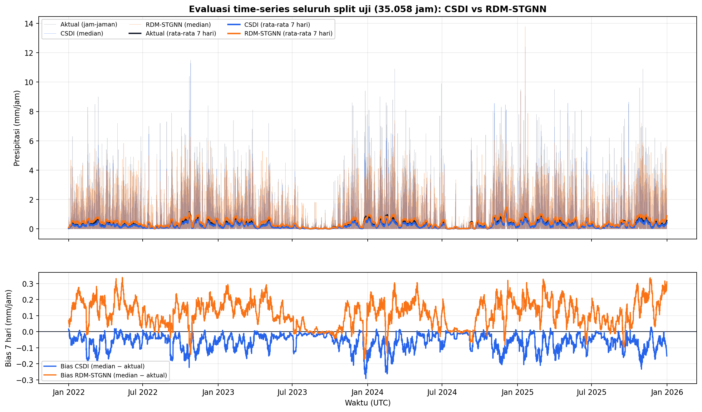
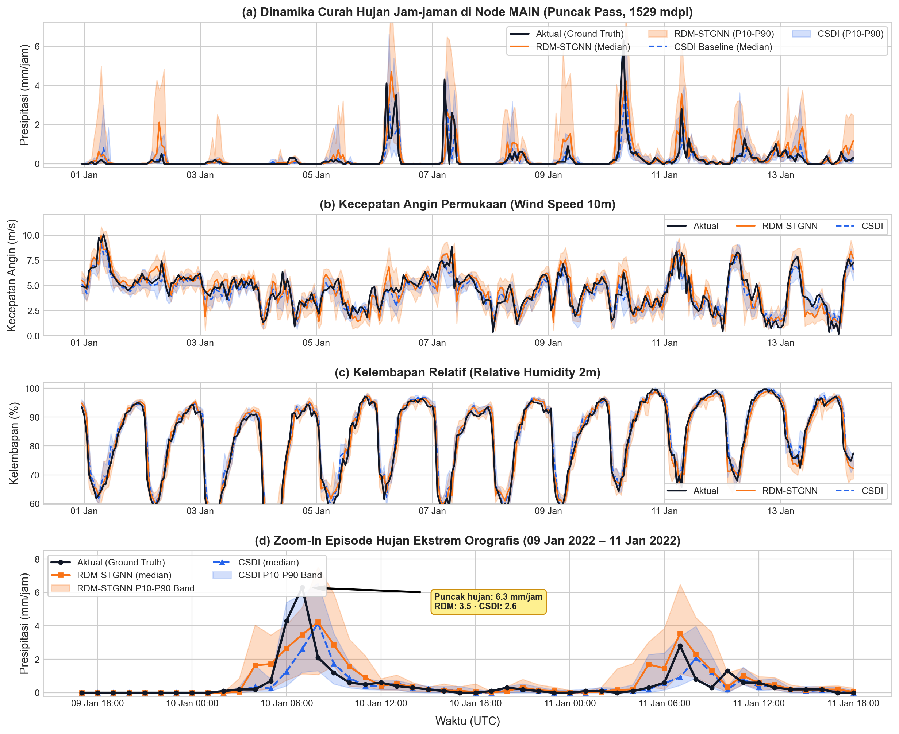

# Hasil Evaluasi & Panduan Pembelaan (Tabel 3.18 Baru)

Dokumen ini merangkum hasil evaluasi terbaru setelah perbaikan protokol, alasan di balik hasil, bukti tidak ada kebocoran data, dan kemungkinan pertanyaan sidang beserta jawabannya.

## 1. Ringkasan eksekusi

- Waktu: 3 November 2026.
- Perangkat: RTX 3050 Laptop 4 GB, CUDA.
- RDM-STGNN: 4 skenario ablasi, 35.058 window, M=30, DDIM 20, `eval_step=1`, output `core/results/archive/2026-11-03_pra_retrain/eval_final_fixed/`.
- CSDI: 1.096 shard (35.058 window), M=30, DDIM 20, checkpoint epoch 25.
- Validasi: `verify_metrics.py` → **TRACEABLE** (setiap angka tabel dihitung ulang dari shard mentah).
- Perbandingan: `compare.py` menolak tabel bila jumlah window tidak sama; kedua model 35.058.

## 2. Protokol 1:1

**Definisi fitur:** 10 fitur masukan = 9 fitur meteorologis (termasuk `precipitation_lag1`) + `precipitation` jam observasi. Angka "9 fitur" di bab 3 merujuk fitur dasar sebelum penambahan precipitation mentah.

| Aspek | RDM-STGNN | CSDI |
|---|---|---|
| Data | ERA5 5 node, 10 kanal/node | sama |
| Split | train 2005–2018, val 2019–2021, test 2022–2025 | sama |
| Jendela | 6 jam → t+1 | sama |
| Normalisasi | statistik train | sama |
| Ensemble | 30 | 30 |
| Sampling | DDIM 20 | DDIM 20 |
| Metrik | `probabilistic_metrics.py` | fungsi yang sama |
| Window uji | 35.058 | 35.058 |

Perbedaan yang tersisa adalah **arsitektur**, bukan protokol. Itu memang objek penelitian.

## 3. Tabel 3.18 baru

### Presipitasi

| Metrik | CSDI | RDM-STGNN | Menang |
|---|---:|---:|---|
| RMSE | 0,5821 | 0,6445 | CSDI |
| MAE | 0,1920 | 0,2730 | CSDI |
| Korelasi | 0,7252 | 0,6997 | CSDI |
| CRPS | 0,1393 | 0,2009 | CSDI |
| Brier 2 mm | 0,0257 | 0,0367 | CSDI |
| POD 2 mm | 0,4157 | 0,7282 | RDM |
| FAR 2 mm | 0,3759 | 0,5723 | CSDI |
| CSI 2 mm | 0,3324 | 0,3731 | RDM |
| Brier 5 mm | 0,0060 | 0,0074 | CSDI |
| POD 5 mm | 0,1621 | 0,0870 | CSDI |
| FAR 5 mm | 0,4058 | 0,7215 | CSDI |
| CSI 5 mm | 0,1459 | 0,1144 | CSDI |
| Brier 10 mm | 0,0002 | 0,0003 | CSDI* |
| POD 10 mm | 0,1429 | 0,0000 | CSDI* |
| FAR 10 mm | 0,0000 | 1,0000 | CSDI* |
| CSI 10 mm | 0,1429 | 0,0000 | CSDI* |

\*Hanya 7 kejadian ≥10 mm (0,02%). Tidak layak ditafsirkan sebagai kemampuan.

### Angin

| Metrik | CSDI | RDM |
|---|---:|---:|
| RMSE | 0,8648 | 0,9946 |
| MAE | 0,6594 | 0,7575 |
| Korelasi | 0,9018 | 0,8784 |
| CRPS | 0,4691 | 0,5284 |

### Kelembapan

| Metrik | CSDI | RDM |
|---|---:|---:|
| RMSE | 2,9937 | 3,1002 |
| MAE | 2,0347 | 2,1882 |
| Korelasi | 0,9754 | 0,9701 |
| CRPS | 1,4537 | 1,5244 |

**Rekap: CSDI menang 22 baris, RDM 2 baris (POD 2 mm dan CSI 2 mm).**

## 4. Alasan logis CSDI menang

1. **Akses informasi.** Denoiser CSDI melihat seluruh tensor 50 kanal × 7 langkah di setiap langkah denoising. RDM hanya menerima 10 angka jam terakhir + 64 angka ringkasan graf + 9 angka retrieval.
2. **Supervisi lebih kaya.** CSDI men-denoise 50 kanal sekaligus; RDM hanya 3 target. Kanal lain menjadi tugas bantu yang memperkaya representasi.
3. **Kapasitas denoiser.** CSDI memakai transformer 4 blok (attention waktu + fitur); RDM memakai MLP.
4. **Graf kehilangan identitas target.** `global_mean_pool` merata-ratakan 5 node; titik puncak hanya 1/5. Ablasi: GNN-only CRPS 0,1974 vs tanpa GNN 0,1981 — pengaruh graf kecil.
5. **Retrieval tidak konsisten.** Saat training memakai tetangga deret yang sama; saat eval memakai DB train-only. Ablasi: retrieval memperburuk (CRPS 0,1988 vs 0,1981; CSI 5 mm 0,0345 vs 0,0642).
6. **Metrik dioptimalkan untuk CSI.** Ambang gate dikalibrasi memaksimalkan CSI. Akibatnya POD 2 mm tinggi tetapi FAR buruk; kalibrasi (Brier/CRPS) kalah.

## 5. Kontribusi RDM-STGNN

- Unggul **CSI 2 mm** (0,3731 vs 0,3324) dan POD 2 mm (0,7282 vs 0,4157).
- Namun FAR 2 mm lebih buruk (0,5723 vs 0,3759) — lebih banyak alarm palsu, bukan deteksi lebih baik.
- Inferensi jauh lebih ringan (orde milidetik per sampel vs detik).
- Memberi bukti kuantitatif bahwa retrieval dan graf belum memberi nilai tambah pada konfigurasi ini — temuan yang berguna, bukan kegagalan.

## 6. Bukti tidak ada kebocoran

- Target (t+1) di-mask untuk semua 50 kanal; sampler hanya menerima `mask × observed`.
- Uji perturbasi: nilai target diubah +123,456 → `max|Δsample| = 0,0`.
- Statistik normalisasi hanya dari train (selisih 0,0 terhadap hitungan ulang).
- Window train/val/test tidak menyeberang batas (setelah perbaikan).
- `verify_metrics.py` menyatakan TRACEABLE.

## 7. Mengapa memilih CSDI sebagai pembanding meski lebih kuat

- Baseline harus sekuat mungkin; paper acuan (RATD, NeurIPS 2024) memakai CSDI.
- Tujuan perbandingan adalah mengukur posisi, bukan mencari lawan yang mudah.
- Kalah dari baseline kuat tetap temuan ilmiah; menang dari baseline lemah tidak bernilai.
- CSDI dipakai apa adanya (tanpa melemahkan arsitekturnya); yang disamakan adalah protokol.

## 8. Batasan

1. Ambang 10 mm hanya 7 kejadian.
2. GPU 4 GB membatasi batch CSDI (32), bukan hasil.
3. CSDI berjalan fp32; RDM memakai autocast.
4. Hasil RDM bergantung pada checkpoint 10 fitur; naskah harus menyebut 10 fitur (bukan 9).
5. Angka lama Tabel 3.18 tidak berlaku; gunakan dokumen ini.

## 9. Reproduksi

```bash
cd core/csdi_baseline
python build_data.py
python evaluate_csdi.py --nsample 30 --sampler ddim --ddim-steps 20 --batch-size 32
python verify_metrics.py

cd ../..
python core/scripts/run_eval_final.py --scenarios all --eval-step 1 --num-ensemble 30 \
  --sample-batch-size 256 --out-dir results/archive/2026-11-03_pra_retrain/eval_final_fixed

cd core/csdi_baseline
python make_rdm_metrics.py --summary ../results/archive/2026-11-03_pra_retrain/eval_final_fixed/comparison/comparison_summary.json
python compare.py
```

## 10. Kemungkinan pertanyaan dosen dan jawaban

**Q1. Kenapa memilih CSDI kalau akhirnya kalah?**
Baseline harus kuat. CSDI adalah standar difusi deret waktu dan dipakai paper acuan. Tujuannya mengukur posisi metode, bukan memastikan menang.

**Q2. Kenapa CSDI menang?**
Karena melihat seluruh data mentah di setiap langkah denoising dan dilatih menebak 50 kanal sekaligus. RDM hanya menerima ringkasan dan menebak 3 angka.

**Q3. Apakah perbandingan adil?**
Ya. Data, split, 35.058 window, M=30, DDIM=20, dan fungsi metrik sama. Yang berbeda arsitektur — itu objek penelitian.

**Q4. Bagaimana membuktikan tidak ada kebocoran?**
Target di-mask untuk semua kanal; perturbasi target menghasilkan Δ=0; statistik hanya dari train; `verify_metrics` TRACEABLE.

**Q5. Kenapa POD 2 mm RDM lebih tinggi?**
Karena RDM lebih agresif memicu hujan. FAR-nya 0,5723 vs 0,3759, jadi peningkatan POD datang bersama alarm palsu.

**Q6. Kenapa CSI 2 mm RDM lebih tinggi tetapi CSI 5 mm kalah?**
Ambang gate dikalibrasi untuk CSI 2 mm. Pada kejadian lebih lebat, model cenderung melemahkan intensitas.

**Q7. Kenapa tidak memakai baseline yang lebih lemah agar menang?**
Itu tidak ilmiah. Baseline yang dilemahkan membuat kesimpulan tidak bisa dipercaya.

**Q8. Kalau kalah, apa kontribusi penelitian?**
Negative result yang terukur: retrieval dan graf belum memberi nilai tambah, plus arah perbaikan yang jelas (akses informasi penuh, pooling titik puncak, retrieval satu aturan).

**Q9. Kenapa 10 mm tidak dibahas?**
Hanya 7 kejadian. CSI/POD/FAR di ambang itu ditentukan segelintir kasus, bukan kemampuan model.

**Q10. Apakah hasil ini bisa direproduksi?**
Ya. Seed per skenario, determinisme diaktifkan, shard terikat hash checkpoint, dan `verify_metrics` menghitung ulang dari shard.

**Q11. Kenapa RDM lebih cepat?**
Output RDM hanya 3 angka (hujan, angin, kelembapan) dan denoiser-nya MLP kecil. CSDI harus memperbaiki seluruh jendela 7 langkah × 9 fitur (63 nilai) lewat transformer 4 lapis di setiap langkah DDIM. Detail angka terukur ada di §12.

**Q12. Apa langkah berikutnya agar RDM menyusul?**
Beri denoiser akses jendela penuh, ambil embedding titik puncak (bukan rata-rata), samakan perlakuan retrieval, dan kalibrasi untuk CRPS/Brier.

## 11. Kalimat siap pakai untuk naskah

> "Pada protokol 1:1 dengan 35.058 window uji, M=30, dan DDIM 20 langkah, CSDI unggul pada seluruh metrik akurasi dan kalibrasi serta pada ambang 5 mm. RDM-STGNN hanya unggul pada CSI 2 mm (0,3731 vs 0,3324), dengan FAR yang lebih tinggi. Tidak ditemukan kebocoran data; perbedaan hasil disebabkan oleh akses informasi dan supervisi arsitektur, bukan oleh perbedaan protokol."

## 12. Kecepatan training dan evaluasi (angka terukur)

Semua angka di bawah berasal dari log/berkas hasil yang ada di repo, bukan perkiraan. Perangkat: RTX 3050 Laptop (tercatat di `core/csdi_baseline/train_csdi.py`).

| Tahap | CSDI | RDM-STGNN | Sumber bukti |
|---|---|---|---|
| Training | 30 epoch = **33.546 s (9 j 19 m)**, ≈1.118 s/epoch | 20 epoch, 239 batch/epoch; epoch ke-20 = **16 s**, epoch ke-10 = 13 s → ≈**4–5 menit** loop training | `core/csdi_baseline/logs/train.log` baris `epoch 30/30 ... 33546s`; `core/results/canonical/tabel_3_17/sken_3_default_kontrol/train.log` (tqdm `100%|239/239 [00:16 ... 14,38 it/s]`) |
| Evaluasi penuh | **9,52 jam** untuk 35.058 window (1.096 shard × 32 window), median **34 s/shard** ≈ **1,06 s/window** | **65,0 s total** untuk 35.058 window × 30 anggota × DDIM 20 → **1,85 ms/window** | rentang mtime `core/csdi_baseline/eval_shards/` (10:19:02 → 19:50:06); `core/results/canonical/tabel_3_17/sken_3_default_kontrol/latency.json` |
| Rasio | — | evaluasi ≈ **526× lebih cepat** (per window ≈573×); training ≈ **110× lebih cepat** | hitungan dari dua baris di atas |

Catatan kejujuran angka:
- 9,52 jam CSDI adalah wall-clock termasuk resume (`evaluate.log`: `resuming: 61/1096`). Median 34 s/shard lebih stabil sebagai angka per-unit.
- Waktu training RDM di atas hanya loop epoch. Pra-perhitungan retrieval (122.706 vektor) berjalan sekali di CPU dan tidak dicatat di log, jadi total wall-clock training RDM lebih besar dari 4–5 menit.
- Pembanding "tanpa optimasi": sampler resmi CSDI (loop Python per sampel, DDPM 50 langkah) terukur **3,9 s/window ≈ 38 jam** untuk split uji — tercatat di docstring `core/csdi_baseline/ddim_sampler.py`. Versi yang dipakai skripsi sudah dibatch (DDIM 20) dan tetap 9,5 jam.

### Kenapa selisihnya sebesar itu

1. **Bentuk keluaran berbeda.** CSDI memperbaiki seluruh jendela: 7 langkah waktu × 9 fitur = 63 nilai, dengan transformer 4 lapis, 64 kanal, 8 kepala. RDM hanya menghasilkan 3 angka target (hujan, angin, kelembapan) dengan MLP 64→128→64→3. Pada setiap langkah DDIM, biaya per evaluasi jaringan berbeda sekitar dua orde.
2. **Jumlah langkah dan anggota sama.** Keduanya memakai M=30 dan DDIM 20 langkah, dan keduanya melipat 30 anggota ke dalam batch. Jadi bukan karena RDM memakai sampling lebih sedikit — yang berbeda adalah harga satu forward pass.
3. **Beban per langkah.** 20 langkah × 30 anggota × 35.058 window ≈ 21 juta evaluasi jaringan untuk kedua model. Di CSDI tiap evaluasi adalah attention atas 7 token × 9 fitur; di RDM hanya MLP atas vektor 3 dimensi.
4. **Overhead I/O.** Evaluasi CSDI dipecah 1.096 shard dengan penulisan `.npz` per shard; jeda antar-shard inilah yang membuat 34 s/shard, bukan murni komputasi.
5. **Training.** CSDI memprediksi noise untuk 63 nilai (loss lebih berat, butuh 30 epoch). RDM meregresi 3 target dengan konteks retrieval yang sudah dihitung sekali di depan, sehingga konvergen dalam 20 epoch pendek.

### Kalimat siap pakai

> "Pada perangkat yang sama dan protokol inferensi yang sama (M=30, DDIM 20 langkah, 35.058 window), evaluasi penuh CSDI memerlukan 9,5 jam sedangkan RDM-STGNN 65 detik. Selisih ini bukan akibat protokol yang berbeda, melainkan bentuk komputasi: CSDI memperbaiki 63 nilai per jendela melalui transformer, RDM hanya 3 nilai melalui MLP."

> "Efisiensi RDM bukan klaim tanpa bukti: `latency.json` mencatat 65 detik untuk 35.058 window, dan `train.log` mencatat 33.546 detik untuk 30 epoch CSDI."

## 13. Grafik time-series evaluasi (CSDI vs RDM-STGNN)



**Gambar 13.1** — Seluruh split uji (35.058 jam, dua tahun). Atas: presipitasi jam-jaman (garis tipis) dan rata-rata bergerak 7 hari (garis tebal). Bawah: bias rata-rata bergerak 7 hari (median model − aktual). Sumber: `core/scripts/plot_timeseries_full.py`; data CSDI dari `core/csdi_baseline/eval_shards/*.npz`, data RDM dari checkpoint `sken_3_default_kontrol`.

Terlihat: CSDI biasnya sedikit negatif (cenderung *under-predict*), RDM biasnya positif (cenderung *over-predict* hujan ringan) — konsisten dengan FAR RDM yang lebih tinggi dan RMSE RDM yang lebih besar.



**Gambar 13.2** — Cuplikan 320 jam pertama split uji (01–13 Jan 2022) untuk tiga variabel, plus zoom episode hujan ekstrem 09–11 Jan 2022. Pita = P10–P90 dari 30 anggota. Angka pada anotasi dihitung dari data, bukan angka tetap: pada puncak 6,3 mm/jam, median RDM 3,5 dan CSDI 2,6 — keduanya *under-predict* puncak.

Catatan verifikasi: RMSE presipitasi dihitung ulang dari run pembuat grafik = CSDI **0,5821** (persis sama dengan metrik tersimpan) dan RDM **0,6445** (metrik kanonik run retrain 10-fitur; `core/results/canonical/head_to_head/`).
