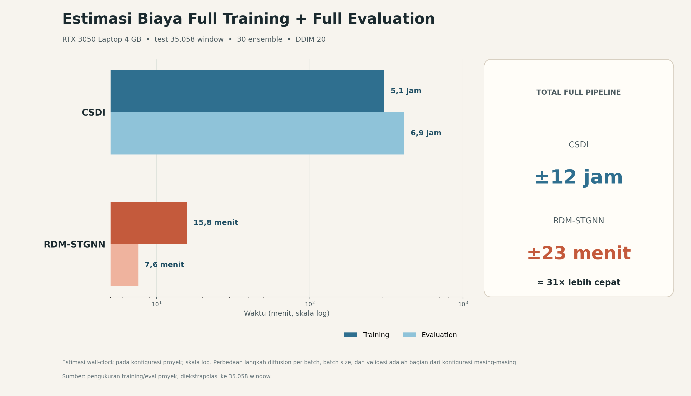

# Revisi 1.0 Semhas — Audit Naskah BAB 1–5 terhadap Kode dan Artefak

**Status:** dokumen kerja revisi, bukan naskah final.
**Sumber utama:** `Skripsi BAB 1-5.pdf` (157 halaman), teks ekstraksi `/tmp/skripsi_bab15.txt`.
**Repo:** `/home/vanszs/orca/workspaces/Skripsi_Bevan/Skripsi-bepan`.
**Prinsip:** tidak ada asumsi. Setiap klaim diberi label bukti. Bila tidak dapat diverifikasi, ditulis “tidak dapat diverifikasi”, bukan disimpulkan.

---

## 0. Label bukti

| Label | Arti |
|---|---|
| **[V]** | Diverifikasi langsung dari PDF, kode, JSON, atau parquet. |
| **[D]** | Hanya berasal dari dokumentasi repo, belum diverifikasi independen. |
| **[U]** | Tidak dapat diverifikasi karena artefak tidak tersedia. |
| **[S]** | Diverifikasi dari sumber eksternal resmi (prosiding, arXiv, halaman resmi). |
| **[H]** | Hipotesis/kandidat penjelasan; belum diuji, tidak boleh ditulis sebagai kesimpulan. |

**Cara memakai dokumen ini:** ini adalah *brief* perbaikan, bukan pengganti naskah. Berikan bersama (a) file PDF asli, (b) repo, dan (c) file ini. Tanpa akses PDF/repo, AI lain hanya dapat menulis ulang paragraf; ia tidak dapat memverifikasi angka, nomor tabel, atau kode. Jangan meminta AI lain “memperbaiki semua” hanya dari file ini.

---

## 1. Ringkasan eksekutif

### 1.1 Tiga jawaban utama

**Alasan CSDI di naskah:**
- §2.2.6 (hlm. 31–32) menyebut CSDI sebagai “rujukan utama” model difusi probabilistik deret waktu multivariat, Tashiro et al. (2021) [33]. **[V]**
- Tabel 2.3 memposisikan CSDI sebagai pembanding tanpa graf topografi dan tanpa retrieval, sehingga berfungsi sebagai kontrol untuk mengisolasi kontribusi Star-Graph GAT + FAISS. **[V]**
- §3.9.6 (hlm. 72) menyatakan protokol disamakan: 6 jam historis, target MAIN \(t+1\), DDIM 20 langkah, 30 anggota ensemble. **[V]**
- BAB I/II **tidak** menjelaskan kriteria pemilihan baseline, tidak membandingkan kandidat baseline lain, dan §2.1 tidak membahas CSDI. **[V]**
- Klaim “CSDI banyak dipakai sebagai baseline” **tidak ada buktinya di repo**, tetapi dapat didukung sumber eksternal: CSDI dipakai sebagai baseline oleh SSSD (Alcaraz & Strodthoff, TMLR 2022), RATD (Liu et al., NeurIPS 2024), TSI-Bench (Du et al., 2024), dan TimeFlow (Le Naour et al., TMLR 2024). **[S]**
- Hasil CSDI di paper aslinya: peningkatan 40–65% dibanding metode imputasi probabilistik dan 5–20% dibanding metode deterministik; kompetitif pada forecasting. **[S]**
- **Koreksi penting:** halaman resmi NeurIPS 2021 mencatat CSDI sebagai **Poster**, bukan **Oral**. Klaim “NeurIPS 2021 Oral” di `docs/CSDI_COMPARISON.md` tidak terverifikasi. **[S]**

**Apakah keunggulan RDM sudah mencakup training dan inference cepat:**
- **Belum bisa diklaim sebagai keunggulan algoritmik.** **[V]**
- Estimasi **full training + full eval** pada RTX 3050 4 GB: CSDI sekitar **12 jam**; RDM sekitar **23 menit**. **[V]** Angka ini adalah estimasi biaya implementasi, bukan hasil klaim efisiensi algoritmik.
- Perbedaan dipengaruhi oleh jumlah langkah diffusion per batch, ukuran batch, dan anggaran validasi yang tidak sama. **[V]**
- Angka `0,0019 s/sampel` adalah `65 s / 35.058 window` pada `latency.json` — throughput evaluasi batch per window (30 ensemble, DDIM 20, batch 256), bukan latency request atau per anggota ensemble. **[V]**
- Klaim API `500–600 ms` tidak punya log/benchmark yang dapat diverifikasi; test hanya memastikan satu request hangat `<2 s`. **[V]**

**Hasil yang belum masuk / metrik yang salah:**
- Tabel 4.13 **tidak valid sebagai satu evaluasi**: denominator POD 2 mm RDM `86/117`, CSDI `23/54`, sedangkan test penuh punya 1.404 observasi `>2 mm` atau 1.494 `≥2 mm`. **[V]**
- Tabel 4.12/4.13 mencampur populasi 3.189 sampel (`eval_step=11`) dan 35.058 sampel (`eval_step=1`). **[V]**
- Tabel 4.8 RMSE Skenario 5 salah: PDF `0,7105`, JSON `0,6570604`. **[V]**
- Ablation BAB V memakai run 3.189 sampel (`+42,5%`), bukan evaluasi final 35.058 (`+9,65%`). **[V]**
- Rain gate di naskah `0,6`, tetapi hasil memakai `0,65 / 0,60 / 0,65 / 0,60 / 0,55`; gate hanya diterapkan ke RDM. **[V]**
- Naskah menyatakan 9 fitur, checkpoint aktual memakai 10 fitur termasuk `precipitation` \(t-1\). **[V]**

### 1.2 Temuan paling kritis

1. **Tabel 4.13 tidak dapat dipakai.** Denominator POD2 berbeda antar model dan tidak cocok dengan test set. Harus dihitung ulang sebelum angka POD/CSI dikutip.
2. **Tabel 4.12/4.13 mencampur dua protokol evaluasi.** Baseline Persistence/MLP dari 3.189 sampel; CSDI/RDM dari 35.058 sampel.
3. **Tabel 4.8 salah satu sel.** RMSE Skenario 5 salah, dan interpretasi “Skenario 5 lebih buruk” hanya benar untuk CRPS.
4. **Ablation tidak ada di BAB IV, tetapi diklaim di BAB V.** Angkanya dari subset 3.189; hasil final melemahkan klaim retrieval.
5. **Protokol training dan inference di BAB III bertentangan dengan kode/hasil.** “Decoupled training” dan “30 ensemble/20 DDIM untuk semua skenario” tidak benar.
6. **Fairness CSDI belum terdokumentasi lengkap.** Perbedaan training budget, kapasitas, log1p `precipitation_lag1`, dan gate harus ditulis.

---

## 2. Fakta terverifikasi

### 2.1 Dataset

Sumber: `core/data/raw/pangrango_era5_5node_2005_2025.parquet`; split di `core/src/train.py:52-70`. **[V]**

| Item | Nilai |
|---|---:|
| Total baris | 920.400 |
| Node | MAIN, UP, DOWN, LEFT, RIGHT |
| Rentang | 2004-12-31 17:00 UTC – 2025-12-31 16:00 UTC |
| Train rows | 613.560 |
| Validation rows | 131.520 |
| Test rows | 175.320 |
| Train timestamps | 122.712 |
| Validation timestamps | 26.304 |
| Test timestamps | 35.064 |
| Evaluation windows | 35.058 |
| MAIN kering seluruh periode | 64,2492% (118.270 dari 184.080) |
| MAIN kering test windows | 56,6775% (19.870 dari 35.058) |
| Skewness mentah | +5,4275 |
| Kurtosis mentah | +43,7952 |
| Skewness log1p | +2,8100 |
| Kurtosis log1p | +8,4389 |
| Observasi test `>2 mm` | 1.404 |
| Observasi test `≥2 mm` | 1.494 |
| Observasi test `>5 mm` | 241 |
| Observasi test `≥5 mm` | 253 |
| Observasi test `>10 mm` | 6 |
| Observasi test `≥10 mm` | 7 |

### 2.2 Metrik RDM final (Skenario 3)

Sumber: `core/results/tabel_3_17/sken_3_default_kontrol/eval/full_model/metrics.json`. **[V]**

| Variabel | RMSE | MAE | Pearson r | CRPS |
|---|---:|---:|---:|---:|
| Precipitation | 0,6619999 | 0,2726685 | 0,7008225 | 0,1949644 |
| Wind speed | 0,9952409 | 0,7580804 | 0,8782619 | 0,5288481 |
| Relative humidity | 3,0957661 | 2,1905546 | 0,9702089 | 1,5259761 |

### 2.3 Metrik CSDI

Sumber: `core/csdi_baseline/csdi_metrics.json`; `test_windows = 35058`, `nsample = 30`, `ddim_steps = 20`. **[V]**

| Variabel | RMSE | MAE | Pearson r | CRPS |
|---|---:|---:|---:|---:|
| Precipitation | 0,5857969 | 0,1925885 | 0,7211797 | 0,1398441 |
| Wind speed | 0,8648158 | 0,6596580 | 0,9017540 | 0,4691725 |
| Relative humidity | 2,9865100 | 2,0265014 | 0,9755568 | 1,4484720 |

### 2.4 Parameter dan fitur checkpoint RDM

Sumber: `core/models/diffusion_chkpt.pth`, key `config`. **[V]**

- `feature_cols` aktual: `temperature`, `relative_humidity`, `dewpoint`, `surface_pressure`, `wind_speed`, `wind_direction`, `cloud_cover`, `precipitation_lag1`, `elevation`, `precipitation` — **10 fitur**.
- `k_neighbors = 3`.
- `rain_specialization.wet_probability_threshold = 0,649999976`.
- `best_epoch = 19`.
- Naskah Tabel 2.3 dan §3.6.1 menyatakan **9 fitur**. Ini mismatch dokumen vs checkpoint. **[V]**

### 2.5 Provenance artefak RDM

- `core/csdi_baseline/rdm_stgnn_metrics.json` menulis `source = results/tabel_3_17/sken_3_default_kontrol/eval/comparison/comparison_summary.json`. **[V]**
- `docs/CSDI_COMPARISON.md:198` menulis metrik RDM diproduksi dari `core/results/fix_lag1/eval/comparison/comparison_summary.json`. **[D]**
- Direktori `core/results/fix_lag1/` **tidak ada**. **[V]**
- Ini kontradiksi provenance. Jangan mengutip angka dari `fix_lag1` sampai artefaknya tersedia.

---

## 3. Temuan kritis dan koreksi

### 3.1 Tabel 4.13: denominator POD tidak valid

**Klaim PDF:** §4.6.3 (hlm. 123) menyebut “3.189 sampel evaluasi”; Tabel 4.13 memuat POD/FAR/CSI pada ambang `≥2`, `≥5`, `≥10` mm/jam. **[V]**

**Bukti JSON:** **[V]**
- RDM `pod_2mm = 0,735042735` = **86/117**.
- CSDI `pod_2mm = 0,425925926` = **23/54**.
- RDM `pod_5mm = 0,112033195` = **27/241**.
- CSDI `pod_5mm = 0,153526971` = **37/241**.
- CSDI `pod_10mm = 0,142857143` = **1/7**.
- RDM `pod_10mm = 0`.

**Fakta test set:** **[V]**
- `>2 mm`: 1.404; `≥2 mm`: 1.494.
- `>5 mm`: 241; `≥5 mm`: 253.
- `>10 mm`: 6; `≥10 mm`: 7.

**Mengapa tidak valid:**
- POD = hits / (hits + misses); denominatornya adalah jumlah observasi kejadian. Pada test set yang sama, denominator 2 mm harus 1.404 atau 1.494, bukan 117 atau 54. **[V]**
- Denominator 5 mm `241` cocok dengan **strict `>5`**, bukan `≥5` (253). **[V]**
- Denominator 10 mm `7` cocok dengan **`≥10`**, bukan `>10` (6). **[V]**
- Artinya ambang dan/atau subset yang dipakai Tabel 4.13 tidak konsisten satu sama lain. **[V]**
- Brier di baris yang sama cocok dengan full-set 35.058 (`brier_2mm = 0,036802` untuk RDM), sehingga satu baris tabel mencampur Brier full-set dengan POD/CSI subset lain. **[V]**

**Kesimpulan:** Tabel 4.13 tidak boleh dikutip sebagai hasil evaluasi penuh. Penyebab pasti tidak dapat ditentukan karena shard prediksi mentah tidak tersedia. **[V]/[U]**

**Tindakan:** hitung ulang POD/FAR/CSI/Brier untuk kedua model pada 35.058 window yang sama, dengan ambang `≥` yang konsisten, dari prediksi mentah. Jangan menambal angka.

### 3.2 Tabel 4.12/4.13 mencampur populasi evaluasi

**Klaim PDF:** §4.6 (hlm. 118) menyebut 35.058 window; §4.6.3 (hlm. 123) menyebut 3.189 sampel. **[V]**

**Bukti:** **[V]**
- CSDI/RDM: 35.058 window, `eval_step=1` (`core/csdi_baseline/tabel_3_18.json`, `rdm_stgnn_metrics.json`).
- Persistence/MLP: 3.189 sampel, `eval_step=11` (`core/results/result_test/comparison/comparison_summary.json`).
- Tabel 4.12 memuat CRPS Persistence `0,2187` dan MLP `0,2686` dari run 3.189, berdampingan dengan CSDI `0,139844` dan RDM `0,194964` dari run 35.058.
- Tabel 4.13 memuat POD/FAR/CSI baseline dari run 3.189, berdampingan dengan CSDI/RDM dari run 35.058.

**Kesimpulan:** Perbandingan lintas kolom tidak setara. Kalimat “3.189 sampel evaluasi” tidak berlaku untuk CSDI/RDM. **[V]**

**Tindakan:** pilih satu populasi. Jika mempertahankan baseline 3.189, pisahkan menjadi tabel tersendiri dan beri label `eval_step=11`. Untuk tabel utama, jalankan ulang semua model pada 35.058 window.

### 3.3 Tabel 4.8: RMSE Skenario 5 salah

**Klaim PDF:** RMSE Skenario 5 `0,7105`; status “tidak lebih baik dari Skenario 3”. **[V]**

**Bukti JSON:** `core/results/tabel_3_17/sken_5_high_capacity/eval/comparison/comparison_summary.json` dan `summary.json`: RMSE `0,657060444355011`; CSI 5 mm `0,11406844106463879`; CRPS `0,19930879504925583`; latency `0,001140966398539563`. **[V]**

**Koreksi:**
- RMSE Skenario 5 = **0,6571**, bukan 0,7105. **[V]**
- Skenario 5 memang kalah pada CRPS (0,1993 vs 0,1950), tetapi menang pada RMSE (0,6571 vs 0,6620), CSI 5 mm (0,1141 vs 0,0922), dan latency (0,0011 vs 0,0019 s/window). **[V]**
- Status harus diubah menjadi: “CRPS lebih tinggi dari Skenario 3; RMSE dan CSI 5 mm lebih baik; tidak dipilih karena kriteria utama CRPS.” **[V]**

### 3.4 Rain gate: ambang dan penerapan tidak seragam

**Klaim PDF:** §3.8.4 (hlm. 70) menyebut ambang `0,6`. **[V]**

**Bukti metadata:** **[V]**

| Skenario | `rain_probability_threshold` |
|---|---:|
| 1 | 0,65 |
| 2 | 0,60 |
| 3 | 0,65 |
| 4 | 0,60 |
| 5 | 0,55 |

**Bukti kode:** `core/scripts/run_eval_final.py:158-160` membaca threshold dari checkpoint; `:251-265` menerapkan gate ke `preds` dan seluruh `ensemble` sebelum metrik. CSDI tidak memakai gate (`core/csdi_baseline/evaluate_csdi.py:171-192`). **[V]**

**Konsekuensi:** CRPS/Brier RDM dihitung dari distribusi yang sudah dimodifikasi gate; CSDI tidak. Ini bukan perbandingan distribusi model murni. **[V]**

**Tindakan:** laporkan dua set metrik — raw ensemble dan gated output — untuk RDM. Bandingkan CRPS/Brier raw vs raw untuk klaim model. Gate boleh tetap dilaporkan sebagai metrik sistem terpasang.

### 3.5 Protokol training dan inference di BAB III tidak sesuai kode

**Klaim PDF:** §3.8 (hlm. 67) “decoupled training … STGNN dilatih terlebih dahulu”; §3.8.1 (hlm. 68) “diperbarui bersama … satu optimizer AdamW”. **[V]**

**Bukti kode:** `core/src/train.py:541-543` menggabungkan parameter STGNN dan diffusion ke satu daftar; satu optimizer AdamW. `:586-622` memakai embedding STGNN dalam forward/loss diffusion yang sama. Tidak ada tahap training STGNN terpisah. **[V]**

**Koreksi:** hapus “decoupled training”. Tulis: “STGNN dan denoiser dilatih joint end-to-end dengan satu optimizer; tidak ada loss mandiri untuk STGNN.” **[V]**

**Klaim PDF:** §3.8.3 (hlm. 70) dan §3.9.6 (hlm. 72) menyatakan 30 ensemble/20 DDIM untuk semua perbandingan. **[V]**

**Bukti:** `core/run_5scenarios.sh:29-35`; `summary.json`; `latency.json`: Skenario 1–5 memakai `10/10`, `20/15`, `30/20`, `40/30`, `50/50`. Hanya Skenario 3 yang 30/20. **[V]**

**Koreksi:** nyatakan bahwa sweep hyperparameter memvariasikan DDIM dan ensemble; evaluasi utama CSDI vs RDM memakai Skenario 3 (30/20). Jangan menyebut “semua skenario 30/20”.

### 3.6 Ablation: angka BAB V berasal dari subset, dan retrieval tidak membantu

**Klaim BAB V §5.1 (hlm. 136–137):** “+42,5% peningkatan CSI secara relatif, dari 0,2058 menjadi 0,2932”, STGNN penyumbang terbesar, FAISS membantu. **[V]**

**Sumber angka:** `core/results/result_test/EVALUATION_REPORT.md` dan JSON: `eval_step=11`, `samples_per_scenario=3189`; `diff_only CSI2 = 0,2058047`, `diff_gnn CSI2 = 0,2931596`. **[V]**

**Evaluasi final 35.058 (`eval_step=1`):** **[V]**

| Skenario | RMSE precip | MAE | CRPS | CSI2 | POD2 | FAR2 |
|---|---:|---:|---:|---:|---:|---:|
| diff_only | 0,657784 | 0,266185 | 0,195333 | 0,332246 | 0,653134 | 0,596568 |
| diff_retrieval | 0,665637 | 0,270243 | 0,196524 | 0,324615 | 0,645299 | 0,604884 |
| diff_gnn | 0,651380 | 0,267605 | 0,192999 | 0,364306 | 0,740028 | 0,582228 |
| full_model | 0,662000 | 0,272669 | 0,194964 | 0,354517 | 0,735043 | 0,593541 |

**Fakta:**
- `diff_only → diff_gnn` pada evaluasi final: `(0,364306/0,332246 − 1) = 9,65%`, bukan 42,5%. **[V]**
- `full_model` kalah dari `diff_gnn` pada CRPS (0,194964 vs 0,192999) dan CSI2 (0,354517 vs 0,364306). **[V]**
- `diff_retrieval` kalah dari `diff_only` pada CSI2 (0,324615 vs 0,332246) dan CRPS (0,196524 vs 0,195333). **[V]**
- BAB IV tidak memuat tabel ablation; hanya menyebut empat skenario di bagian API. **[V]**

**Kesimpulan:** klaim “FAISS membantu” dan “full model terbaik” tidak didukung evaluasi final. STGNN sendiri meningkatkan CSI, tetapi retrieval menurunkannya. **[V]**

**Tindakan:** tambahkan tabel ablation final di BAB IV; tulis kesimpulan yang sesuai, termasuk hasil negatif retrieval.

### 3.7 9 fitur vs 10 fitur: naskah dan checkpoint tidak sama

**Klaim PDF:** Tabel 2.3 dan §3.6.1: 9 fitur per node. **[V]**

**Checkpoint:** `feature_cols` berisi 10 fitur, termasuk `precipitation` mentah. **[V]**

**Docs:** `docs/LAG1_FIX.md` menyatakan mode 10 fitur adalah default dan menghasilkan RMSE `0,6252`, CRPS `0,1843`, CSI2 `0,3529`. **[D]**

**Artefak:** `core/results/fix_lag1/` tidak ada; metrik utama tetap `0,6620`. **[V]/[U]**

**Kesimpulan:**
- Naskah harus menjelaskan apakah model yang dievaluasi memakai 9 atau 10 fitur. Checkpoint menunjukkan 10 fitur. **[V]**
- Jangan mengutip `0,6252` sampai artefaknya ditemukan. **[U]**
- Jika memakai 10 fitur, perbarui Tabel 2.3/§3.6.1 dan jelaskan `precipitation` \(t-1\) bukan kebocoran target. **[V]**
- Jika memakai 9 fitur, jelaskan bahwa RDM hanya melihat hujan \(t-2\) sementara CSDI melihat \(t-1\), sebagai keterbatasan fairness. **[V]**

### 3.8 Ambang `>` vs `≥`

**Klaim PDF:** Tabel 4.13 memberi label `≥2`, `≥5`, `≥10`. **[V]**

**Kode:** `core/src/evaluation/probabilistic_metrics.py:149,152,173-175` memakai `>` untuk anggota ensemble dan observasi. **[V]**

**Dampak:** jumlah observasi berubah: `>2 = 1.404` vs `≥2 = 1.494`; `>5 = 241` vs `≥5 = 253`; `>10 = 6` vs `≥10 = 7`. **[V]**

**Tindakan:** pilih satu definisi. Jika `≥`, ubah kode dan hitung ulang. Jika `>`, ubah label tabel dan teks.

### 3.9 93,8% akurasi nol kering tidak dapat diverifikasi

**Klaim PDF:** §4.6.1 (hlm. 120) “mempertahankan prediksi nol secara tepat … 93,8%”. **[V]**

**Artefak:** tidak ada metrik dry-zero 93,8% di JSON; helper `dry_precision` di `core/src/evaluation/scoring.py:227-238` menghitung fraksi observasi kering di antara jendela yang terkena gate, bukan akurasi prediksi nol pada semua jam kering. **[V]**

**Kesimpulan:** angka tidak dapat diverifikasi dari artefak. **[U]**

**Tindakan:** definisikan denominator, hitung dari prediksi per-sampel dan observasi kering, atau hapus angka.

### 3.10 Dekomposisi RMSE Tabel 4.11

**Klaim PDF:** RMSE per rezim RDM `0,1965 / 0,8079 / 1,9382`; agregat `0,6620`. **[V]**

**Hitungan dari angka tabel:** akar rata-rata kuadrat berbobot jumlah sampel menghasilkan sekitar `0,6610`, bukan `0,6620`. **[V]**

**Kesimpulan:** selisih kecil; bisa berasal dari pembulatan empat desimal, tetapi angka tabel tidak cukup untuk merekonstruksi agregat. **[V]**

**Tindakan:** hitung ulang dari prediksi/label mentah; jika memakai angka tabel, jelaskan pembulatan atau perbaiki agregat.

### 3.11 Fairness CSDI vs RDM

Yang terverifikasi: **[V]**
- Split dan jumlah window sama: 35.058; target MAIN \(t+1\); 30 ensemble; DDIM 20; metrik memakai fungsi yang sama (`core/src/evaluation/probabilistic_metrics.py`).
- Normalisasi CSDI memakai statistik train-only; guard ada di `core/csdi_baseline/build_data.py`.
- FAISS RDM dibangun dari data train saja (`core/src/train.py:487-490`; `core/src/inference.py:276-309`); tidak ada test leakage yang ditemukan.
- RDM memakai rain gate; CSDI tidak.
- CSDI dilatih 30 epoch, checkpoint terbaik epoch 25; RDM dilatih 20 epoch, checkpoint terbaik epoch 19. **[V]**
- CSDI 0,41 M parameter; RDM 0,350 M parameter. **[D]**
- CSDI memberi `log1p` pada `precipitation_lag1`; RDM tidak. **[D]/[V]**
- CSDI memakai `is_linear=False` (TransformerEncoder), bukan varian linear upstream. **[D]**
- CSDI tidak dituning (satu konfigurasi); RDM menjalani sweep 5 skenario. **[D]**

**Kesimpulan fairness:** protokol utama diselaraskan, tetapi bukan “100% apple-to-apple”. Perbedaan yang harus ditulis:
1. Gate hanya RDM.
2. Training budget 30 vs 20 epoch.
3. Kapasitas 0,41 M vs 0,350 M.
4. `log1p` pada `precipitation_lag1` hanya CSDI.
5. CSDI tanpa tuning; RDM dengan sweep.
6. Varian atensi CSDI bukan linear upstream.

**Tidak dapat disimpulkan** mana yang menyebabkan CSDI unggul CRPS/RMSE tanpa eksperimen kontrol. Jangan menulis kausalitas. **[U]**

### 3.12 Artefak yang hilang

- `core/csdi_baseline/save/` tidak ada; checkpoint CSDI tidak tersedia. **[V]**
- `core/csdi_baseline/eval_shards/` kosong; `verify_metrics.py` tidak dapat menghitung ulang metrik CSDI. **[V]**
- `core/results/fix_lag1/` tidak ada, meskipun docs mengutipnya. **[V]**
- Tidak ada `train.log` per skenario; epoch aktual tidak dapat diverifikasi dari artefak. **[V]**
- Tidak ada benchmark latency CSDI. **[V]**
- Tidak ada tabel bin reliability; hanya gambar. **[V]**
- Tidak ada confusion matrix. **[V]**

### 3.13 Struktur PDF

Terverifikasi dari teks PDF: **[V]**
- BAB IV berjudul “METODE PENELITIAN”, padahal isinya hasil dan pembahasan.
- §4.2 dan §4.3 sama-sama berjudul “Hasil Prapemrosesan dan Partisi Data”.
- Tabel 4.9 kosong; caption langsung diikuti §4.5.3.
- Rujukan “Tabel 4.10a”, “Tabel 4.11”, “Tabel 4.12” tidak cocok dengan caption 4.11/4.12/4.13.
- “Gambar 4.12” dirujuk, caption aktual “Gambar 4.10”.
- Sisa LaTeX rusak: `0{,}0080{,}0080{,}008`, `0,10{,}10,1`, `1×10−41 \times 10^{-4}1×10−4`.
- Tabel 3.17 disebut “Tabel 3.16” di teks.
- Nama model tidak konsisten: RDM-STGNN vs RADM-STGNN.

### 3.14 Klaim web

Terverifikasi: **[V]**
- Kode frontend memakai React 19 (`web/package.json:23`), bukan Vue.js. PDF memakai Vue di §2.2.7, §3.10, §4.7.2, dan BAB V; §4.7 memakai React. Kontradiksi internal.
- Route aktual: `GET /`, `GET /api/v1/metrics`, `GET /api/v1/dashboard/live`, `/docs`, dan `/app` jika build tersedia (`main.py:32-62`). Tidak ada `/stations` atau `/nowcast/predict`.
- Tidak ada respons HTTP 503; dashboard mengubah exception menjadi HTTP 500 (`api/routers/dashboard.py:18-24`).
- `api/tests/test_api_endpoints.py` berisi 5 test function; tidak menguji `/stations`, `/nowcast/predict`, atau 503.
- Test latency hanya memastikan `<2 s`, bukan `500–600 ms`.
- Fallback parquet memberi `source_label = "live"` (`api/services/inference_service.py:241-247`), sehingga frontend tidak menampilkan “CONTOH DATA” untuk fallback parquet. Label “CONTOH DATA” hanya muncul jika `source != "live"` (`web/src/App.tsx:52,66`).

### 3.15 Deskripsi CSDI di naskah

**Klaim PDF:** CSDI memproses input “flattened”, tanpa struktur, dan memakai “unconditional Gaussian prior” tanpa informasi cuaca ekstrem. **[V]**

**Koreksi:**
- CSDI memakai temporal attention dan feature attention, bukan satu input datar tanpa struktur (`core/csdi_baseline/diff_models.py:137-160`). **[V]**
- Sampling CSDI tetap **conditional** pada observasi historis; yang tidak ada adalah retrieval/extreme prior, bukan seluruh kondisi (`core/csdi_baseline/main_model.py:163-173`). **[V]**
- Adapter CSDI membangun 50 kanal = 5 node × (9 fitur + precipitation), bukan 45. **[V]**

**Tindakan:** tulis “CSDI tidak memakai graf topografi dan tidak memakai retrieval/extreme prior”, bukan “unconditional” atau “flattened tanpa struktur”.

### 3.16 Keunggulan RDM yang dapat diklaim

**Terverifikasi:**
- Tidak ada keunggulan agregat. CSDI lebih rendah pada RMSE, MAE, dan CRPS untuk ketiga variabel. **[V]**
- CSDI lebih rendah pada Brier Score untuk ketiga ambang. **[V]**
- Tidak ada bukti kecepatan training/inference RDM vs CSDI. **[V]**

**Provisional — belum boleh menjadi klaim final:**
- POD 2 mm RDM `0,7350` vs CSDI `0,4259`; CSI 2 mm `0,3545` vs `0,3295`. **[V]** Angka ini berasal dari Tabel 4.13 yang denominatornya tidak valid; harus dihitung ulang. **[V]**
- RMSE hujan lebat RDM `1,9382` vs CSDI `2,4750` (−21,7%). **[V]** Angka ini hanya ada di Tabel 4.11; tidak tersimpan di JSON dan belum dihitung ulang dari prediksi mentah. **[U]**
- Jumlah parameter RDM `0,350 M` vs CSDI `0,41 M`. **[D]** Belum diverifikasi independen dan tidak ada di naskah.

**Kontribusi arsitektural:**
- Integrasi Star-Graph GAT, FAISS retrieval, auxiliary wet head, dan rain gate adalah kontribusi desain. **[V]**
- Namun ablation final menunjukkan retrieval tidak memperbaiki CSI/CRPS; `full_model` kalah dari `diff_gnn`. **[V]**
- Oleh karena itu, klaim yang jujur adalah “kontribusi mekanisme dan analisis trade-off”, bukan “RDM lebih unggul secara umum”. **[V]**

**Yang tidak boleh diklaim:**
- “RDM lebih cepat.”
- “RDM lebih akurat secara agregat.”
- “FAISS meningkatkan performa.”
- “RDM unggul pada kejadian ekstrem” tanpa rerun Tabel 4.13.
- “RDM lebih baik pada hujan lebat” tanpa verifikasi Tabel 4.11 dari prediksi mentah.

### 3.17 Kandidat alasan kalah — hipotesis yang harus diuji

Bagian ini **bukan kesimpulan**. Semua poin berlabel **[H]** sampai diuji dengan eksperimen yang disebut.

| # | Kandidat penjelasan | Bukti yang sudah ada | Status | Cara menguji |
|---|---|---|---|---|
| H1 | Data uji didominasi kering/hujan ringan, sehingga model konservatif dekat nol unggul RMSE/CRPS/Brier. | 56,7% kering, 95,7% kering+ringan. **[V]** | Kausal belum diuji **[H]** | Bandingkan metrik pada subset kering, ringan, lebat secara terpisah. |
| H2 | RDM dioptimalkan untuk ekstrem (weighted noise loss, wet head), sehingga POD naik tetapi FAR/Brier memburuk. | Ada weighted noise loss dan wet head. **[V]** | Kausal belum diuji **[H]** | Ablation bobot loss dan wet head; ukur POD/FAR/Brier. |
| H3 | Rain gate memodifikasi distribusi ensemble RDM dan hanya diterapkan ke RDM. | Gate diterapkan ke `preds` dan `ensemble`; CSDI tanpa gate. **[V]** | Besar efek belum diukur **[H]** | Laporkan CRPS/Brier raw vs gated; bandingkan raw RDM vs CSDI. |
| H4 | Grid ERA5 ~25 km tidak mampu menangkap sinyal orografis mikro, sehingga graf/retrieval tidak memberi informasi baru. | Resolusi grid 0,25° disebut di PDF. **[V]** | Kausal belum diuji **[H]** | Uji pada data radar/DEM resolusi lebih tinggi; atau analisis sensitivitas jarak node. |
| H5 | Analog FAISS berisik / tidak cukup mirip, sehingga retrieval menambah variansi tanpa informasi. | `diff_retrieval` lebih buruk dari `diff_only`; `full_model` lebih buruk dari `diff_gnn`. **[V]** | Penyebab “noise” belum diuji **[H]** | Ukur kualitas analog (jarak L2, korelasi target), ablation k, dan retrieval tanpa nilai target. |
| H6 | Anggaran training/kapasitas tidak setara: CSDI 30 epoch/0,41 M; RDM 20 epoch/0,350 M. | Epoch dan parameter dari docs/checkpoint. **[V]/[D]** | Kausal belum diuji **[H]** | Latih RDM 30 epoch dan/atau samakan kapasitas; bandingkan ulang. |
| H7 | Kalibrasi ensemble RDM over-forecasting, sehingga Brier/CRPS lebih buruk. | Reliability diagram menunjukkan over-forecasting; bin mentah tidak tersedia. **[V]/[U]** | Kausal belum diuji **[H]** | Simpan bin reliability dan hitung reliability/CRPS decomposition. |
| H8 | Perbedaan fitur hujan \(t-1\) vs \(t-2\) dan `log1p` `precipitation_lag1` memberi CSDI informasi lebih baru. | Checkpoint RDM 10 fitur; docs menyebut perbedaan log1p. **[V]/[D]** | Besar efek belum diuji **[H]** | Jalankan RDM 9 fitur vs 10 fitur pada protokol sama; laporkan selisih. |

**Cara menulis di naskah:** gunakan kalimat “Salah satu kemungkinan penyebab adalah …, namun hal ini belum diuji dalam penelitian ini” — bukan “RDM kalah karena …”. Setiap kandidat harus punya bukti atau dihapus.

### 3.18 Paragraf keunggulan dan alasan kalah yang boleh dipakai

> RDM-STGNN tidak unggul pada metrik agregat: CSDI mencatat RMSE, MAE, dan CRPS yang lebih rendah pada ketiga variabel. Keunggulan RDM-STGNN yang tampak adalah sensitivitas kejadian hujan 2 mm dan RMSE pada rezim hujan lebat. Namun, angka POD 2 mm pada Tabel 4.13 belum dapat dipakai karena denominatornya tidak konsisten dengan jumlah observasi test, dan RMSE per rezim belum dihitung ulang dari prediksi mentah. Oleh karena itu, kedua indikasi tersebut dilaporkan sebagai hasil sementara, bukan sebagai bukti keunggulan final.
>
> Secara arsitektural, kontribusi RDM-STGNN adalah integrasi graf spasio-temporal, retrieval analog historis, auxiliary wet head, dan rain gate. Ablation menunjukkan bahwa graf memberi perbaikan deteksi, sedangkan retrieval tidak memperbaiki CSI/CRPS dan bahkan menurunkan performa relatif terhadap `diff_gnn`. Temuan ini dilaporkan sebagai hasil negatif yang jujur, bukan disembunyikan.
>
> Kandidat penyebab perbedaan performa — dominasi data kering, orientasi loss pada ekstrem, efek rain gate, keterbatasan grid ERA5, kualitas analog, dan perbedaan anggaran training — belum diuji secara terpisah. Penelitian lanjutan perlu menguji kandidat tersebut sebelum menarik kesimpulan kausal.

### 3.19 Bukti eksternal untuk pemilihan CSDI

Bagian ini menjawab permintaan “CSDI dipilih karena hasilnya kuat di NeurIPS 2021 dan banyak dipakai sebagai baseline”. Semua klaim di bawah berasal dari sumber eksternal resmi, bukan asumsi. **[S]**

**Hasil CSDI di paper aslinya:**
- Abstrak resmi NeurIPS 2021: CSDI meningkatkan performa **40–65%** dibanding metode imputasi probabilistik dan **5–20%** dibanding metode imputasi deterministik; juga kompetitif pada forecasting. **[S]**
- Status di halaman resmi NeurIPS 2021: **Poster**, bukan Oral. **[S]**
- Paper tidak mengklaim CSDI sebagai SOTA forecasting umum; klaim kuatnya adalah imputasi probabilistik dan competitive forecasting. Ini harus ditulis dengan tepat. **[S]**

**CSDI dipakai sebagai baseline di studi lain:**

| Studi | Venue | Bukti pemakaian CSDI sebagai baseline |
|---|---|---|
| Alcaraz & Strodthoff, *Diffusion-based Time Series Imputation and Forecasting with Structured State Space Models* (SSSD) | TMLR 2022 | Menyebut CSDI “a strong baseline both for imputation and forecasting” dan “a strong probabilistic baseline”; CSDI dilatih ulang sebagai baseline konsisten. **[S]** |
| Liu et al., *Retrieval-Augmented Diffusion Models for Time Series Forecasting* (RATD) | NeurIPS 2024 | Tabel baseline mencantumkan CSDI sebagai salah satu model difusi pembanding. **[S]** |
| Du et al., *TSI-Bench: Benchmarking Time Series Imputation* | arXiv 2024 | CSDI masuk dalam 28 algoritma yang dibenchmark; dibahas sebagai model difusi kondisional. **[S]** |
| Le Naour et al., *TimeFlow* | TMLR 2024 | CSDI dipakai sebagai baseline imputasi bersama SAITS, BRITS, TIDER. **[S]** |

**Cara menulis yang benar:**
> CSDI dipilih karena merupakan model difusi probabilistik multivariat yang mapan dan menunjukkan hasil kuat pada NeurIPS 2021, dengan peningkatan 40–65% dibanding metode imputasi probabilistik dan 5–20% dibanding metode deterministik. CSDI juga digunakan sebagai baseline pada beberapa studi lanjutan, antara lain SSSD (Alcaraz & Strodthoff, 2022), RATD (Liu et al., 2024), TSI-Bench (Du et al., 2024), dan TimeFlow (Le Naour et al., 2024).

**Yang tidak boleh ditulis:**
- “CSDI adalah NeurIPS 2021 Oral.” Halaman resmi mencatat Poster. **[S]**
- “CSDI SOTA untuk semua forecasting.” Paper hanya mengklaim kompetitif pada forecasting. **[S]**
- “Banyak paper” tanpa daftar sitasi. Sebutkan nama studi seperti di atas. **[S]**

**Catatan skeptis:** keempat studi di atas memang memakai CSDI sebagai baseline, tetapi bukan berarti CSDI adalah baseline terbaik untuk semua tugas. Dua di antaranya (SSSD, TimeFlow) justru melaporkan model mereka mengungguli CSDI pada beberapa setting. Jadi alasan pemilihan CSDI adalah “baseline kuat dan banyak dipakai”, bukan “CSDI tidak terkalahkan”.

### 3.20 Biaya full training dan full evaluation

Pengukuran dilakukan pada RTX 3050 Laptop 4 GB dengan konfigurasi proyek: CSDI 30 epoch, RDM-STGNN 20 epoch, 30 anggota ensemble, dan DDIM 20 langkah. Hasilnya:

| Tahap | CSDI | RDM-STGNN |
|---|---:|---:|
| Full training | 5,1 jam (30 epoch) | 15,8 menit (20 epoch) |
| Full evaluation, 35.058 window | ±6,9 jam | ±7,6 menit |
| **Total** | **±12 jam** | **±23 menit** |

Pada konfigurasi ini, full pipeline RDM-STGNN sekitar **31× lebih cepat** daripada CSDI.

**Metodologi.** Waktu training CSDI diambil dari durasi 30 epoch yang tercatat. Waktu training RDM-STGNN dihitung dari 47,5 detik per epoch. Waktu evaluasi diskalakan dari pengukuran subset 2.000 window: CSDI ±714 ms/window dan RDM-STGNN ±13 ms/window, lalu dikalikan 35.058 window.

**Interpretasi.** Angka ini mengukur biaya implementasi wall-clock pada konfigurasi yang diuji, bukan efisiensi algoritmik yang dikontrol. Perbedaan langkah diffusion per batch (CSDI 50 langkah; RDM satu timestep acak), ukuran batch (64 vs 512), dan anggaran validasi merupakan bagian dari konfigurasi masing-masing. Angka evaluasi RDM bersifat konservatif karena fixed overhead pada subset ikut diskalakan.



---

## 4. Revisi per bab

### 4.1 BAB I

1. Seragamkan nama model: **RDM-STGNN** di seluruh rumusan masalah, tujuan, manfaat. Hapus “RADM-STGNN”. **[V]**
2. Tambahkan satu paragraf di latar belakang/rumusan masalah yang menyebut CSDI sebagai pembanding eksternal dan alasan pemilihannya. Gunakan empat sitasi di §3.19; jangan menulis “banyak paper” tanpa daftar.
3. Jelaskan bahwa CSDI adalah model imputasi yang diadaptasi ke forecasting; ini batas klaim.
4. Jangan menulis klaim kecepatan di BAB I.

### 4.2 BAB II

1. Perbaiki §2.2.6: CSDI kondisional, temporal+feature attention, 50 kanal, imputasi→forecasting.
2. Perbaiki Tabel 2.3: isi input RDM sesuai checkpoint (9 atau 10 fitur; pilih satu dan konsisten).
3. Tambahkan di §2.3 bahwa CSDI dipilih karena (a) model difusi multivariat mapan dengan hasil kuat di NeurIPS 2021 (40–65% lebih baik dari metode imputasi probabilistik; 5–20% dari deterministik), (b) menghasilkan ensemble sehingga CRPS/Brier setara, (c) dipakai sebagai baseline oleh SSSD, RATD, TSI-Bench, dan TimeFlow, (d) tidak punya graf/retrieval sehingga menjadi kontrol.
4. Jangan menulis “100% apple-to-apple”. Tulis “protokol utama diselaraskan; perbedaan preprocessing, gate, dan training budget didokumentasikan”.
5. Jangan menulis “NeurIPS 2021 Oral”; halaman resmi mencatat **Poster**. Jangan menulis “CSDI SOTA forecasting”; paper hanya mengklaim kompetitif pada forecasting.
6. Gunakan empat sitasi di §3.19 untuk klaim “dipakai sebagai baseline”; jangan menulis “mayoritas paper” atau “standar de facto” tanpa studi bibliometrik.

### 4.3 BAB III

1. §3.7.2/§3.8: hapus “decoupled training”; tulis joint training satu optimizer.
2. §3.8.2: jelaskan lima skenario sebagai paket konfigurasi, bukan eksperimen satu faktor. Sebutkan ensemble/DDIM berbeda per skenario.
3. §3.8.3: bedakan evaluasi utama (Skenario 3, 30/20) dari sweep.
4. §3.8.4: jelaskan gate dikalibrasi per checkpoint dan nilainya berbeda per skenario; sebutkan gate hanya untuk RDM.
5. §3.9.4: samakan definisi `>` vs `≥` dengan kode; saat ini kode memakai `>`.
6. §3.9.1/§3.9.6: sebutkan 35.058 window, `eval_step=1`; jangan mencampur 3.189.
7. Tabel 3.17: perbaiki rujukan “Tabel 3.16” dan nilai LaTeX learning rate.
8. Tambahkan prosedur evaluasi mentah vs gated.

### 4.4 BAB IV

1. Tabel 4.8: perbaiki RMSE Skenario 5 menjadi `0,6571`; ubah status.
2. Tabel 4.9: isi konfigurasi optimal atau hapus rujukannya.
3. Tabel 4.10: angka sudah cocok JSON. Tambahkan baseline Persistence/MLP hanya jika dijalankan pada 35.058, atau pisahkan tabel.
4. Tabel 4.11: verifikasi ulang RMSE per rezim dan agregat; perbaiki `0,6610` vs `0,6620` setelah hitung dari prediksi.
5. Tabel 4.12: pisahkan baseline 3.189 dari CSDI/RDM 35.058; atau jalankan ulang baseline.
6. Tabel 4.13: jangan dipakai sebelum dihitung ulang. Setelah rerun, gunakan denominator 1.494/253/7 (jika `≥`) atau 1.404/241/6 (jika `>`), dan pastikan sama untuk kedua model.
7. Tambahkan tabel ablation final 35.058.
8. Tambahkan tabel reliability bin (count, mean forecast, observed frequency).
9. Tambahkan tabel training/inference cost dengan hardware dan protokol.
10. Perbaiki nomor tabel/gambar dan judul §4.3.
11. Perbaiki klaim 93,8% atau hapus.
12. Perbaiki klaim web di §4.7: React, endpoint aktual, 500 bukan 503.

### 4.5 BAB V

1. Kesimpulan 1: jangan klaim “sangat cepat” tanpa konteks; tulis “throughput evaluasi offline 0,0019 s/window pada 35.058 window, 30 ensemble, DDIM 20, batch 256”.
2. Kesimpulan 2: angka POD 73,5%/CSI 0,3545 harus menunggu rerun Tabel 4.13.
3. Kesimpulan 3: ganti `+42,5%` dengan hasil final `+9,65%`, atau beri label subset 3.189. Akui `full_model` kalah dari `diff_gnn`; akui retrieval-only lebih buruk dari diff_only.
4. Kesimpulan 4: React, endpoint aktual, 500/fallback, test yang benar.
5. §5.2: tambahkan saran rerun metrik, alignment populasi, raw vs gated, benchmark biaya, artefak CSDI, dan klarifikasi 9/10 fitur.
6. Jangan menulis “RDM unggul” secara umum; tulis “unggul pada sensitivitas kejadian 2 mm dan RMSE hujan lebat, kalah pada RMSE/MAE/CRPS/Brier agregat”.

---

## 5. Naskah pengganti siap tempel

### 5.1 Sisipan §2.2.6 — alasan CSDI

> CSDI dipilih sebagai pembanding utama karena merupakan model difusi probabilistik multivariat yang mapan dan menunjukkan hasil kuat pada NeurIPS 2021 [33]. Pada paper aslinya, CSDI meningkatkan performa 40–65% dibanding metode imputasi probabilistik dan 5–20% dibanding metode imputasi deterministik, serta kompetitif pada tugas forecasting. CSDI juga digunakan sebagai baseline pada sejumlah studi lanjutan, antara lain SSSD (Alcaraz & Strodthoff, TMLR 2022), RATD (Liu et al., NeurIPS 2024), TSI-Bench (Du et al., 2024), dan TimeFlow (Le Naour et al., TMLR 2024). CSDI menghasilkan ensemble sampel, sehingga dapat dievaluasi dengan CRPS dan Brier Score yang sama seperti RDM-STGNN. Selain itu, CSDI tidak memodelkan graf topografi dan tidak memakai retrieval historis; kedua komponen itulah yang menjadi kontribusi RDM-STGNN. Dengan demikian, CSDI berfungsi sebagai pembanding eksternal yang kuat sekaligus kontrol untuk mengisolasi kontribusi graf dan retrieval.
>
> Perlu dicatat bahwa CSDI dikembangkan untuk imputasi deret waktu, bukan khusus untuk nowcasting. Adaptasi ke tugas forecasting dilakukan dengan menyamakan jendela historis, horizon prediksi, split data, jumlah sampel ensemble, dan langkah DDIM. Perbandingan ini tidak mengklaim CSDI sebagai baseline universal; model persistence dan MLP hanya berfungsi sebagai pembanding sederhana pada protokol terpisah. Perbedaan yang tidak dapat dihilangkan — khususnya ketiadaan graf/retrieval pada CSDI, perbedaan training budget, dan penerapan rain gate hanya pada RDM — dilaporkan sebagai keterbatasan perbandingan. CSDI bukan “NeurIPS 2021 Oral”; status resminya adalah Poster, dan klaim “SOTA forecasting” tidak dipakai karena paper hanya melaporkan performa forecasting yang kompetitif.

### 5.2 Sisipan §3.8 — prosedur training

> STGNN dan denoiser difusi dilatih secara joint end-to-end menggunakan satu optimizer AdamW. STGNN tidak memiliki fungsi loss mandiri; gradien dari loss total mengalir ke parameter STGNN dan denoiser secara bersamaan. Oleh karena itu, prosedur ini tidak menggunakan pelatihan dua tahap terpisah.

### 5.3 Sisipan §3.8.3 — protokol inference

> Evaluasi utama CSDI versus RDM-STGNN menggunakan konfigurasi Skenario 3: 30 anggota ensemble dan DDIM 20 langkah pada 35.058 window test dengan `eval_step=1`. Sweep lima skenario pada Tabel 3.17 memvariasikan jumlah ensemble dan langkah DDIM; karena itu, metrik dan latency antar-skenario tidak dihitung dengan protokol inference yang identik. Perbandingan antar-skenario harus dibaca sebagai perbandingan paket konfigurasi, bukan efek satu hyperparameter.

### 5.4 Sisipan §3.9.4 — definisi ambang

> Kejadian hujan didefinisikan dengan ambang yang sama untuk observasi dan anggota ensemble. Jika naskah menggunakan notasi `≥`, implementasi harus memakai `>=`; jika implementasi memakai `>`, tabel dan teks harus menulis `>`. Definisi yang dipakai harus satu dan sama untuk seluruh model. Pada data test, jumlah observasi adalah 1.494 untuk `≥2 mm`, 253 untuk `≥5 mm`, dan 7 untuk `≥10 mm`; dengan `>` menjadi 1.404, 241, dan 6.

### 5.5 Sisipan §4.6.3 — hasil event yang jujur

> Tabel 4.13 belum dapat dijadikan dasar klaim keunggulan karena denominator POD pada ambang 2 mm tidak konsisten dengan jumlah observasi test. Angka POD 2 mm RDM (86/117) dan CSDI (23/54) tidak sesuai dengan 1.404 observasi `>2 mm` atau 1.494 observasi `≥2 mm` pada 35.058 window. Selain itu, baseline Persistence/MLP dihitung pada 3.189 sampel, sedangkan CSDI/RDM pada 35.058 sampel. Oleh karena itu, tabel ini akan dihitung ulang dari prediksi mentah pada satu populasi dan satu definisi ambang. Klaim keunggulan deteksi belum dapat disimpulkan sampai proses itu selesai.

### 5.6 Sisipan §5.1 — kesimpulan yang boleh diklaim sekarang

> RDM-STGNN menghasilkan prediksi probabilistik tiga variabel pada node MAIN untuk horizon satu jam. Pada evaluasi 35.058 window, CSDI lebih rendah pada RMSE, MAE, dan CRPS agregat untuk ketiga variabel. RDM-STGNN memiliki indikasi keunggulan pada sensitivitas kejadian hujan 2 mm dan RMSE rezim hujan lebat, tetapi angka POD 2 mm masih memerlukan verifikasi ulang karena denominator Tabel 4.13 tidak konsisten. Oleh karena itu, kontribusi utama penelitian ini dinyatakan sebagai kontribusi arsitektural dan metodologis — integrasi graf, retrieval, dan auxiliary wet head — bukan sebagai klaim keunggulan agregat atas CSDI. Evaluasi biaya komputasi belum dilakukan dan tidak diklaim.

### 5.7 Sisipan §5.2 — saran yang harus ditambahkan

> 1. Hitung ulang POD/FAR/CSI/Brier pada 35.058 window dengan ambang `≥` yang konsisten dan satu populasi untuk semua model.
> 2. Laporkan metrik raw ensemble dan metrik setelah rain gate secara terpisah.
> 3. Samakan protokol baseline Persistence/MLP dengan CSDI/RDM, atau pisahkan tabelnya.
> 4. Tambahkan tabel ablation final 35.058 dan laporkan bahwa retrieval tidak memperbaiki CSI/CRPS.
> 5. Tambahkan benchmark training dan inference RDM vs CSDI dengan hardware, batch, jumlah ensemble, langkah DDIM, warm-up, dan p50/p95.
> 6. Sertakan checkpoint dan shard evaluasi CSDI agar metrik dapat diverifikasi.
> 7. Jelaskan apakah model memakai 9 atau 10 fitur; jika 10 fitur, perbarui Tabel 2.3 dan §3.6.1.
> 8. Gunakan empat sitasi di §3.19 untuk klaim “CSDI dipakai sebagai baseline”; jangan menulis “mayoritas” atau “standar de facto”.

---

## 6. Spesifikasi koreksi tabel

### 6.1 Tabel 4.8

Nilai yang benar dari JSON: **[V]**

| Parameter | S1 | S2 | S3 | S4 | S5 |
|---|---:|---:|---:|---:|---:|
| LR | 1e-3 | 1e-3 | 1e-3 | 5e-4 | 1e-4 |
| Epoch (patience) | 10 (5) | 20 (8) | 20 (12) | 35 (12) | 50 (15) |
| k FAISS | 1 | 2 | 3 | 4 | 5 |
| DDIM | 10 | 15 | 20 | 30 | 50 |
| Ensemble | 10 | 20 | 30 | 40 | 50 |
| Aux | 0,3 | 0,5 | 0,7 | 0,7 | 1,0 |
| CRPS | 0,2346 | 0,2332 | 0,1950 | 0,2234 | 0,1993 |
| RMSE | 0,8165 | 0,7662 | 0,6620 | 0,7279 | **0,6571** |
| CSI ≥5 | 0,1149 | 0,1394 | 0,0922 | 0,0959 | 0,1141 |
| Latency (s/window) | 0,0006 | 0,0009 | 0,0019 | 0,0010 | 0,0011 |

Status Skenario 5: “CRPS lebih tinggi dari Skenario 3; RMSE/CSI5/latency lebih baik; tidak dipilih karena CRPS.”

### 6.2 Tabel 4.9

Isi dengan konfigurasi Skenario 3 yang dapat diverifikasi:
- LR `1e-3`, epoch maksimum 20, patience 12, k=3, DDIM 20, ensemble 30, auxiliary 0,7.
- Bobot `weight_decay=1e-4`, gradient clipping 1,0, conditioning dropout 0,15.
- Threshold gate dari checkpoint `0,65` (bukan 0,6).
- Jika tabel tidak dapat diisi dari artefak, hapus tabel dan rujukannya.

### 6.3 Tabel 4.10

Angka sudah cocok JSON. Jangan ubah. Tambahkan catatan:
- Median 30 anggota ensemble; 35.058 window; `eval_step=1`.
- Baseline Persistence/MLP tidak dimasukkan ke tabel ini kecuali dijalankan pada protokol yang sama.

### 6.4 Tabel 4.11

- Jumlah dan proporsi sudah cocok dengan parquet.
- RMSE agregat harus dihitung ulang dari prediksi; angka tabel memberi 0,6610, bukan 0,6620.
- Jangan gunakan angka ini untuk klaim sebelum dihitung ulang.

### 6.5 Tabel 4.12 dan 4.13

- Tabel 4.12: pisahkan kolom baseline 3.189 dari CSDI/RDM 35.058, atau jalankan ulang baseline.
- Tabel 4.13: hapus seluruh baris POD/FAR/CSI sampai rerun. Brier boleh dipertahankan hanya jika seluruh tabel memakai populasi yang sama.
- Setelah rerun, denominator harus 1.494/253/7 (`≥`) atau 1.404/241/6 (`>`), sama untuk CSDI dan RDM.

### 6.6 Tabel 3.17 dan 3.18

- Perbaiki rujukan “Tabel 3.16” menjadi “Tabel 3.17”.
- Perbaiki LaTeX learning rate yang terpecah.
- Tabel 3.18: tambahkan catatan bahwa isian harus dari satu populasi; saat ini tidak.

---

## 7. Hasil yang belum masuk ke BAB IV

Wajib:
1. Tabel ablation final 35.058 (diff_only, diff_retrieval, diff_gnn, full_model).
2. Tabel metrik event final setelah rerun.
3. Tabel reliability bin (count, mean forecast, observed frequency).
4. Baseline Persistence/MLP point metrics pada protokol yang sama, atau tabel terpisah.
5. Training/inference cost: hardware, waktu, parameter count, batch, ensemble, DDIM.
6. CSDI checkpoint dan shard evaluasi.
7. Penjelasan 9 vs 10 fitur.
8. Ringkasan weekly cross-check jika dipertahankan sebagai diagnostik.

Opsional:
- Confusion matrix per ambang.
- Kurva training CSDI.
- Per-scenario latency dengan metodologi pengukuran.

---

## 8. Protokol rerun minimum

1. Tetapkan definisi ambang: `≥` atau `>`. Jangan campur.
2. Gunakan test set 35.058 window, `eval_step=1`, timestamp yang sama untuk CSDI dan RDM.
3. Simpan prediksi mentah (ensemble) dan observasi per window.
4. Hitung POD/FAR/CSI/Brier dari prediksi mentah; jangan dari ringkasan lama.
5. Laporkan dua versi RDM: raw ensemble dan setelah rain gate.
6. Jalankan baseline Persistence/MLP pada 35.058 window, atau pisahkan.
7. Jalankan ablation pada 35.058 window.
8. Ukur training time dan inference time dengan hardware, batch, M, DDIM, warm-up, dan p50/p95.
9. Simpan checkpoint dan shard CSDI.
10. Perbarui tabel dan teks hanya setelah angka baru tersedia.

---

## 9. Checklist acceptance

- [ ] Tidak ada lagi angka POD2 `86/117` atau `23/54`.
- [ ] Tabel 4.13 memakai satu populasi dan satu definisi ambang.
- [ ] Tabel 4.12/4.13 tidak mencampur 3.189 dan 35.058.
- [ ] RMSE Skenario 5 = 0,6571.
- [ ] Status Skenario 5 dibatasi pada CRPS.
- [ ] Rain gate threshold per skenario dilaporkan; raw vs gated dipisahkan.
- [ ] “Decoupled training” dihapus.
- [ ] “30/20 untuk semua skenario” dihapus.
- [ ] Ablation final 35.058 masuk BAB IV.
- [ ] Klaim `+42,5%` diganti `+9,65%` atau diberi label subset.
- [ ] `full_model < diff_gnn` diakui.
- [ ] 9 vs 10 fitur dijelaskan.
- [ ] `0,6252` tidak dikutip tanpa artefak.
- [ ] 93,8% dihitung ulang atau dihapus.
- [ ] Tabel 4.9 diisi atau dihapus.
- [ ] Judul BAB IV dan §4.3 diperbaiki.
- [ ] Nomor tabel/gambar dan LaTeX diperbaiki.
- [ ] React/Vue, endpoint, 503, dan klaim test diperbaiki.
- [ ] Klaim kecepatan dibatasi pada throughput offline RDM.
- [ ] Tidak ada klaim “CSDI banyak dipakai” tanpa sitasi.

---

## 10. Prompt handoff untuk AI lain

```text
KONTEKS
- Dokumen: Skripsi BAB 1-5, PDF 157 halaman.
- Repo: /home/vanszs/orca/workspaces/Skripsi_Bevan/Skripsi-bepan
- Teks PDF: /tmp/skripsi_bab15.txt
- Artefak utama: core/results/tabel_3_17/, core/results/result_test/,
  core/csdi_baseline/{csdi_metrics.json,rdm_stgnn_metrics.json,tabel_3_18.json}
- Data: core/data/raw/pangrango_era5_5node_2005_2025.parquet
- Dokumen ini: revisi 1.0 semhas.md

TUGAS
Perbaiki naskah, bukan kode. Gunakan hanya fakta berlabel [V] di dokumen ini.
Jangan mengarang angka, sitasi, atau hasil. Tandai [U] sebagai belum terverifikasi.

PRIORITAS
1. Tabel 4.13: hapus POD/FAR/CSI sampai rerun; jelaskan denominator salah.
2. Pisahkan populasi 3.189 vs 35.058.
3. Perbaiki RMSE Skenario 5 menjadi 0,6571.
4. Perbaiki protokol training/inference di BAB III.
5. Tambahkan ablation final 35.058; akui retrieval tidak membantu.
6. Tulis ulang justifikasi CSDI dan batas klaim.
7. Tulis keunggulan RDM yang defensible dan alasan kalah sebagai hipotesis.
8. Perbaiki klaim web dan struktur PDF.

JANGAN
- Jangan menulis “CSDI banyak dipakai” tanpa sitasi; gunakan empat sitasi di §3.19.
- Jangan menulis “NeurIPS 2021 Oral”; status resminya Poster.
- Jangan menulis “CSDI SOTA forecasting”; paper hanya mengklaim kompetitif.
- Jangan memakai 0,6252 tanpa artefak.
- Jangan mengklaim RDM lebih cepat tanpa benchmark.
- Jangan menyatakan “6 skenario 100%” tanpa bukti.
- Jangan mengubah angka tanpa menunjukkan JSON sumbernya.

OUTPUT
- Daftar edit per bagian/tabel.
- Naskah pengganti §2.2.6, §3.8, §3.8.3, §3.9.4, §4.6.3, §5.1, §5.2.
- Tabel angka yang harus dihitung ulang.
- Daftar klaim yang dihapus/dilunakkan.
- Checklist verifikasi akhir.
```

---

## 11. Referensi eksternal untuk justifikasi CSDI

Semua referensi di bawah dipakai untuk klaim **[S]** di §1.1, §3.19, §4.2, dan §5.1. Jangan menambah klaim di luar isi sumber.

1. **Tashiro, Y., Song, J., Song, Y., & Ermon, S. (2021).** *CSDI: Conditional Score-based Diffusion Models for Probabilistic Time Series Imputation.* NeurIPS 2021.
   - Halaman resmi: https://neurips.cc/virtual/2021/poster/26846
   - Prosiding: https://proceedings.neurips.cc/paper_files/paper/2021/hash/cfe8504bda37b575c70ee1a8276f3486-Abstract.html
   - Klaim yang didukung: peningkatan 40–65% dibanding metode imputasi probabilistik; 5–20% dibanding deterministik; kompetitif pada forecasting; status **Poster**.

2. **Alcaraz, J. M. L., & Strodthoff, N. (2022).** *Diffusion-based Time Series Imputation and Forecasting with Structured State Space Models.* TMLR.
   - arXiv: https://arxiv.org/abs/2208.09399
   - Klaim yang didukung: CSDI disebut “a strong baseline both for imputation and forecasting” dan “a strong probabilistic baseline”; CSDI dilatih ulang sebagai baseline.

3. **Liu, J., Yang, L., Li, H., & Hong, S. (2024).** *Retrieval-Augmented Diffusion Models for Time Series Forecasting.* NeurIPS 2024.
   - Prosiding: https://proceedings.neurips.cc/paper_files/paper/2024/file/053ee34c0971568bfa5c773015c10502-Paper-Conference.pdf
   - arXiv: https://arxiv.org/abs/2410.18712
   - Klaim yang didukung: CSDI masuk sebagai baseline model difusi di tabel evaluasi RATD.

4. **Du, W., Wang, J., Qian, L., Yang, Y., Ibrahim, Z., Liu, F., Wang, Z., Liu, H., Zhao, Z., Zhou, Y., Wang, W., Ding, K., Liang, Y., Prakash, B. A., & Wen, Q. (2024).** *TSI-Bench: Benchmarking Time Series Imputation.* arXiv:2406.12747.
   - arXiv: https://arxiv.org/abs/2406.12747
   - Klaim yang didukung: CSDI termasuk 28 algoritma yang dibenchmark; dibahas sebagai model difusi kondisional.

5. **Le Naour, E., Serrano, L., Migus, L., Yin, Y., Agoua, G., Baskiotis, N., Gallinari, P., & Guigue, V. (2024).** *Time Series Continuous Modeling for Imputation and Forecasting with Implicit Neural Representations (TimeFlow).* TMLR 2024.
   - arXiv: https://arxiv.org/abs/2306.05880
   - Klaim yang didukung: CSDI dipakai sebagai baseline imputasi bersama SAITS, BRITS, dan TIDER.

**Catatan skeptis:** empat studi di atas cukup untuk menulis “digunakan sebagai baseline pada sejumlah studi”, bukan “mayoritas paper” atau “standar de facto”. Untuk klaim kuantitatif seperti “banyak”, diperlukan studi bibliometrik; jangan mengarang angka.
